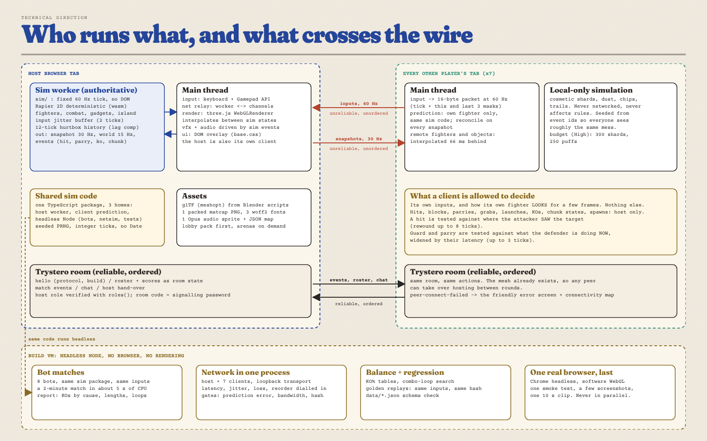
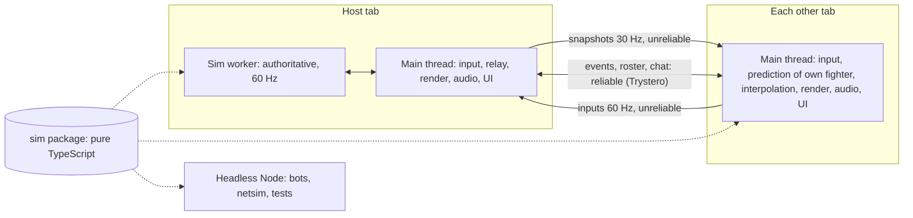

# BRIC-A-BRAWL: master design document

Pre-production package for a browser party fighter. Working title was "Fracture".
Generated from `design_src/` by `tools/build_master.py`. Do not edit this file; edit the chapter and rebuild.
Numbers come from `tools/design_data.py` and are also in `data/*.json`.

Read `00_READ_THIS_FIRST.md` before this. The art bible (chapter 4) is `ART_BIBLE.md`; the concept art critique (chapter 5) is `concept_art/CRITIQUE.md`.

## Contents

- [1. Research](#1-research)
  - [1.1 Competitive and genre analysis](#11-competitive-and-genre-analysis)
  - [1.2 Technical research](#12-technical-research)
  - [1.3 Art research](#13-art-research)
  - [1.4 Flags and unknowns](#14-flags-and-unknowns)
  - [1.5 Sources](#15-sources)
- [2. Vision](#2-vision)
  - [2.1 The title](#21-the-title)
  - [2.2 Elevator pitch](#22-elevator-pitch)
  - [2.3 Vision statement](#23-vision-statement)
  - [2.4 Pillars](#24-pillars)
  - [2.5 Target player and target moment](#25-target-player-and-target-moment)
  - [2.6 The screenshot moment](#26-the-screenshot-moment)
- [3. Game design document](#3-game-design-document)
  - [3.1 Core loop](#31-core-loop)
  - [3.2 Modes and win conditions](#32-modes-and-win-conditions)
  - [3.3 Controls](#33-controls)
  - [3.4 Movement](#34-movement)
  - [3.5 Combat](#35-combat)
  - [3.6 The fighters](#36-the-fighters)
  - [3.7 Gadgets](#37-gadgets)
  - [3.8 The island](#38-the-island)
  - [3.9 Arenas](#39-arenas)
  - [3.10 Balance philosophy](#310-balance-philosophy)
  - [3.11 Progression](#311-progression)
  - [3.12 Shareability](#312-shareability)
- [4. Art direction and art bible](#4-art-direction-and-art-bible)
- [5. Concept art and mock-ups](#5-concept-art-and-mock-ups)
- [6. Audio direction](#6-audio-direction)
  - [6.1 Direction](#61-direction)
  - [6.2 How it is made](#62-how-it-is-made)
  - [6.3 Mix](#63-mix)
  - [6.4 Sound list](#64-sound-list)
- [7. Technical direction](#7-technical-direction)
  - [7.1 Architecture](#71-architecture)
  - [7.2 Dependencies](#72-dependencies)
  - [7.3 Netcode](#73-netcode)
  - [7.4 Physics](#74-physics)
  - [7.5 Performance on the player's machine](#75-performance-on-the-players-machine)
  - [7.6 Asset pipeline](#76-asset-pipeline)
- [8. Building on a 2-vCPU, 8 GB machine](#8-building-on-a-2-vcpu-8-gb-machine)
  - [8.1 The four rules](#81-the-four-rules)
  - [8.2 What gets installed](#82-what-gets-installed)
  - [8.3 Memory plan](#83-memory-plan)
  - [8.4 The heavy-job lock and the order of work](#84-the-heavy-job-lock-and-the-order-of-work)
  - [8.5 How long things take](#85-how-long-things-take)
  - [8.6 How hard each system is for an autonomous agent](#86-how-hard-each-system-is-for-an-autonomous-agent)
  - [8.7 Things the VM cannot judge, and who does](#87-things-the-vm-cannot-judge-and-who-does)
- [9. Asset production plan](#9-asset-production-plan)
  - [9.1 Download budget](#91-download-budget)
  - [9.2 Fighters](#92-fighters)
  - [9.3 Gadgets and small props](#93-gadgets-and-small-props)
  - [9.4 Arenas and environment](#94-arenas-and-environment)
  - [9.5 VFX (no files: code and shaders)](#95-vfx-no-files-code-and-shaders)
  - [9.6 UI](#96-ui)
  - [9.7 Audio](#97-audio)
  - [9.8 Data](#98-data)
  - [9.9 Order of production](#99-order-of-production)
- [10. QA and acceptance](#10-qa-and-acceptance)
  - [10.1 Bots](#101-bots)
  - [10.2 Headless matches](#102-headless-matches)
  - [10.3 Networked matches in one process](#103-networked-matches-in-one-process)
  - [10.4 What fails the build](#104-what-fails-the-build)
  - [10.5 Evidence, and the rule against claiming what did not happen](#105-evidence-and-the-rule-against-claiming-what-did-not-happen)
  - [10.6 Human playtest script](#106-human-playtest-script)
- [11. Production plan](#11-production-plan)
  - [M1. The connection test page](#m1-the-connection-test-page)
  - [M2. The headless simulation with networked bots](#m2-the-headless-simulation-with-networked-bots)
  - [M3. The grey-box vertical slice](#m3-the-grey-box-vertical-slice)
  - [M4. Art](#m4-art)
  - [M5. Polish, audio, menus, sharing](#m5-polish-audio-menus-sharing)
  - [11.6 Risk register](#116-risk-register)
  - [11.7 Cut list](#117-cut-list)
- [12. Handoff package](#12-handoff-package)

---

# 1. Research

Everything in this chapter was checked on 25 November 2026. Library versions come from the npm and PyPI registries. Measurements were run on a 2-vCPU, 7 GB, CPU-only Linux box, which is the same class of machine as the build VM, so treat the numbers as what the team will see. Anything I could not confirm is listed in 1.4.

## 1.1 Competitive and genre analysis

| Game | Steal | Avoid | Why |
|---|---|---|---|
| **Super Smash Bros. (Ultimate, Melee)** | Percent damage; a launch formula built from base knockback, knockback growth and weight; blast zones; directional influence; ledge play; the off-screen bubble. | A fixed stage. Hidden frame data. Delay-based online play. | The percent system is the best spectator mechanic in fighting games: everyone can see who is in danger. Its online play is the genre's cautionary tale: Ultimate uses delay-based netcode with heavy input delay, and its developers looked at rollback and did not ship it. |
| **Rivals of Aether (1 and 2)** | The parry as a universal answer. Wavedash-style movement tech as a deliberate feature. Small, legible rosters. | Removing guard entirely (Rivals 1). Stacking every defensive option at once (a common complaint about Rivals 2). | Rivals 1 replaced shields and grabs with a timed parry and replaced ledges with wall jumps; Rivals 2 put shields, grabs and ledges back. The lesson is that a party audience needs a "hold this to be safe" button, and a competitive audience needs that button to lose to something. We keep guard, make it slide you off ledges, and make parry the reward for timing. |
| **Brawlhalla** | Weapon pickups that change your move set for a while. Free, instant, low-spec. Two attack buttons plus a dodge. | Characters that are only skins over shared weapon move lists. | Proof that a platform fighter with pickups can be both a party game and a ranked game. Its fighters blur together, which is the opposite of what we want from four ornaments. |
| **Street Fighter 6** | Modern controls: one-button specials at a cost. Readable frame data in training mode. Perfect parry as a slow-motion highlight. | Six-button layouts. Long combo trials. | SF6 shows the exact trade we want: assisted inputs do 80% damage, so the easy route is real but the hard route is better. Its perfect parry has a two-frame window; ours is five frames because we have latency and newcomers. |
| **Guilty Gear Strive** | The wall break: the stage itself gives way and the fight moves on. Burst as a once-per-round escape. Huge counter-hit freeze frames. | Screen-filling effects that hide the characters. | Strive made "the arena breaks" a celebrated moment rather than a hazard. Our island does it continuously. Burst becomes our Gilt Break. |
| **Stick Fight: The Game** | Rounds measured in seconds. Guns whose recoil is a movement tool. The level falling apart as the clock. Instant rematch with no menu. | No depth: a week later there is nothing left to learn. | The closest tonal match to our pitch. Players already throw weapons at each other and ride recoil. It runs out of game because there is no fighting system underneath. |
| **Gang Beasts** | Grabbing and throwing as the comedy. Hazards that kill by removing footing. | Fully physical, floppy characters. | Reviewers called it a slapstick facilitator rather than a fighting game, and that is accurate: when every character is a ragdoll, skill cannot express itself and netcode cannot hide latency. Our fighters are scripted and tight; only the world is physical. |
| **Nidhogg** | One-hit clarity. A tug-of-war that a spectator understands in two seconds. Parry-by-positioning. | Two players only. | Shows how much drama comes from a single readable exchange. Our parry freeze and final-KO freeze borrow its "everyone saw that" quality. |
| **TowerFall, Duck Game** | Eliminated players stay involved. Round-end replays that become the social object. | Local-only design. | Dead time kills a party. Our eliminated players become teaspoons that tap the island apart, and every round ends with a copyable photo. |
| **Fall Guys** | Toy-like bodies that read at tiny sizes with eight on screen. One colour per player. | Mini-game variety as the hook. | The proof that soft, rounded, saturated-on-pale characters survive a 720p stream. |

Design conclusions that every later chapter obeys:

1. Keep the percent system and show it on the body: ceramic cracks.
2. Guard exists, but pushes you toward the edge. Parry is guard pressed on time.
3. One-button specials for everyone; motion inputs give a stronger "clean" version.
4. Only the world is simulated physically. Fighters are scripted, with fixed frame data.
5. The arena is the round timer.
6. Nobody waits. Eliminated players act, rematch is automatic.

## 1.2 Technical research

### What has already been built with this stack

- **DISCBALL3D** (2026) is the closest precedent: a browser soccer game for up to 5v5 on three.js r181 and Rapier, where the host's browser is the server and the authoritative simulation runs in a Web Worker in the host's tab at 60 Hz. It sends snapshots at 30 Hz over an unordered, no-retransmit data channel, keeps a second reliable channel for events, reports about 220 bytes for a 4v4 snapshot, predicts on every client and blends corrections out, and picks a new host if the host leaves. That is our architecture, already shipped by someone else. Two differences: it uses a Socket.IO gateway for signalling and relay, which we may not operate, and it runs Rapier 3D.
- **mrdoob/trystero-test** is a small three.js sandbox using Trystero for peer-to-peer networking, by three.js's author. It shows the pairing is ordinary.
- **Phewland** is a host-authoritative peer-to-peer browser shooter on three.js with physics. Same pattern again.

### Trystero (signalling and rooms)

Verified from the package and its docs at version 0.27.0, published 11 November 2026, MIT.

- The default strategy is Nostr, connecting to five public relays in parallel. No keys, no account. BitTorrent and MQTT strategies are a one-line import change.
- Default ICE servers are Google and Cloudflare STUN. There is a first-class `turnConfig` option and a `peer-connect-failed` error that carries `turnConfigured: false`. That is our friendly failure hook and our TURN slot.
- `room.getPeers()` returns, per peer, the underlying `RTCPeerConnection`. This matters: Trystero's own actions travel on a reliable, ordered channel with a 36-byte header on every frame, which is wrong for 60 Hz inputs. Because we can reach the connection, we open our own negotiated, unordered, no-retransmit data channel on it for inputs and snapshots, and keep Trystero's actions for joins, events and chat.
- Built in and useful: `maxUsers`, room `password` (encrypts signalling), `room.ping()`, signed per-user state and room state with late-joiner sync, and a `roles()` plugin that gives one peer verified admin rights. We use room state for the lobby and scores, and roles for "who is host".
- Trystero's docs put direct connection success at roughly 85 to 90 percent, with the remainder needing TURN. With eight friends, expect one person in two or three sessions to hit this. The failure screen is not an edge case.
- Bundle: about 46 KB Brotli by its own table; 53 KB gzip measured in our test build.

### WebRTC data channels

- A channel created with `ordered: false, maxRetransmits: 0` behaves like UDP. `negotiated: true` with a fixed `id` lets both sides create the same channel without another round of signalling.
- Keep messages small. Without message interleaving, a large message on one channel delays every other channel on the connection. Our largest snapshot is 716 bytes, under one packet.
- `RTCDataChannel` can now be transferred to a dedicated worker in Chrome and Edge 130+, Firefox 144+, and Safari. We do not depend on it; it is a later optimisation.

### Background tabs

The host will alt-tab to Discord. In a hidden tab, `requestAnimationFrame` stops and main-thread timers are clamped to about once a second. Tabs with an open data channel are exempt from Chrome's harsher one-per-minute throttling, and audible tabs are exempt from timer throttling, but neither makes a main-thread 60 Hz loop safe. Worker timers are not throttled the same way today, and message events are never timer-throttled. So the simulation runs in a Web Worker and the main thread only relays. Firefox has an open bug about throttling worker timers in background tabs, so M1 measures this on real browsers.

### Rapier

- Version 0.21.0, published September 2026, Apache-2.0. Packages exist for 2D and 3D, each in standard, SIMD, deterministic and `-compat` (wasm embedded as base64) builds.
- Determinism: rapier.rs says the JavaScript build is fully cross-platform deterministic; the npm README says only the `-deterministic` packages guarantee that, and the others are deterministic on one machine. The two statements disagree. We use `@dimforge/rapier2d-deterministic-compat` and stop caring; it measured 10 percent slower.
- **We use Rapier 2D, not 3D.** Gameplay lives on a plane. The 3D is rendering only.
- Measured, 74 bodies (24 terrain chunks, 6 falling chunks, 16 rubble, 8 gadgets, 12 projectiles, 8 kinematic fighters through the character controller): a full two-minute match of 7,200 ticks took 4.7 s, mean 0.65 ms per tick, p99 2.4 ms. Two runs produced identical state hashes. A world snapshot is 95 KB, 0.07 ms to take, 0.3 ms to restore.

### Rollback and lockstep libraries

| Library | Status | Fit |
|---|---|---|
| **NetplayJS** 0.4.1 | Last published April 2023. Its rollback implementation describes itself as for two-player games; its netcode package is marked work in progress. Corrects drift by having the host send authoritative state. | No. Two players, stale. |
| **rollback-netcode** 0.0.6 | Published February 2026. Claims N-player rollback over WebRTC with desync detection. Its README says APIs may change. | No for launch. Version 0.0.x, and see below. |
| **@geckos.io/snapshot-interpolation** 1.1.1 | Published February 2025, BSD-3. Transport-agnostic snapshot vault and interpolation, 2.2 KB gzip. | Yes, for remote entities. Small enough to vendor if it stalls. |

Rollback is the right answer for a two-player fighter and the wrong one here, for four reasons that are specific to this game:

1. **Connectivity.** Rollback and lockstep need every pair of players connected: 28 links for eight players. With no TURN and a 10 to 15 percent failure rate per link, a full mesh of eight almost never forms. A host star needs seven links, and we can choose the host everyone can reach.
2. **Cost on the weakest machine.** Every client would restore and re-simulate the whole physics world several ticks per frame. Measured: restore plus seven re-simulated ticks is about 5 ms of physics alone on the build-class machine, before game logic and before rendering, on every client, and with seven remote players a misprediction happens nearly every frame.
3. **Eight inputs.** Rollback windows are set by the worst link among all players. One friend on hotel wifi degrades everyone.
4. **Join and leave.** Friends drop in and out. Host authority absorbs that; synchronised simulation fights it.

Decision: host-authoritative, as briefed. What would change my mind: a 1v1 ranked mode. That mode alone could use rollback, because the sim is already deterministic and snapshot-able.

### Three.js

Version 0.187.0. The project now recommends `WebGPURenderer` with automatic WebGL 2 fallback, and guides call WebGL the fallback path. We use the classic `WebGLRenderer` anyway: our look is one small GLSL shader; the forum has a 2026 report of the WebGPU renderer costing about twice the CPU of the WebGL one on many-mesh scenes; the WebGL build is the smaller import; and headless Chrome on the VM renders WebGL in software reliably. What would change my mind: `WebGLRenderer` being deprecated, or a real need for compute shaders.

### GitHub Pages

Static only: 1 GB site limit, 100 GB a month soft bandwidth, no custom response headers. No custom headers means no cross-origin isolation, so no `SharedArrayBuffer` and no wasm threads without a service-worker hack. We need neither. Our 3 MB first load gives roughly 30,000 visits a month before the soft limit.

### Discord link previews

Discord builds the embed from Open Graph tags in the HTML it fetches. It does not run JavaScript, images must be HTTPS, and the fetch must finish in ten seconds. Since the room code lives in the URL fragment, which is never sent to a server, every room shares one static preview. That is fine and is the only option on static hosting. Use a 1200 by 630 image.

### Headless Blender on a CPU

Tested with `bpy` 5.3.0 from PyPI on Python 3.13, 918 MB installed, 450 MB resident for a small scene.

| Job | Result on 2 vCPUs |
|---|---|
| Cycles, 640x360, 16 samples, denoised | 4.9 s |
| Cycles, 640x360, 64 samples, denoised | 11.7 s |
| Workbench, 640x360 | 1.3 s, worked through Mesa software GL after Vulkan failed to initialise and EGL logged errors |
| EEVEE | Hung. Never use it on the VM. |
| glTF export of a vertex-coloured mesh | 0.2 s. The exporter has meshopt compression built in. |
| Packed matcap bake, three 256x256 Cycles renders | 16 s |
| Engine-look preview, 640x640 character tile, 20 samples | about 6 s |
| Engine-look style frame, 1600x900, 46k triangles, 28 samples | 46 s |

Conclusions: Cycles on CPU is dependable and needs no GL at all, so it is the default. Workbench is a bonus that depends on Mesa being installed. Scripted modelling from lathe profiles and swept tubes produced four distinct fighters at 4,900 to 6,200 triangles each in one sitting of iteration, which is the evidence that the art direction is achievable.

### Headless browser on a CPU

Chrome 153 headless, software WebGL (ANGLE over llvmpipe), 44k triangles, 29 draw calls, matcap material:

| Canvas | Mean frame | p95 |
|---|---|---|
| 960x540 | 12.0 ms | 15.5 ms |
| 640x360 | 8.6 ms | 10.8 ms |
| 480x270 | 7.1 ms | 9.0 ms |

So one browser smoke test at 640x360 can hold a real frame-time gate on the VM. It says nothing about a real integrated GPU; that is what the human playtest perf report is for.

### Sizes measured in a real Vite build

| Chunk | Raw | Gzip |
|---|---|---|
| Rapier 2D deterministic, compat build | 3,446 KB | 1,300 KB |
| three (tree-shaken: renderer, skinned and instanced meshes, glTF loader, audio) | 651 KB | 160 KB |
| Trystero (Nostr) | 150 KB | 53 KB |
| msgpackr | 32 KB | 11.5 KB |
| snapshot-interpolation | 5.5 KB | 2.2 KB |

Rapier is 85 percent of the JavaScript. The separate `.wasm` build is 919 KB gzip if the host compresses wasm, which I could not confirm for GitHub Pages; start with compat, measure, and switch if the load-time gate needs it. The Vite 8 production build took 0.4 s.

## 1.3 Art research

The constraint is unusual: every model is written as a Python script by an agent with no eye, rendered on a CPU, and has to look deliberate at 60 fps on integrated graphics. That rules out anything whose quality lives in sculpted detail or painted textures, and rewards styles whose quality lives in a rule.

| Candidate | For | Against | Verdict |
|---|---|---|---|
| Flat-shaded low-poly | Trivial to script. | The default look of every game jam and every free asset pack. Banned in spirit. | Rejected |
| Toon shading with outlines | Readable. Shader-driven. | First thing anyone thinks of. Outlines double draw calls. Needs good silhouettes to carry it, which is the hard part. | Rejected |
| Papercraft | Material-committed, charming, scriptable as folds. | Paper tears and floats; it does not shatter or launch. Wrong physics for a game about ejection. | Rejected |
| Risograph print (halftone, two inks, misregistration) | Striking in screenshots. All in the shader. | Fights readability with eight players; halftone shimmers in motion. | Kept as the impact-frame treatment only |
| Painted wooden toys | Lathe-friendly, warm. | Wood splinters; nothing about it says fracture. | Rejected |
| **Glazed ceramic ornaments** | Pottery is literally made on a lathe, so the modelling method and the subject are the same thing. Ceramic breaks into flat-faced shards with a different colour inside, which is exactly what low-poly fracture looks like. Glaze is a matcap, the cheapest material there is. Cracks are a damage meter. Gold repair is a comeback meter. | Risk of twee. Needs a strict palette to avoid looking like a gift shop. | **Chosen** |

Why it beats the others: it is the only option where the production constraint, the game's verb and the look are one idea. Thrown forms are what the scripts are good at. Shattering is what the game is about. A glossy thing with a window reflected in it is what a matcap is. And nobody has made this game.

It is anchored by three references, detailed in the art bible: the **Mingei** folk-craft movement (useful, handmade, slightly wrong on purpose), **blue-and-white transferware and kintsugi** (the decoration and the repair), and **British stop-motion** (the comic timing and the thumbprint).

## 1.4 Flags and unknowns

| # | Unknown | Why it matters | Where it gets resolved |
|---|---|---|---|
| U1 | Whether a negotiated unreliable data channel opened on Trystero's `RTCPeerConnection` works in Chrome, Firefox and Safari without disturbing Trystero. | It is the whole fast path. | M1, first thing. Fallback: send everything on Trystero actions and accept stalls under loss. Second fallback: PeerJS 1.5.5 with its public broker, which supports unreliable connections but has a single point of failure. |
| U2 | Reliability of the public Nostr relays on a given night. | No relays, no room. | M1 logs time-to-first-peer over repeated trials. Fallback: also join via the BitTorrent strategy. |
| U3 | Worker timer behaviour when the host tab is hidden, per browser. | A frozen host freezes eight people. | M1 has a "hide this tab for 60 s" test. |
| U4 | Whether GitHub Pages compresses `.wasm`. | 400 KB of load time. | M3 load-time gate. |
| U5 | Real frame rate on real integrated GPUs. | The VM cannot measure it. | Human playtest perf report at M3 and M5. |
| U6 | The exact disk and memory of each tool on Antigravity's image. | I measured on a similar box, not theirs. | M0 `du` and `free` report. |
| U7 | Licences of individual text-to-speech voices. The maintained Piper engine is now GPL-3.0 and each voice carries its dataset's licence. | Announcer lines. | Audio chapter: announcer is text and foley by default; voice is optional and gated on a licence check. |
| U8 | The title. A web search found no game called Bric-a-Brawl; it did find current games called Smithereens, Crackpots and Knockoff, which is why those were dropped. This was a search, not a trademark check. | Renaming later costs an afternoon. | Ace decides before the link goes anywhere public. |

## 1.5 Sources

Libraries and platforms: [Trystero repository and docs](https://github.com/dmotz/trystero) · [Rapier JavaScript determinism](https://rapier.rs/docs/user_guides/javascript/determinism) · [Rapier npm package notes](https://www.npmjs.com/package/@dimforge/rapier3d) · [NetplayJS](https://www.npmjs.com/package/netplayjs) · [rollback-netcode](https://www.pkgstats.com/pkg:rollback-netcode) · [three.js WebGPURenderer manual](https://threejs.org/manual/en/webgpurenderer) · [three.js forum, renderer tag](https://discourse.threejs.org/tag/webgpu-renderer/1686) · [MDN: using data channels](https://developer.mozilla.org/en-US/docs/Web/API/WebRTC_API/Using_data_channels) · [MDN: createDataChannel](https://developer.mozilla.org/docs/Web/API/RTCPeerConnection/createDataChannel) · [RTCDataChannel transferable support](https://caniuse.com/mdn-api_rtcdatachannel_transferable) · [Chrome: timer throttling in Chrome 88](https://developer.chrome.com/blog/timer-throttling-in-chrome-88) · [Chrome: background tabs](https://developer.chrome.com/blog/background_tabs) · [Firefox bug 1818463](https://bugzilla.mozilla.org/show_bug.cgi?id=1818463) · [GitHub Pages limits](https://docs.github.com/en/pages/getting-started-with-github-pages/github-pages-limits) · [GitHub Pages COOP/COEP discussion](https://github.com/orgs/community/discussions/13309) · [Discord link previews](https://docs.discord.com/developers/link-previews/overview) · [web.dev: async clipboard](https://web.dev/articles/async-clipboard) · [Blender devtalk: headless rendering](https://devtalk.blender.org/t/blender-2-8-unable-to-open-a-display-by-the-rendering-on-the-background-eevee/1436) · [Piper licence change](https://www.assemblyai.com/blog/free-open-source-text-to-speech)

Precedents: [DISCBALL3D write-up](https://discourse.threejs.org/t/discball3d-multiplayer-soccer/95207) · [Phewland](https://github.com/grep-many/phewland) · [Trystero with three.js](https://dev.to/bandinopla/effortless-serverless-multiplayer-in-threejs-with-trystero-3551)

Genre: [SmashWiki: knockback](https://www.ssbwiki.com/KB) · [Rivals of Aether system notes](https://wiki.gbl.gg/w/Rivals_of_Aether/System) · [Rivals of Aether II review, AV Club](https://www.avclub.com/rivals-of-aether-ii-review) · [Street Fighter 6 game information, Liquipedia](https://liquipedia.net/fighters/Street_Fighter_6/Game_Information) · [Smash Ultimate and rollback, Shacknews](https://shacknews.com/article/127238/digital-eclipse-on-rollback-netcode-smash-ultimate-online-issues) · [Fighting-game netcode explained, Infil](https://ki.infil.net/w02-netcode-p5.html) · [Gang Beasts review, PC Gamer](https://pcgamer.com/gang-beasts-review)

Name checks: [Smithereens on Steam](https://store.steampowered.com/app/5251660) · [The Amazing Crackpots Club on Steam](https://store.steampowered.com/app/2474020) · [KNOCKOFF on Steam](https://store.steampowered.com/app/3269810)

Measurements: scripts and raw output are in `reference/poc/`.

---

# 2. Vision

## 2.1 The title

**BRIC-A-BRAWL.** Bric-a-brac is the word for the small ornaments on a mantelpiece. These ones fight.

"Fracture" stays as nothing: the repository, the Trystero app id and the page title all use `bric-a-brawl`. I dropped three better-sounding names first because each is a multiplayer game on Steam right now (see 1.4, U8).

## 2.2 Elevator pitch

Paste one link in Discord. Ten seconds later, eight ornaments are punching each other off a floating dinner plate that is cracking under their feet. A teapot with a monocle, a basalt bull, a nesting doll that gets smaller and angrier, and a gnome who would rather be fishing. Bellows, plungers and champagne corks fall from the sky on doilies. Two minutes a round. Nobody installs anything.

## 2.3 Vision statement

Somewhere above every house is the place where things go when they fall behind the furniture. The ornaments call it the Mantel. It is made of every plate that was ever dropped: drifting islands of glazed earthenware, held together by habit and gold glue. Ornaments that get knocked off shelves arrive here chipped and furious, and settle it the only way bric-a-brac can, by knocking each other off again. An unseen auctioneer calls the lots. Losers are "gone". The winner is "sold".

That fiction exists to make four production facts feel like choices.

**The world is ceramic because ceramic is what we can make.** A pot is a profile spun around an axis. So is every model a script can write well. Glaze is a single reflected window, which is the cheapest material a browser can draw. And ceramic breaks into flat-sided shards with raw clay inside, which is exactly what a low-polygon fracture looks like. Nothing in this game pretends to be something the pipeline cannot build.

**The island breaks because the round needs a clock.** A two-minute party round cannot depend on eight strangers to fighting games landing kill moves. The island leaves on a schedule and leaves faster when people are slammed into it. The space shrinks, launches get shorter, and the round ends on time with everybody shouting.

**The weapons shove because shoving is funny and damage is not.** Every gadget moves somebody: pushes, pulls, launches, sticks, reverses. They do almost no damage. A newcomer with a pair of bellows is dangerous in ten seconds. A veteran who parries the gust back is dangerous for a week.

**The fighters are tight because the world is loose.** The ornaments have real frame data: startup, active, recovery, cancel windows, a five-frame parry. They are never ragdolls. All the physical chaos is in the ground and the junk, so skill has something solid to stand on and the netcode has something predictable to send.

What it is not: a ranked game, a live service, a ragdoll toy, a Smash clone with the names changed. It is a thing a friend group opens at 11pm instead of arguing about what to play.

## 2.4 Pillars

Every later decision names the pillar it serves. If a feature serves none, it is cut.

| # | Pillar | Meaning | A decision it forces |
|---|---|---|---|
| P1 | **The ten-second rule** | From clicking the link to hitting a friend: ten seconds. From never having played a fighter to doing something that makes the call laugh: ten more. | You spawn into a playable lobby before the network has finished connecting. Mashing Attack produces a three-hit string that launches. |
| P2 | **Everything chips** | The world keeps score in cracks. Fighters crack as they take damage. The island cracks where people land. Nothing resets to pristine. | Damage percent is drawn on the body. Slamming someone into the floor damages the floor. The arena is the timer. |
| P3 | **Shove, don't stab** | Position is the only health bar. Every tool exists to move someone. | Gadgets do 1 to 9 percent. Guard does not stop you sliding off the edge. The strongest moves are the ones with the best launch, not the most damage. |
| P4 | **Honest frames** | The depth is real and it is written down. Same input, same result, every time, at any ping we support. | Frame data ships in the game. Nothing is plus on block. Latency is handled by rules the player can learn, not by luck. |
| P5 | **One link** | No install, no account, no server, no second step. Sharing the game is playing the game. | Static hosting, peer-to-peer, room codes you can say out loud, a result screen that is one click from a Discord post. |

There is a sixth rule that is not a pillar because players never see it: **small machine, small game**. Everything must be built, tested and rendered on two CPU cores. That is why there are four fighters and not eight, three arenas and not six, and no feature whose correctness can only be judged by eye or ear without a number attached.

## 2.5 Target player and target moment

**The player** is one of five to eight friends in their twenties and thirties who are already in a voice call. Two of them have a main in some fighting game. Three of them have not touched one since a console at a friend's house. One is on a work laptop with integrated graphics and a trackpad, and will plug in a mouse but not a controller. Nobody will read a tutorial.

**The moment** is 11pm on a weeknight. Someone pastes a link and says "click this". The design target is what happens in the next ninety seconds:

| Time | What they do | What the game has to do |
|---|---|---|
| 0:00 | Click the link in Discord. | The embed already told them it is a party fighter for 2 to 8 and that nothing installs. |
| 0:04 | Page is up. They are a teapot on a saucer. | No menu. Movement works. Friends pop in as they connect. |
| 0:10 | Press a key. The teapot hits someone. Crockery noise. | First laugh on the call. |
| 0:25 | Everyone stands on the platter. | Round one starts. Nobody chose a character on purpose yet, and that is fine. |
| 0:40 | Somebody is blown off the island by a pair of bellows. | The auctioneer says "Gone." The victim is now a teaspoon and can tap the island. |
| 2:30 | Round ends on a plate the size of a dinner table. | Freeze, slow motion, the last hit in blue and white. "Sold!" A photo of it is one click from the clipboard. |
| 2:38 | Rematch has already started. | "One more round" was never a decision. |

Sessions are a best-of sequence to three round wins, about fifteen minutes. The game is designed to be closed after forty-five minutes and reopened three nights later with someone saying "I found a thing Nesta can do."

## 2.6 The screenshot moment

**"Sold."** The last hit of a round, frozen for 24 frames and rendered in two colours: cobalt ink on white, like a transfer-printed plate. One ornament is mid-launch with a brushstroke behind it. What is left of the island is splitting under the winner's feet. Shards hang in the air. A red auction stamp lands across the corner, and the loser's lot tag swings off the bottom of the screen.

Three things make it shareable rather than merely pretty:

1. **It is automatic.** The game captures that frame every round. Nobody has to be fast with a screenshot key.
2. **It is one click.** The results screen has a "Copy photo" button that puts a PNG on the clipboard, with both names and the cause on it ("Lot 3, Slightly Chipped Gravy Boat. Gone: Bellows."). Paste into Discord.
3. **It contains the pitch.** A still of a teapot being launched off a breaking plate by a bull explains the game to someone who was not in the call, and the link is in the caption.

The moving version is the same five seconds: the hit, the freeze, the blue-and-white frame, the launch, "Gone." If a clip of this game exists anywhere, it is that.

---

# 3. Game design document

Every number in this chapter is generated from `tools/design_data.py` and is also in `data/*.json`. Load the JSON; do not retype numbers from these tables. Units: 1 u is about a metre, a mid-size fighter is 1.5 u tall, speeds are u/s, frame counts are at 60 Hz.

## 3.1 Core loop

**Second to second:** move, hit, get hit, hold on. Every exchange changes where somebody is standing.

**Round (about two minutes):** spawn on a full island, fight for gadgets, lose ground on a schedule, end on a fragment.

**Session (about fifteen minutes):** rounds repeat with automatic rematch until someone has three round wins. Then the lobby, with the scores still on the wall.

```
link -> lobby (playable) -> everyone on the platter 3 s -> "Lot one!" 3-2-1
     -> ROUND: full island (0:00) -> first losses (0:25) -> last call (1:45) -> sudden death (2:00) -> hard end (2:20)
     -> "Sold!" freeze + photo -> results 8 s -> next round (same players, next arena)
     -> someone reaches 3 wins -> session results -> lobby
```

Rules that keep the loop tight:

- The lobby is the game. You can move and attack on the lobby island before any peer has connected (P1).
- Ready-up is physical: stand on the big platter. When every player is on it for three seconds, the round starts. No ready button to forget.
- Round one is always The Willow Plate. After that the arena rotates without repeats; the host can pin one.
- Rematch starts by itself after 8 seconds unless the host presses "Back to lobby" (P5).
- Late joiners enter as spectating teaspoons and get a fighter next round.

## 3.2 Modes and win conditions

| Mode | Rules | Why it earns its place |
|---|---|---|
| **Free-for-all** (default) | Stocks: 3 each with 2 to 4 players, 2 each with 5 to 8. Last fighter with a stock wins the round. | The game. |
| **Teams** | Two teams, split evenly, team liveries from two colour families. Hits on team-mates launch but do no damage. A team wins when the other has no stocks. | Friend groups of 6 to 8 ask for it within a night. Friendly knockback without friendly damage is P3 in one rule: you cannot hurt your friend, you can only shove them off by accident. |
| **Fragile** (a toggle on either mode) | One stock, everyone starts at 60 percent, the island takes double crack damage. Rounds last 45 to 60 seconds. | Costs nothing to build. The "we have ten minutes" setting. |
| **Practice** (the lobby itself, alone or with friends) | No stocks, a dummy, optional bots, frame-data overlay. | Needed for P4 and for anyone waiting on friends. It is not a separate screen. |

Nothing else at launch. No items-off competitive rule set, no story, no ranked.

**Round end, in order of precedence:** last fighter or team with stocks; at 2:00, sudden death sets everyone to at least 150 percent; at 2:20 the last fragment sinks and the winner is whoever has most stocks, then least damage, then whoever fell last.

**Bots.** The host can add up to three bots to fill a room. They are the same bots QA uses, at three skill levels. They exist so two friends are not alone on a 26 u plate.

**Player-count scaling.** With four or fewer players the first timeline event has already happened when the round starts (the rim is gone), and every later event comes 10 seconds earlier. Two people do not need a tennis court.

**Eliminated players: the Teaspoon.** A fighter with no stocks becomes a floating teaspoon in their colour. It moves left and right along the top of the screen. Every 5 seconds it can tap the chunk below it for 15 crack damage, with a small "tink" everyone hears. It cannot touch fighters. This keeps the dead involved, gives them revenge, and makes rounds accelerate as people drop out, which is the pacing we want anyway.

## 3.3 Controls

Eight abstract buttons. Everything is rebindable; these are the defaults.

| Action | Keyboard A (default) | Keyboard B (arrows) | Gamepad (Xbox names) |
|---|---|---|---|
| Move / aim | W A S D | Arrow keys | Left stick or d-pad |
| Jump | Space | Space | A |
| Attack (A) | J | Z | X |
| Heavy (H) | K | C | Y, or flick the right stick |
| Special (S) | L | X | B |
| Guard (G) | Left Shift | A | RB or RT |
| Grab | Left Shift + J, or U | D | LB |
| Use gadget (U) | E | S | LT |
| Taunt | T | Q | Back |

Rules:

- **Up does not jump** by default. Up is for up-attacks, up-specials and aiming. There is an option to turn tap-jump on.
- **Buffer.** Any press is remembered for 8 frames and fires on the first frame it is legal. This is the single most important beginner aid and it also hides network jitter.
- **Opposite directions.** Left plus right resolves to the most recent press. Up plus down is neutral.
- **Analogue.** The stick is read as 8 directions with a 0.35 dead zone, plus a "tilt versus full" bit at 0.75 for walking slowly. Keyboards always send "full".
- **One local player per browser** at launch. The input packet carries a slot number so couch play can be added later without a protocol change.

### The beginner layer (works by accident)

- **Mash Attack** for a jab chain that ends in a launcher.
- **Special plus a direction** for all four specials. No motions needed, ever.
- **Hold Guard** to be safe from hits. Tap it at the right moment and you parried, whether you meant to or not.
- **Press Use** next to a gadget to grab it, again to fire it. It is a separate button, so holding a gadget never takes away your attacks.
- **Up plus Special** always tries to get you back to the island.

### The advanced layer (found over a week)

| Technique | Input | Effect |
|---|---|---|
| Clean specials | 236, 623 or 214 then Special (quarter-circle forward, dragon punch, quarter-circle back), 12-frame window | Stronger version of side, up and down special: faster, more damage, or invulnerable. Same three motions for every fighter. |
| Short hop | Release Jump within 3 frames, or press Jump and Attack together | Low jump for fast aerials. |
| Fast fall | Tap down at or after the top of a jump | Fall at the fast-fall speed. |
| Chip-slide | Air dodge diagonally into the ground | Keeps 60 percent of the speed as a slide, 10 frames of landing lag. The game's wavedash. |
| Launch steering | Hold a direction when hit | Bends the launch angle by up to 15 degrees. |
| Tech | Guard within 12 frames before hitting ground or wall while tumbling | No bounce, no bounce damage, half the crack damage to the chunk. |
| Special cancel | Special during the cancel window of a light attack that hit or was blocked | Cuts the recovery into the special. |
| Charged heavy | Hold Heavy up to 60 frames | Damage and launch up to 1.4 times. |
| Gadget catch | Use as a thrown gadget reaches you | Catch it. |
| Gilt Break | Guard plus Special while being hit, at full Gilt | Combo breaker (3.5.9). |

## 3.4 Movement

| Stat | EARL | GROG | NESTA (Big / Mid / Small) | MOSS |
|---|---|---|---|---|
| Weight | 1 | 1.25 | 1.12 / 0.98 / 0.82 | 0.9 |
| Height (u) | 1.6 | 1.7 | 1.9 / 1.5 / 1.1 | 1.4 |
| Run (u/s) | 8.5 | 7.6 | 6.6 / 8.4 / 10.4 | 7 |
| Initial dash (u/s) | 10.5 | 9 | 8 / 10.5 / 12.5 | 8.5 |
| Air speed (u/s) | 6.5 | 5.6 | 5.5 / 6.6 / 7.6 | 6.8 |
| Full hop (u) | 3.6 | 3.1 | 3.3 / 3.7 / 4 | 3.9 |
| Short hop (u) | 1.7 | 1.5 | 1.7 | 1.8 |
| Double jump (u) | 3.2 | 2.7 | 2.9 / 3.3 / 3.6 | 3.6 |
| Gravity scale | 1 | 1.12 | 0.97 | 0.82 |
| Max fall (u/s) | 14 | 16 | 14.5 / 13.5 / 12.5 | 11.5 |
| Fast fall (u/s) | 20 | 23 | 19.5 | 17 |
| Traction (u/s^2) | 50 | 60 | 45 | 38 |
| Grab range (u) | 1.2 | 1.5 | 1.3 / 1 / 0.8 | 3.2 |
| Guard HP | 50 | 60 | 55 / 50 / 40 | 45 |
| Crack multiplier | 1 | 2 | 1.3 / 1 / 0.6 | 1 |
| Jump velocity, full hop (u/s) | 19.6 | 19.3 | 19.6 | 18.5 |
| Frames to apex, full hop | 22 | 19 | 23 | 25 |

Shared constants: gravity 53.6 u/s² times the fighter's gravity scale; jump squat 3 frames for everyone; one double jump, one air dodge and one wall jump per airtime, all restored on landing or grabbing a ledge.

| Move | Numbers | How it should feel |
|---|---|---|
| **Run** | Initial dash for 10 frames at dash speed, then run speed. Turnaround 4 frames. Hold a direction; there is no separate dash button. | A ceramic clatter. Little feet (or hooves, or a wobble) drumming. Starts instantly, stops with a short skid whose length is the traction stat: Moss slides, Grog plants. |
| **Jump** | 3 frames of squash, then the full-hop or short-hop height from the table. About 22 frames to the top for Earl. | Snappy up, heavy down. Gravity is deliberately strong so jumps are commitments measured in frames, not floats. |
| **Double jump** | Slightly lower than the first. Can reverse direction. | A hiccup. A puff of dust under nothing. |
| **Air dodge** | 8 directions or in place. 3 u over 14 frames, invulnerable frames 3 to 16, 28 total. Once per airtime. Ends helpless only if used after an up-special. | A blink. The fighter goes matte for the invulnerable frames (the glaze highlight switches off), which is how you read it at a glance. |
| **Roll and spot dodge** | Guard plus left or right: 4 u, 28 frames, invulnerable 4 to 14. Guard plus down: in place, 24 frames, invulnerable 3 to 16. | Roll is a literal roll: round fighters tip and trundle. |
| **Ledge grab** | Grabbed automatically when falling past an exposed top corner within 0.8 u, facing it. 30 frames of invulnerability on the first grab of an airtime, none on a re-grab. Options: climb (30 frames), jump, roll, attack, drop. Hang for 3 seconds at most. A second fighter grabbing the same ledge knocks the first one off. | Hanging by two floating hands with the body dangling. Ledges move: when a chunk drops, its neighbour's corner becomes the new ledge that instant. |
| **Wall jump** | Push away from a chunk's side face and press Jump. Once per airtime. | The way back from underneath a breaking island. |
| **Recovery** | Every fighter's up-special. Heights and behaviours differ and are a main axis of balance: Moss needs something to hook, Grog barely has one. | The last thing you try. Should fail often enough to be tense and succeed often enough to cheer. |

## 3.5 Combat

### 3.5.1 Damage and launch

Damage is a percent that only goes up, shown on the lot tag and as cracks on the fighter. It does nothing by itself. It scales how far you fly.

```
launchSpeed L (u/s) = (BKB + KBG x percentAfterHit / 100) x 2 / (1 + weight)
```

- **BKB** is base knockback, **KBG** is knockback growth, both per move, both in u/s. Weight is 0.82 to 1.25.
- The victim leaves at angle θ (per move, 0 is forward, 90 is up, 270 is down), bent by up to 15 degrees of launch steering.
- Launch velocity decays at 28 u/s² along its own direction and is added to the fighter's normal falling. This is the Melee model, chosen because it is two lines of code and feels right.
- **Hitstun** is `6 + 1.25 x L` frames, capped at 80. During it you can only steer the launch, tech, or Gilt Break.
- **Tumble** begins at L of 18 or more: the fighter spins, drops their gadget, and will bounce off terrain unless they tech.
- **Terrain impact.** A tumbling fighter hitting ground or wall above 16 u/s bounces with 70 percent of their speed, takes 3 percent, and deals crack damage to that chunk equal to their impact speed times the attacker's crack multiplier. Teching halves the crack and cancels the rest. This is P2: the island is damaged by where people land.

There is no separate "kill power" stat, no rage, no stale-move penalty outside combos. Two numbers and an angle per move.

### 3.5.2 Hit-stop

On every hit both fighters freeze for `3 + 0.5 x damage` frames, minimum 4, maximum 14, plus 2 for heavies. The victim shakes; the attacker holds the pose at full extension. The final hit of a round freezes for 24 frames and then plays 40 frames at quarter speed. Hit-stop is also where the netcode hides its corrections (chapter 7).

### 3.5.3 Guard

Guard is a side plate. Holding Guard, the fighter raises a small plate in their own colour. It has a rim of gold and it cracks as it takes hits. When it shatters, that is a guard break. Everyone can read its state from across the screen.

- Guard HP is 40 to 60 by fighter. Blocked hits remove their damage from it (heavies 1.2 times). Holding it drains 8 per second. It regenerates 6 per second after half a second down.
- Blockstun is `3 + 0.7 x damage` frames. Lowering the plate takes 8 frames.
- **Blocked hits still push you**, at 35 percent of the normal launch speed along the ground. Guarding at the ledge slides you off it. Guard keeps your percent down; it does not keep you on the island (P3).
- No high or low blocking, no chip damage. The mix-up is strike, grab or wait, not left, right, high, low.
- **Guard break.** At 0 HP the plate shatters, the fighter pops up at 14 u/s and is stunned for 150 frames, reduced by mashing to no less than 90. Nesta loses a shell instead (3.6).
- Grabs ignore guard.

Nothing in the launch roster is positive on block. The safest move is −7. Guarding something always gives you the next move, which is the rule that makes guard worth teaching a newcomer (P4).

### 3.5.4 Parry

The first 5 frames of raising the plate are a parry.

- **Parrying a strike:** the attacker rings like a struck bowl and is stuck for 30 frames. The defender is free at once. The screen flashes the blue-and-white impact frame.
- **Parrying a projectile, gust, cork or plunger:** it is sent back at 1.3 times the speed and now belongs to the defender.
- A parry costs no guard HP and earns 15 Gilt.
- The window only exists if Guard was not held in the previous 30 frames. Flickering the button gives you guard, not parries.
- Over the network the window is widened by the defender's one-way latency, up to 3 more frames (7.3.5).

Five frames is generous on purpose. SF6's perfect parry is two; ours has to survive latency and people on trackpads.

### 3.5.5 Grabs and throws

Grab is Guard plus Attack, or its own button. It beats guard and parry, loses to any attack that is already active, and is avoided by jumping or dodging.

- Startup 6 to 12 frames by fighter; a whiff has 30 or more frames of recovery.
- A held fighter can be thrown forward, back, up or down. If the grabber does nothing they are released after `40 + 0.5 x victim percent` frames, at most 100. Mashing shortens it.
- Two grabs within 6 frames of each other cancel and push both fighters apart.
- After a throw, the victim cannot be grabbed again for 60 frames. No chain grabs.
- Back throws are each fighter's ledge finisher. Up and down throws start combos.

### 3.5.6 Combos

- **Chains.** Jabs chain into each other on Attack.
- **Special cancels.** Any light ground attack marked in the tables can be cancelled into a special if it hit or was blocked, from the hit frame until 12 frames later.
- **Juggles.** Up tilts, up throws and down throws launch at low speed and high angle below about 60 percent.
- **Aerial strings.** Landing lag per aerial decides what links.
- **Combo decay.** Each hit after the first in one combo has 6 percent less hitstun than the last, to a floor of half. The same move a second time in one combo has half hitstun. This is the anti-infinite rule; the QA bots search for loops and the build fails if they find one longer than 12 hits.
- A combo counter shows on the attacker's lot tag from the second hit.

### 3.5.7 Invulnerability

| Source | Frames |
|---|---|
| Respawn | 120, or until you attack |
| First ledge grab of an airtime | 30 |
| Roll | 4 to 14 |
| Spot dodge | 3 to 16 |
| Air dodge | 3 to 16 |
| Gilt Break | 1 to 12 |
| Clean up-specials | As listed per fighter |
| Egg Timer rewind | 10 on arrival |

Invulnerable fighters are drawn matte: the glaze highlight is switched off for those frames.

### 3.5.8 Gadgets in hand

One at a time. Picked up and fired with Use. A fighter knocked into tumble drops theirs, and it flies off in the direction of the hit: it can be caught. An empty gadget can be thrown with Use for 4 percent.

### 3.5.9 Gilt and the Gilt Break

Gilt is the one meter. It is drawn on the fighter: as it fills, their cracks fill with gold. Full Gilt means every crack is a gold seam.

- Gain 1 per percent of damage taken, 15 per parry, 25 on losing a stock. Maximum 100. It carries over between stocks, not between rounds.
- **Gilt Break.** At 100, press Guard plus Special while in hitstun or while held. The fighter is invulnerable for 12 frames, everything within 3 u is pushed away at 16 u/s with no damage, and they are free. Costs all of it.

That is the combo breaker. It arrives about once per stock, it is visible on the body before it is used, and a clever attacker baits it. One meter, one use.

Designed but not in scope unless the M3 playtest asks for more depth: Gilt Cancel (spend 50 to cancel a landed light attack's recovery). It needs no new art.

## 3.6 The fighters

Four at launch. They are the four classic archetypes on purpose, so that two fighting-game people recognise their job at once, and each has one mechanic nobody has seen before, so that the other six have something to find.

All four share: floating hands in the player's colour, a neutral-coloured body, a 42-degree turn toward the camera when facing left or right, and the same inputs.

### EARL

- **Ornament:** teapot, bone china. **Role:** all-rounder. **Difficulty:** 1 of 3.
- **Silhouette:** a circle with a spout and a handle. Facing is unmistakable: the spout is his nose and it points where he is going.
- **Personality:** pompous, short-fused. The lid rattles when he is annoyed. He believes someone will be along shortly to collect him.
- **Playstyle:** the honest one. A pushing projectile, a lunging charge, an uppercut that doubles as recovery, and good buttons at every range. His one trick is **Steep**: hold down-special for 50 frames to store a single "Piping" charge, which upgrades his next special. He loses it if he is launched into a tumble. Deciding when you can afford 50 frames is his whole skill curve.
- **Strengths:** no bad matchups, the best anti-air, a real invulnerable reversal with the clean input.
- **Weaknesses:** nothing extreme. Average recovery. Needs Piping to finish early.
- **Gadgets:** baseline. His Steam Puff pushes pepper clouds and jam jars around.
- **The island:** a Piping Lid Pop from underneath breaks through a crazed chunk and brings him up through the floor.
- **Lore:** *Lot 1. Teapot, bone china, with lid. Missing nothing, as he will tell you.* Earl spent forty years on the top shelf being too good to use, until a cat disagreed. He has not poured for anyone since and does not intend to start now. He regards the Mantel as a clerical error.

| Move | Input | Startup | Active | Total | Dmg % | BKB | KBG | Angle | On block | KO% centre | KO% ledge | Notes |
|---|---|---|---|---|---|---|---|---|---|---|---|---|
| Spout Flick | A | 4 | 2 | 16 | 2.5 | 4 | 0 | 75 | -7 | - | - | Set knockback. Chains to jab 2 on A. Chain. |
| Glove Tap | A, A | 4 | 2 | 18 | 2.5 | 4 | 0 | 75 | -9 | - | - | Chains to jab 3 on A. Chain. |
| Spout Poke | A, A, A | 6 | 3 | 30 | 5 | 12 | 10 | 40 | -18 | - | 191 | Auto-combo ender. Special-cancel on hit. |
| Spout Jab | side + A | 7 | 3 | 27 | 8 | 10 | 12 | 35 | -11 | 264 | 163 |  |
| Lid Tip | up + A | 6 | 5 | 26 | 7 | 11 | 9 | 88 | -12 | - | - | Combo starter under 60%. |
| Saucer Sweep | down + A | 5 | 3 | 22 | 6 | 8 | 6 | 70 | -10 | - | - | Hits low. Safe poke. |
| Trolley Dash | run + A | 8 | 6 | 36 | 9 | 13 | 10 | 50 | -19 | - | 208 |  |
| Lid Crash | side + H | 14 | 3 | 46 | 15 | 16 | 21 | 38 | -18 | 116 | 57 | Chargeable to x1.4. Claps the lid like a cymbal. |
| Whistle Blast | up + H | 11 | 6 | 44 | 14 | 15 | 20 | 90 | -20 | 131 | 131 | Steam geyser from the spout. Anti-air. |
| Spin Pour | down + H | 9 | 4 | 42 | 12 | 14 | 17 | 25 | -22 | 144 | 76 | Hits both sides (rear hit frame 14). Low angle: sets up edge-guards. |
| Tea Cosy | A (air) | 5 | 12 | 34 | 7 | 9 | 8 | 45 | -21 | - | 293 | Landing lag 8. Late hit 4%. |
| Spout Lunge | fwd + A (air) | 8 | 4 | 36 | 10 | 12 | 14 | 40 | -18 | 220 | 130 | Landing lag 11. |
| Handle Hook | back + A (air) | 7 | 3 | 33 | 11 | 13 | 15 | 140 | -15 | 197 | 113 | Landing lag 10. His best aerial KO move. |
| Lid Flip | up + A (air) | 6 | 5 | 30 | 8 | 11 | 11 | 85 | -15 | 293 | 293 | Landing lag 8. |
| Base Drop | down + A (air) | 13 | 4 | 42 | 12 | 5 | 11 | 270 | -18 | - | 62 | Landing lag 16. Spike on frames 13-14, then 60 deg. |
| Handle Grab | G + A | 7 | 2 | 32 | - | - | - | - | - | - | - |  |
| Pour Out | grab, fwd | - | - | 24 | 8 | 12 | 8 | 45 | - | - | 254 |  |
| Over the Handle | grab, back | - | - | 28 | 10 | 14 | 12 | 135 | - | 257 | 148 | KO throw at the ledge. |
| Lid Launch | grab, up | - | - | 24 | 7 | 12 | 7 | 90 | - | - | - | Combo throw. |
| Steep | grab, down | - | - | 26 | 6 | 9 | 5 | 75 | - | - | - | Combo throw. |
| Steam Puff | S | 16 | - | 44 | 4 | 14 | 4 | 20 | -22 | - | - | Ring projectile, 7 u/s, lives 70 f. Shoves more than it hurts. Piping: 3 hits x 3%, BKB 18. |
| Spout Charge | side + S | 12 | 10 | 48 | 11 | 14 | 13 | 42 | -25 | 226 | 129 | Lunges 5 u. Piping: 7 u, armour f8-21 vs hits under 10%. **Clean** (236 + S: 10 f startup, 12.5%). |
| Lid Pop | up + S | 6 | 8 | 40 | 9 | 12 | 12 | 80 | -25 | 261 | 261 | Rises 4.6 u, then helpless fall. Piping: 6.2 u, KBG 18. **Clean** (623 + S: 5 f startup, invulnerable f3-6). |
| Steep | down + S (hold) | 20 | - | 30 | - | - | - | - | - | - | - | Hold 50 f to store one Piping charge (lid rattles, whistle). Lost if launched into tumble. **Clean** (214 + S: full charge in 35 f). |
| Ledge Swipe | A (ledge) | 20 | 3 | 50 | 6 | 10 | 6 | 45 | -23 | - | - |  |
| Getup Swipe | A (floored) | 18 | 4 | 48 | 5 | 10 | 5 | 50 | -24 | - | - | Hits both sides. |

### GROG

- **Ornament:** bull, black basalt stoneware. **Role:** heavy bruiser and grappler. **Difficulty:** 2 of 3.
- **Silhouette:** a horizontal barrel on four floating hooves, with horns. The only quadruped. Twice as wide as anyone else.
- **Personality:** not angry, just committed. He does not hold grudges; he holds momentum.
- **Playstyle:** the bull in the china shop. Slow buttons, enormous launch. **Stampede** is a charge with armour that picks up the first fighter it touches and carries them on his horns. He does not stop at ledges. Running someone off the island and going with them is a legitimate, frequently correct, always funny play.
- **Strengths:** heaviest, longest grab, strongest single hit (Gore: KO from the centre at 96 percent), armour on his dash attack and charge.
- **Weaknesses:** the biggest target, a jab that starts on frame 6, a recovery of 3.6 u. If he leaves the island he usually stays left.
- **Gadgets:** recoil barely moves him, so the Cork and Bellows cannot save him. Too heavy to be yanked by the Plunger or bagged by the Hoover: the Plunger pulls its user to him instead.
- **The island:** he deals double crack damage with everything, and his stomps add more. Grog shortens rounds. A Grog player chooses between breaking the floor under an opponent and keeping a floor to stand on.
- **Lore:** *Lot 2. Bull, black basalt. Heavy. Souvenir of somewhere.* Grog was bought as a joke and kept as a doorstop. He has been inside exactly one china shop and maintains that the door was too narrow.

| Move | Input | Startup | Active | Total | Dmg % | BKB | KBG | Angle | On block | KO% centre | KO% ledge | Notes |
|---|---|---|---|---|---|---|---|---|---|---|---|---|
| Horn Jab | A | 6 | 2 | 20 | 4 | 5 | 0 | 70 | -8 | - | - | Chain. |
| Hoof Clop | A, A | 7 | 3 | 32 | 6 | 13 | 10 | 45 | -18 | - | 194 | Two-hit jab. Special-cancel on hit. |
| Shoulder | side + A | 9 | 4 | 32 | 11 | 13 | 12 | 35 | -12 | 236 | 135 |  |
| Horn Toss | up + A | 8 | 6 | 32 | 10 | 13 | 9 | 92 | -14 | - | - |  |
| Hoof Scrape | down + A | 7 | 3 | 28 | 8 | 9 | 6 | 65 | -12 | - | - | Hits low. +5 crack. |
| Lowered Horns | run + A | 10 | 8 | 44 | 12 | 15 | 11 | 45 | -23 | 270 | 152 | Armour f8-17 vs hits under 8%. |
| Gore | side + H | 18 | 4 | 54 | 20 | 18 | 22 | 38 | -19 | 96 | 40 | Chargeable. The strongest single hit in the game. |
| Buck | up + H | 14 | 6 | 50 | 17 | 17 | 20 | 88 | -21 | 118 | 118 |  |
| Quake Stomp | down + H | 16 | 3 | 52 | 16 | 16 | 16 | 75 | -22 | 165 | 165 | Both sides. +30 crack to the chunk underfoot. |
| Belly Flop | A (air) | 7 | 14 | 40 | 10 | 10 | 9 | 45 | -23 | - | 245 | Landing lag 12. Late hit 6%. Landing adds +10 crack. |
| Double Hoof | fwd + A (air) | 11 | 4 | 44 | 14 | 14 | 16 | 40 | -20 | 175 | 96 | Landing lag 15. |
| Back Kick | back + A (air) | 9 | 3 | 38 | 15 | 15 | 17 | 140 | -15 | 157 | 83 | Landing lag 12. |
| Horn Sweep | up + A (air) | 8 | 6 | 36 | 11 | 12 | 12 | 85 | -17 | 257 | 257 | Landing lag 10. |
| Anvil | down + A (air) | 15 | 6 | 50 | 15 | 6 | 12 | 270 | -21 | - | 44 | Landing lag 22. Spike. Landing adds +20 crack. |
| Horn Hook | G + A | 8 | 3 | 36 | - | - | - | - | - | - | - | Longest standing grab (1.5 u). |
| Horn Flick | grab, fwd | - | - | 26 | 11 | 14 | 10 | 40 | - | 291 | 165 |  |
| Suplex | grab, back | - | - | 34 | 13 | 15 | 13 | 135 | - | 226 | 126 | KO throw. +15 crack where they land. |
| Toss | grab, up | - | - | 26 | 9 | 13 | 8 | 90 | - | - | - |  |
| Trample | grab, down | - | - | 30 | 10 | 10 | 5 | 60 | - | - | - | +15 crack. |
| Snort | S | 12 | 6 | 38 | 1 | 17 | 3 | 15 | -22 | - | 273 | Cone gust 3.5 u. Pure shove: also pushes projectiles, rubble and gadgets. |
| Stampede | side + S (hold) | 14 | 60 | 90 | 12 | 15 | 14 | 40 | -65 | 196 | 107 | Runs 11 u/s for up to 60 f, armour vs hits under 10%. First fighter touched is carried on the horns (unblockable) up to 40 f, then tossed (the listed hit). He does NOT stop at ledges. **Clean** (236 + S: 12 f startup, armour threshold 13%). |
| Rodeo | up + S | 9 | 10 | 46 | 12 | 14 | 14 | 75 | -26 | 210 | 210 | Bucking leap, 3.6 u at 60 deg. His only real recovery, and it is short. **Clean** (623 + S: invulnerable f5-8, rises 4.0 u). |
| Stamp | down + S | 20 | 4 | 56 | 14 | 13 | 8 | 85 | -23 | - | - | Ground: shockwave 3 u each side pops grounded fighters; +45 crack underfoot. Air: dives at 26 u/s, spikes on the way down (BKB 6, KBG 12, 270 deg). **Clean** (214 + S: 17 f startup). |
| Ledge Gore | A (ledge) | 22 | 4 | 54 | 8 | 11 | 7 | 45 | -23 | - | - |  |
| Getup Buck | A (floored) | 20 | 5 | 52 | 7 | 11 | 5 | 50 | -24 | - | - | Hits both sides. |

### NESTA

- **Ornament:** nesting doll, tin-glazed. **Role:** stance trickster. **Difficulty:** 3 of 3.
- **Silhouette:** a tall bowling pin with no feet and two mittens. She rocks and slides rather than walks. The bands around her base count how many of her are left.
- **Personality:** cheerful on the outside. Each one inside is younger, faster and more furious.
- **Playstyle:** three fighters in one stock. She starts Big: slow, heavy, long reach, 1.15 times damage. **Shed** (down-special) pops her out of her shell one size smaller with 12 invulnerable frames. The empty shell stays behind as a heavy prop that anyone can knock around, and a struck shell is a projectile. Small Nesta is the fastest thing in the game, has the fastest jab (2 frames), the highest recovery, and dies to a stiff breeze. Two sheds per stock. A guard break costs her a shell instead of stunning her.
- **Strengths:** adapts mid-stock; Shed is an escape, a trap and a projectile; Small form's hurtbox is tiny.
- **Weaknesses:** every shed makes her lighter for the rest of that stock, and she cannot go back. Small form does 0.8 times damage and launches at 0.85.
- **Gadgets:** Small Nesta flies furthest from a gust and rocket-jumps best with the Bellows. The Magnet picks up her empty shells.
- **The island:** Big Nesta cracks at 1.3 times, Small at 0.6. Small Nesta fits through gaps one chunk wide that nobody else can.
- **Lore:** *Lot 3. Nesting doll, set of three. Originally seven. Do not ask.* Nesta was a wedding present and has opinions about every one of the four that went missing. She is looking for them. She is not looking very carefully at who is in the way.

| Move | Input | Startup | Active | Total | Dmg % | BKB | KBG | Angle | On block | KO% centre | KO% ledge | Notes |
|---|---|---|---|---|---|---|---|---|---|---|---|---|
| Mitten Slap | A | 3 | 2 | 14 | 2 | 4 | 0 | 75 | -7 | - | - | Fastest move in the game (Small: 2 f). Chain. |
| Other Mitten | A, A | 3 | 2 | 15 | 2 | 4 | 0 | 75 | -8 | - | - | Chain. |
| Bob | A, A, A | 5 | 3 | 26 | 4 | 11 | 9 | 45 | -15 | - | 240 |  |
| Rocking Bump | side + A | 6 | 3 | 24 | 7 | 10 | 11 | 35 | -10 | 290 | 180 |  |
| Bob Up | up + A | 5 | 5 | 22 | 6 | 10 | 8 | 90 | -10 | - | - |  |
| Hem Tap | down + A | 4 | 2 | 18 | 5 | 7 | 5 | 75 | -8 | - | - | Hits low. Her combo starter. |
| Topple | run + A | 7 | 8 | 34 | 8 | 12 | 9 | 55 | -18 | - | 268 |  |
| Wobble Whack | side + H | 13 | 3 | 44 | 14 | 15 | 20 | 38 | -18 | 129 | 67 | Chargeable. |
| Pop Top | up + H | 10 | 5 | 40 | 13 | 15 | 19 | 90 | -18 | 140 | 140 | Head springs up on a coil. |
| Spin Skirt | down + H | 8 | 6 | 40 | 11 | 13 | 15 | 28 | -21 | 176 | 98 | Both sides. |
| Whirl | A (air) | 4 | 14 | 30 | 6 | 9 | 8 | 45 | -19 | - | 294 | Landing lag 6. Late hit 3%. |
| Mitten Fan | fwd + A (air) | 7 | 4 | 32 | 9 | 11 | 13 | 42 | -16 | 252 | 154 | Landing lag 9. |
| Bustle | back + A (air) | 6 | 3 | 30 | 10 | 12 | 14 | 140 | -14 | 220 | 130 | Landing lag 9. |
| Kerchief Flick | up + A (air) | 5 | 5 | 27 | 7 | 11 | 10 | 85 | -14 | - | - | Landing lag 7. |
| Corkscrew | down + A (air) | 9 | 16 | 40 | 10.5 | 4 | 9 | 280 | -21 | - | 91 | Landing lag 14. Drill: 5 hits of 1.5%, final hit 3% is a weak spike. |
| Mitten Grab | G + A | 6 | 2 | 30 | - | - | - | - | - | - | - | Range by size: 1.3 / 1.0 / 0.8 u. |
| Shoo | grab, fwd | - | - | 22 | 7 | 11 | 8 | 45 | - | - | 268 |  |
| Twirl | grab, back | - | - | 26 | 9 | 13 | 11 | 135 | - | 291 | 173 |  |
| Hup | grab, up | - | - | 22 | 6 | 11 | 6 | 90 | - | - | - | Combo throw. |
| Sit On | grab, down | - | - | 24 | 5 | 8 | 4 | 75 | - | - | - | Combo throw. Big form: +10 crack. |
| Whirligig | S | 8 | 24 | 50 | 13 | 13 | 11 | 50 | -30 | - | 184 | Spinning top: 6 hits of 1.5% then 4% launcher. Steerable at 5 u/s. Slides off ledges. |
| Skittle | side + S | 10 | 45 | 62 | 8 | 12 | 10 | 45 | -43 | - | 202 | Tips over and rolls at 12 u/s for up to 45 f. Jump-cancel from f12. Bounces back on hit. **Clean** (236 + S: 10%, passes through instead of bouncing back). |
| Up She Pops | up + S | 7 | 10 | 42 | 7 | 11 | 10 | 85 | -27 | - | - | Rises 3.8 / 4.6 / 5.4 u by size. Helpless fall after. **Clean** (623 + S: invulnerable f3-7). |
| Shed | down + S | 10 | - | 34 | 10 | 14 | 12 | 45 | -14 | 257 | 148 | Pops out of her shell one size smaller, invulnerable f1-12, hop 2.2 u. The empty shell stays as a heavy prop for 6 s or 3 hits; struck, it becomes a projectile (the listed hit). Twice per stock. Guard break sheds a shell instead of stunning her. **Clean** (214 + S: the empty shell is kicked forward at 14 u/s). |
| Ledge Bob | A (ledge) | 18 | 3 | 46 | 5 | 10 | 6 | 45 | -22 | - | - |  |
| Getup Whirl | A (floored) | 16 | 4 | 44 | 5 | 10 | 5 | 50 | -22 | - | - | Hits both sides. |

The table is for the Mid form. Big adds 2 frames of startup and multiplies damage by 1.15 and launch by 1.10. Small removes 1 frame and multiplies damage by 0.80 and launch by 0.85.

### MOSS

- **Ornament:** angler gnome, garden terracotta. **Role:** zoner and puller. **Difficulty:** 2 of 3.
- **Silhouette:** a triangle. The hat is half his height and is not part of his hurtbox above the brim. The rod makes him the widest fighter in reach and the narrowest in body.
- **Personality:** patient to the point of rudeness. Sits down in the middle of fights.
- **Playstyle:** he fishes. **Cast** hooks the first thing it touches at up to 8 u: a fighter, a gadget, a parcel still on its doily, a lump of rubble, a piece of island. He can reel it in or **yank** it over his head and behind him. Standing with his back to the edge, that is a kill throw from across the screen. **Tether Cast** is his recovery and needs something to hook. **Gone Fishin'** has him sit down and pull up rubble, a boot, occasionally a gadget.
- **Strengths:** the longest reach by far, controls gadgets before anyone touches them, makes his own ammunition, floaty with a high double jump.
- **Weaknesses:** light, slow on the ground, slow grab, weak up close. When the island is nearly gone there is nothing to tether to, and he knows it.
- **Gadgets:** he can hook a parcel out of the air and a gadget out of a fighter's reach. Anything he yanks becomes a thrown object.
- **The island:** he can hook a falling chunk and ride it, or yank rubble as a projectile. He is the only fighter who gets weaker as the island shrinks, which balances how strong he is while it is whole.
- **Lore:** *Lot 4. Garden gnome, terracotta, weathered. Rod not original.* Moss stood by a pond for thirty winters without a bite. A football ended that. He considers the Mantel an improvement: far more things fall past.

| Move | Input | Startup | Active | Total | Dmg % | BKB | KBG | Angle | On block | KO% centre | KO% ledge | Notes |
|---|---|---|---|---|---|---|---|---|---|---|---|---|
| Rod Tap | A | 5 | 2 | 18 | 3 | 5 | 0 | 70 | -8 | - | - | Reach 1.8 u. Chain. |
| Butt End | A, A | 6 | 3 | 30 | 5 | 12 | 8 | 40 | -18 | - | 240 |  |
| Rod Swat | side + A | 8 | 3 | 30 | 8 | 11 | 12 | 35 | -13 | 256 | 155 | Reach 2.4 u. Tip: 10%. |
| Hat Poke | up + A | 6 | 5 | 25 | 7 | 11 | 9 | 90 | -11 | - | - |  |
| Line Trip | down + A | 6 | 3 | 24 | 5 | 6 | 4 | 80 | -12 | - | - | Hits low. Barely launches: sets up Cast. |
| Belly Slide | run + A | 9 | 7 | 40 | 8 | 12 | 9 | 50 | -22 | - | 244 |  |
| Big Cast | side + H | 17 | 3 | 50 | 15 | 16 | 21 | 40 | -19 | 119 | 60 | Chargeable. Reach 3.0 u. Tip: 18%. |
| Hat Spike | up + H | 12 | 6 | 46 | 13 | 15 | 19 | 90 | -22 | 140 | 140 |  |
| Tackle Box | down + H | 11 | 4 | 44 | 12 | 14 | 16 | 30 | -22 | 159 | 86 | Both sides. |
| Line Twirl | A (air) | 6 | 12 | 36 | 6 | 9 | 8 | 45 | -23 | - | 294 | Landing lag 9. |
| Rod Whip | fwd + A (air) | 10 | 3 | 40 | 10 | 12 | 14 | 40 | -20 | 220 | 130 | Landing lag 13. Reach 2.6 u. Tip: 12%. |
| Boot | back + A (air) | 7 | 3 | 32 | 9 | 12 | 13 | 140 | -16 | 238 | 142 | Landing lag 10. |
| Hat Bonk | up + A (air) | 6 | 6 | 30 | 8 | 11 | 11 | 85 | -15 | 293 | 293 | Landing lag 8. |
| Sinker | down + A (air) | 14 | - | 44 | 7 | 4 | 9 | 270 | -22 | - | 94 | Landing lag 14. Drops a lead weight (16 u/s). Weak spike. One on screen. |
| Hook and Line | G + A | 12 | 4 | 48 | - | - | - | - | - | - | - | Tether grab, reach 3.2 u. Slow, long recovery on whiff. |
| Flick | grab, fwd | - | - | 24 | 7 | 11 | 8 | 45 | - | - | 268 |  |
| Back-cast | grab, back | - | - | 28 | 9 | 14 | 13 | 135 | - | 238 | 137 | KO throw at the ledge. |
| Hoist | grab, up | - | - | 24 | 6 | 11 | 6 | 90 | - | - | - |  |
| Stake | grab, down | - | - | 24 | 5 | 8 | 4 | 75 | - | - | - |  |
| Cast | S (aim with stick) | 14 | - | 46 | 6 | 15 | 9 | 150 | -25 | 287 | 157 | Hook flies 16 u/s in an arc, reach 8 u. Hooks the first fighter, rubble, gadget, parcel or chunk. Hold S: reel (13 u/s). Tap A: Yank, flinging the catch over his head (the listed hit). Any hit on the line cuts it. |
| Bobber | side + S | 15 | - | 40 | 5 | 13 | 6 | 60 | -19 | - | - | Lobs a float that sits for 4 s and pops on touch. Two on screen. Anyone can hit it away. **Clean** (236 + S: bobber is thrown 40% further and pops for 7%). |
| Tether Cast | up + S (aim) | 10 | 9 | 44 | 6 | 10 | 6 | 90 | -27 | - | - | Hook reaches 9 u at 45-135 deg. Latches terrain, ledges, loose chunks and rubble: zips there at 20 u/s. Latches a fighter: zips to them and bonks (the listed hit). Nothing to hook = nothing happens. **Clean** (623 + S: reach 11 u, zip has a 5% hitbox). |
| Gone Fishin' | down + S (hold) | 55 | - | 70 | - | - | - | - | - | - | - | Sits and fishes off whatever he is standing on. Result: 60% rubble, 30% old boot (throw: 6%), 9% random gadget, 1% a fish that slaps him. **Clean** (214 + S: 40 f channel). |
| Ledge Swat | A (ledge) | 21 | 3 | 52 | 6 | 10 | 6 | 45 | -24 | - | - |  |
| Getup Twirl | A (floored) | 19 | 4 | 50 | 5 | 10 | 5 | 50 | -25 | - | - | Hits both sides. |

### Finishers at a glance

Simulated with the launch model above against Earl, no launch steering, on a 26 u stage. "Ledge" means one unit inside the edge; spikes are measured just off it.

| Fighter | Move | KO% from centre | KO% at ledge |
|---|---|---|---|
| EARL | Lid Crash | 116 | 57 |
| EARL | Base Drop | - | 62 |
| EARL | Spin Pour | 144 | 76 |
| EARL | Handle Hook | 197 | 113 |
| GROG | Gore | 96 | 40 |
| GROG | Anvil | - | 44 |
| GROG | Back Kick | 157 | 83 |
| GROG | Double Hoof | 175 | 96 |
| NESTA | Wobble Whack | 129 | 67 |
| NESTA | Corkscrew | - | 91 |
| NESTA | Spin Skirt | 176 | 98 |
| NESTA | Bustle | 220 | 130 |
| MOSS | Big Cast | 119 | 60 |
| MOSS | Tackle Box | 159 | 86 |
| MOSS | Sinker | - | 94 |
| MOSS | Rod Whip | 220 | 130 |

- Fastest hit: 3 frames. Fastest grab: 6 frames.
- Safest move on block: Spout Flick at -7. Nothing is plus on block: guard always returns the turn.
- Earliest ledge KO: 40%. Earliest centre KO: 96%.
- Moves in the launch roster: 102.

## 3.7 Gadgets

Household junk that fell behind the furniture, at ornament scale. They arrive on doilies. They move people; they barely hurt them.

| # | Gadget | Verb | Uses | Spawn weight | Build tier |
|---|---|---|---|---|---|
| 1 | The Bellows | push | 6 | 22 (22%) | A |
| 2 | Plunger-on-a-String | pull | 3 | 16 (16%) | A |
| 3 | The Vintage | launch | 1 | 10 (10%) | A |
| 4 | Pepper Mill | reverse | 2 | 10 (10%) | B |
| 5 | Pop-Up Toaster | launch | 3 | 10 (10%) | B |
| 6 | Jam Jar | stick | 2 | 10 (10%) | B |
| 7 | Egg Timer | reverse | 2 | 8 (8%) | B |
| 8 | The Hoover | suck and spit | 2 | 8 (8%) | C |
| 9 | Horseshoe Magnet | attract and repel | 3 | 6 (6%) | C |

**Spawn rules.** The first parcel appears 8 seconds in, then one every 9 to 12 seconds. At most 3 on the island with up to four players, 5 with more. A parcel floats down for 2 seconds on a doily to a random standing chunk, with a 60 percent bias toward the half of the island where the player with fewest stocks is. It can be hit or hooked on the way down. Unclaimed gadgets vanish after 20 seconds. During last call, parcels arrive twice as often. Build tier A ships with the grey-box; B with art; C only if M3 is on time.

#### 1. The Bellows (push; 6 uses; tier A)

- **Behaviour.** Cone gust, 6 u long, 50 deg wide, fires in the facing direction (aim up/down 45 deg). Instant. 18 f between puffs.
- **Numbers.** push 16, pushAirborneMult 1.6, damage 1, userRecoil 4, cooldownFrames 18.
- **Counterplay.** Guard halves the push and keeps your feet planted. Parry sends the gust back at 1.3x. Stay grounded: airborne fighters fly 1.6x further.
- **The beat.** Three people leaving the island like leaves off a lawn. Also the cheapest recovery in the game: puff downward to hop.

#### 2. Plunger-on-a-String (pull; 3 uses; tier A)

- **Behaviour.** Fires a plunger 9 u at 22 u/s. Sticks to the first fighter, chunk, rubble or gadget. Press Use again within 3 s to yank: light targets fly to you at 18 u/s; heavier or fixed targets pull YOU to them.
- **Numbers.** range 9, speed 22, yankSpeed 18, damage 3, stickSeconds 3.
- **Counterplay.** Parry it and it sticks to the shooter's face: you get the yank. Any hit on the string cuts it. Grog is too heavy to be yanked: he reels you in instead.
- **The beat.** Yank a friend toward you, sidestep, watch them sail past and off the far edge.

#### 3. The Vintage (launch; 1 use; tier A)

- **Behaviour.** Champagne bottle. Hold Use to shake (up to 45 f), release to fire the cork at 34 u/s. The recoil launches the shooter the other way.
- **Numbers.** damage 9, bkb 24, kbg 20, angle 35, recoilMin 14, recoilMax 24, shakeFrames 45.
- **Counterplay.** It is loud and slow: jump or parry (the cork comes back). The shooter is airborne and helpless for 20 f afterwards.
- **The beat.** The recoil kills the shooter as often as the target. Aim it at the floor to rocket-jump back from the dead.

#### 4. Pepper Mill (reverse; 2 uses; tier B)

- **Behaviour.** Grinds a pepper cloud 3 u wide, lasting 4 s. Anyone inside (the user too) for 40 f builds a sneeze, then sneezes: launched BACKWARDS from the way they face.
- **Numbers.** cloudRadius 1.5, cloudSeconds 4, sneezeBuildFrames 40, sneezeLaunch 18, sneezeAngle 25, damage 2.
- **Counterplay.** Leave the cloud, or turn your back to the island centre so the sneeze throws you inward. Bellows and Snort blow the cloud around.
- **The beat.** Ah... ah... CHOO. An ornament rocketing backwards off the island with a tiny sneeze.

#### 5. Pop-Up Toaster (launch; 3 uses; tier B)

- **Behaviour.** Place it on the ground. 36 f after anyone (or anything) lands on it: DING, straight up at 26 u/s. Three pops, then it is a throwable brick.
- **Numbers.** armFrames 36, popSpeed 26, damage 4, uses 3.
- **Counterplay.** It ticks for 36 f: step off. Hit it to knock it away. Jam on top of it stops it firing.
- **The beat.** The ding. Then somebody who was winning is above the camera.

#### 6. Jam Jar (stick; 2 uses; tier B)

- **Behaviour.** Lob it: it splats into a puddle 3 u wide for 8 s. Fighters in it are rooted (can attack and guard, cannot walk or jump) until they press Jump 3 times or 90 f pass. Rubble and gadgets stick too.
- **Numbers.** puddleWidth 3, puddleSeconds 8, rootMaxFrames 90, mashToEscape 3, damage 2.
- **Counterplay.** Mash Jump. Guard still works while stuck. The puddle falls with its chunk.
- **The beat.** Being glued to a piece of island at the exact moment that piece stops being island.

#### 7. Egg Timer (reverse; 2 uses; tier B)

- **Behaviour.** Press Use: you snap back to where you were 120 f ago, with the damage you have now. Leaves a ticking ghost where you will return to. Usable in hitstun.
- **Numbers.** rewindFrames 120, invulnFrames 10.
- **Counterplay.** Everyone can see the ghost: stand on it with a heavy attack ready, or break the chunk under it.
- **The beat.** Launched, rewound, saved. Or: rewinding onto a chunk that fell off a second ago.

#### 8. The Hoover (suck and spit; 2 uses; tier C)

- **Behaviour.** Hold Use: suction cone 5 u, pulls fighters at 9 u/s, rubble and gadgets at 16 u/s. A fighter who reaches the nozzle is bagged for up to 90 f, then fired in the aim direction as a living projectile.
- **Numbers.** cone 5, pullFighter 9, pullObject 16, bagMaxFrames 90, spitSpeed 28, spitDamage 8, spitBkb 16, spitKbg 10, hitByFlyingFriend 10.
- **Counterplay.** Guard resists the pull. Mash inside the bag to cut it to 40 f. The user cannot guard while sucking. Grog cannot be bagged.
- **The beat.** Firing one friend at another friend.

#### 9. Horseshoe Magnet (attract and repel; 3 uses; tier C)

- **Behaviour.** Tap Use: for 60 f every loose object within 8 u (rubble, gadgets, shells, bobbers, corks) flies to the holder and orbits. Tap again: all of it fires outward in the aim direction as shrapnel. Fighters are ceramic and do not stick, but their held gadgets are ripped away.
- **Numbers.** radius 8, attractFrames 60, shrapnelSpeed 24, shrapnelDamageEach 4, maxOrbit 8.
- **Counterplay.** Useless on a clean stage: deny it rubble. Parry reflects each piece of shrapnel. Hold your gadget out of range or lose it.
- **The beat.** A cloud of crockery, a held breath, then all of it going one direction.

## 3.8 The island

The island is made of chunks. Each chunk is one convex polygon in the gameplay plane with hit points. This is the only destruction model: no runtime slicing, no voxels.

**States.**

| State | What it is | Collides as |
|---|---|---|
| Intact | Glazed, whole. | Fixed body |
| Crazed | Below 40 percent HP, or warned by the timeline. Hairline cracks all over, a rising ceramic creak. Lasts at least 6 seconds on the timeline path. | Fixed body |
| Loose | HP 0 or its timeline time is up. Sinks at 0.8 u/s for 2.5 seconds, wobbling. You can still stand on it. | Kinematic body |
| Falling | Gravity takes it. It tumbles, can hit fighters, and can be hooked or hit. | Dynamic body |
| Gone | Below the blast zone. | Removed |

**What cracks a chunk.**

| Source | Crack damage |
|---|---|
| A tumbling fighter bouncing on it | Impact speed, times the attacker's crack multiplier, halved if they tech |
| Specific moves | As listed (Grog's Stamp: 45) |
| The Teaspoon | 15 per tap |
| A falling chunk landing on it | 25 |
| The timeline | Sets it to crazed, then loose, at fixed times regardless of HP |

So the schedule is the latest a chunk can go. Players make it go earlier. Chunk HP is 60 to 130; a typical heavy slam at 100 percent does 30 to 45.

**What a chunk leaves behind.** When a chunk goes loose it sheds 2 to 4 lumps of **rubble**: small dynamic bodies that roll, can be hit, thrown, hooked and magnetised, and hurt on impact above 9 u/s (0.6 percent per u/s). At most 16 on the island. Everything smaller than rubble is cosmetic and local to each player's machine.

**Platforms** are thin one-way pieces attached to named chunks. A platform falls when all its supports are gone, or when its own HP runs out.

**Ledges** are computed, not authored: any exposed top corner of an intact or crazed chunk is a ledge.

## 3.9 Arenas

Three, plus the lobby. All share the blast-zone logic and a two-minute shape:

| Phase | Time | Purpose |
|---|---|---|
| Full plate | 0:00 to 0:25 | Learn the layout, race for the first gadget. Launches are long; almost nobody dies. |
| First losses | 0:25 to 1:05 | The outside goes. Ledges move inward. First eliminations. |
| Middle | 1:05 to 1:45 | Platforms and structure go. The arena's own gimmick peaks. |
| Last call | 1:45 to 2:00 | Announced. Parcels double. A third of the starting ground left. |
| Sudden death | 2:00 to 2:20 | Everyone at 150 percent or more on one or two fragments. Then they sink. |

Layout maps (side and top) are in `concept_art/png/map_*.png`; chunk polygons are in `data/arenas.json`.

### The Willow Plate

A blue-and-white platter. Flat, wide and readable: the teaching arena. A humpback bridge in the middle, a pagoda eave on the left and a willow bough on the right as soft platforms. It shrinks evenly from both ends, so the fight is always pushed toward the centre and there is always a ledge on each side. No hazards.

| Time | Event | Pieces |
|---|---|---|
| 0:25 | craze | W1, W12 |
| 0:31 | drop | W1, W12 |
| 0:45 | craze | W2, W11 |
| 0:52 | drop | W2, W11 |
| 1:05 | craze | W3, W10 |
| 1:12 | drop | W3, W10 |
| 1:20 | drop | bridge |
| 1:30 | craze | W4, W9 |
| 1:37 | drop | W4, W9 |
| 1:45 | last call | W5, W8 |
| 1:52 | drop | W5, W8 |
| 2:00 | sudden death | W6, W7 |
| 2:10 | sink one | W6|W7 |
| 2:20 | sink | W6, W7 |

### High Tea

A three-tier cake stand with a teacup floating either side. Vertical and cramped: three short floors instead of one long one. You can stand inside a teacup and its wall covers you from the side. **The Pour:** twice a round the teapot in the background whistles for 1.5 seconds, tips, and pours a column of tea through the right side of the stand for 4 seconds. It shoves down and outward, does no damage, and leaves what it hits slippery for 6 seconds. The stand collapses from the bottom up. At 1:25 the stem snaps and the top tier becomes a seesaw that tilts toward whoever is heavier. The round ends on that seesaw.

| Time | Event | Pieces |
|---|---|---|
| 0:25 | craze | T1a, T1h |
| 0:31 | drop | T1a, T1h |
| 0:40 | hazard | pour |
| 0:45 | craze | T1b, T1g |
| 0:52 | drop | T1b, T1g |
| 1:00 | craze | cupL, cupR |
| 1:06 | drop | cupL |
| 1:10 | craze | T1c, T1f |
| 1:12 | drop | cupR |
| 1:17 | drop | T1c, T1f |
| 1:20 | hazard | pour |
| 1:25 | stem snap | T3a, T3b |
| 1:25 | craze | T2a, T2f |
| 1:32 | drop | T2a, T2f |
| 1:40 | craze | T1d, T1e |
| 1:45 | last call | T2b, T2e |
| 1:47 | drop | T1d, T1e |
| 1:56 | drop | T2b, T2e |
| 2:00 | sudden death | T2c, T2d |
| 2:06 | drop | T2c, T2d |
| 2:20 | sink | T3a, T3b |

### The Mended Bowl

A bowl that was broken once and repaired with gold. The gold seams are the fracture lines, drawn on the arena from the first second: this is the arena that shows its plan (P4). At 0:35 the centre seam fails and the bowl splits into two halves that drift apart to an 8 u gap. **Kiln updraft:** hot air rises through the gap. Inside it everything falls at half speed and launched fighters are carried upward, so the chasm is a place to fight and the ceiling above it is a place to die. Later each half tilts outward. The round ends as a duel between two small plates across a column of rising air.

| Time | Event | Pieces |
|---|---|---|
| 0:35 | split | B4|B5 |
| 0:36 | drop | shardTop |
| 0:55 | craze | B1, B8 |
| 1:02 | drop | B1, B8 |
| 1:15 | tilt | L, R |
| 1:30 | craze | B2, B7 |
| 1:37 | drop | B2, B7 |
| 1:45 | last call | B3, B6 |
| 1:52 | drop | B3, B6, shardL, shardR |
| 2:00 | sudden death | B4, B5 |
| 2:10 | sink one | B4|B5 |
| 2:20 | sink | B4, B5 |

### The Saucer (lobby)

One unbreakable saucer 14 u wide, a training dummy, the ready platter, and a catalogue stand that opens character select. It reuses Willow Plate parts.

## 3.10 Balance philosophy

**Tune ejection, not damage.** If something feels too strong, look at where it sends people before how much it hurts.

Principles:

1. **Every fighter must be able to lose to a pair of bellows.** Gadgets are the equaliser and stay strong.
2. **Nothing is safe on block.** Pressure comes from spacing and grabs.
3. **Strength is paid for in recovery, speed or size.** Grog hits hardest and comes back worst.
4. **The island is the comeback mechanic.** As it shrinks, the percent needed to die drops for everyone, and the leader has the most stocks to lose on a fragment.
5. **Tune by data, confirm by laughter.** Bots catch broken numbers. Only people can say whether it is fun.

**Tune first, in this order.** These ten numbers decide how the game feels; touch them before any single move.

| # | Knob | Start | Target it controls |
|---|---|---|---|
| 1 | Global launch scale (multiplies every L) | 1.0 | First KO of a round lands between 0:25 and 0:45 |
| 2 | Blast zone distances | ±25, +19, −12 | Centre-stage KOs happen above 95 percent |
| 3 | Chunk HP scale and timeline offsets | 1.0, 0 s | Half the island gone at 1:05 ± 10 s in bot matches |
| 4 | Parcel interval | 9 to 12 s | A gadget is involved in 30 to 45 percent of KOs |
| 5 | Hitstun per launch speed | 1.25 | True combos average 2.5 to 4 hits below 60 percent, none above 12 |
| 6 | Parry window | 5 frames | Skilled testers parry 1 in 3 attempts online |
| 7 | Guard HP and pushback | 40 to 60, 0.35 | Guard breaks happen about once per two rounds |
| 8 | Gravity and fall speeds | 53.6 | Recoveries succeed 55 to 70 percent of the time |
| 9 | Weights | 0.82 to 1.25 | Lightest dies about 25 percent earlier than heaviest |
| 10 | Sudden-death percent | 150 | Rounds end by 2:15 in 95 percent of bot matches |

**Acceptance bands for fighters** (bot round-robin, equal skill): each fighter wins 40 to 60 percent of mirror-free matches, no move accounts for more than 30 percent of a fighter's KOs, self-destructs are 10 to 25 percent of all stock losses. Self-destructs below 10 percent means the island is too safe.

## 3.11 Progression

There are no accounts, so there is no progression that matters, and that is correct for a game played for a week by one friend group. Anything that gates a fighter or a gadget behind play time would break P1 for whoever joins on night three.

What there is, stored in the browser's local storage:

- **Your lot.** Name, last fighter, last colour, key bindings, volume.
- **Provenance.** A small card per fighter with rounds played, KOs, and "most embarrassing exit".
- **Twelve appraisals.** One-off silly feats, each unlocking a cosmetic glaze finish for all fighters (crackle, lustre, matte, gold rim and so on). Examples: win a round without attacking; KO yourself with the Cork; parry a parried cork; end a round as the Teaspoon who tapped the last chunk. They are conversation pieces ("how did you get the gold rim?"), which is a discovery mechanic that costs one shader parameter each.

Appraisals are the first thing on the cut list.

## 3.12 Shareability

| Feature | Design |
|---|---|
| **Room codes** | Three words from ceramic and auction word lists, 64 each: `chipped-gravy-boat`. Sayable on a call. About 262,000 combinations; the code is also the Trystero room password, so signalling is encrypted against anyone who does not have it. |
| **Invite link** | `https://<user>.github.io/bric-a-brawl/#r=chipped-gravy-boat`. Creating a room copies it to the clipboard and says so. A "Copy invite" button is always on screen in the lobby. |
| **Discord preview** | Static Open Graph tags in `index.html`. Title: "BRIC-A-BRAWL". Description: "A party fighter for ornaments with grudges. 2 to 8 players, one link, nothing to install. Click to join." Image: `og.png`, 1200x630, the key art. Site name: "bric-a-brawl". Theme colour: cobalt `#24459A`. The room code is in the fragment, so every room shows the same card. |
| **Default names** | Auction lots: "Slightly Chipped Gravy Boat", "Suspicious Tureen", "Unsigned Vase". Editable. Nobody has to type before playing. |
| **Quick rematch** | Automatic after 8 seconds. |
| **Spectating** | Eliminated players and late joiners are Teaspoons. Up to 2 extra spectators beyond 8 players. |
| **Joining mid-session** | Always allowed. You arrive as a Teaspoon in the current round and get a fighter next round, with zero wins. |
| **The photo** | Every round's final hit is captured as a 1200x630 PNG in the blue-and-white treatment, with names and cause. "Copy photo" writes it to the clipboard. "Save" downloads it. |
| **Session card** | At three wins, a second image: the lots in finishing order with one line each. Same buttons. |
| **Host tools** | Pin arena, add or remove bots, kick, pass host. The game suggests a better host between rounds if someone else reaches more peers or runs the simulation faster (7.3.8). |

---

# 4. Art direction and art bible

The art bible is its own file so the art work can be done from it alone: **`ART_BIBLE.md`**. It covers mood and references (4.1), the palette with hex values and player-colour rules (4.2), shape language, proportions, silhouette tests and polygon budgets (4.3), the one material and its shader, lighting, sky, fog and post-processing (4.4), camera (4.5), VFX and the frame-by-frame juice of a big launch (4.6), animation (4.7), UI and typography (4.8), and the asset rules, lint and review loop (4.9).

The decisions, in one table:

| Question | Answer |
|---|---|
| What is the look? | Glazed ceramic ornaments on crockery islands, lit like a product photograph in a sunny room |
| Why? | Pottery is made on a lathe and so is every model a script writes well. Ceramic shatters into flat shards with raw clay inside, which is what low-polygon fracture looks like. Glaze is a matcap |
| How is it shaded? | One shader, one 256 px packed matcap, no lights, no shadow maps. Vertex colours carry a palette slot, gloss, baked occlusion and a metal flag |
| How do eight players stay readable? | Bodies are neutrals; all saturation on a fighter is the player's livery; hands are always the player's colour; the world stays under 35 percent saturation and under the fighters in value |
| How are fighters built? | Three to seven rigid parts each, floating hands and feet, no skinning. One bone per part |
| How do they move? | Pose tables timed by the frame data, plus springs, squash, an idle "boil" and stop-motion timing for anything that is not gameplay |
| What is the signature effect? | The impact frame: the whole screen in cobalt on white for two frames, like a transfer-printed plate |
| What is banned beyond the brief? | Bloom, additive glows, outlines, textures other than the matcap |
| What does the UI look like? | An auction catalogue: paper, ink, one blue, one red stamp, a little gold. Fraunces, Instrument Sans, Courier Prime |

# 5. Concept art and mock-ups

Twenty-six images in `concept_art/png/`; the critique, the list of what was redone, and the list of what is still below the bar are in **`concept_art/CRITIQUE.md`**. Sources are in `concept_art/src/` (the UI mock-ups are real HTML and CSS) and `reference/blender/` (every 3D image is a script).

| Deliverable | Files |
|---|---|
| Key art | `key_art.png`, `key_art_render_clean.png` |
| Character concept sheets: front, side and in-game views, silhouettes, all eight colour variants, expression and pose notes | `sheet_earl.png`, `sheet_grog.png`, `sheet_nesta.png`, `sheet_moss.png`, `sheet_silhouettes.png` |
| Weapon concept sheet | `sheet_gadgets.png` |
| Arena concept views | `arena_view_willow.png`, `arena_view_high_tea.png`, `arena_view_mended_bowl.png`, `arena_view_lobby_saucer.png` |
| Arena layout maps, side and top | `map_willow.png`, `map_high_tea.png`, `map_mended_bowl.png` |
| In-game style frame, mid-match, as the player sees it | `ui_hud.png` (with HUD), `style_frame_ingame_clean.png` (without) |
| UI: title, lobby, character select, HUD, results, connection error | `ui_title.png`, `ui_lobby.png`, `ui_charselect.png`, `ui_hud.png`, `ui_results.png`, `ui_connection_error.png` |
| Discord link preview image, and how it unfurls | `discord_preview.png`, `discord_embed_mock.png` |
| Palette | `palette.png` |
| Architecture diagram | `architecture.png` |

Open `concept_art/index.html` to see them all on one page.

---

# 6. Audio direction

## 6.1 Direction

**The sound of a kitchen cupboard having a disagreement.** Everything is small, hard and close: clinks, clacks, pops, squeaks, a spoon on a cup. Dry, as if recorded on a table in a quiet room. No whooshes of energy, no synth zaps, no bass drops, no chiptune. If the art is glaze, the audio is the noise glaze makes when you set it down too hard.

Three signatures the game should be recognisable by with the screen off:

1. **The parry ring.** A struck bowl: a clean, long, slightly out-of-tune ring, 1.2 seconds. The only long sound in combat. Everyone in the call learns it in one evening.
2. **The auctioneer.** He does not speak words. He is a muted-trombone "wah" voice, the way adults sound in old cartoons, with the line on screen as text and a gavel knock at the end. Each line has its own rhythm and pitch shape, so "Going..." and "Gone." are distinguishable by ear. This needs no speech synthesis, no voice licence and no actor, and it is funnier.
3. **The smash.** A KO is a plate hitting a kitchen floor.

**Music** is a small band playing the tea service: tuned cups and bowls, a plucked bass, brushes, a music box. Light, a little smug, in swing time.

| Where | What plays |
|---|---|
| Lobby and menus | No music. A mantel clock ticking at 60 a minute, room tone, the occasional settle of the house. It is the Mantel; it should sound like one. |
| Round | "Tea Service", a 16-bar loop at 132 beats a minute, in D Dorian. Layer A (music box and bass) from the countdown; layer B (cup ostinato and brushes) from the first hit. |
| Last call | The clock chimes once. Layer C enters: the cup pattern in double time. |
| Sudden death | The whole mix speeds up to 1.12 times, pitch and all. |
| Results | Music stops on the freeze. Auction-room murmur, the gavel, then the clock again. |

## 6.2 How it is made

Everything is generated on the VM by scripts, deterministically, from recipes in `assets-src/audio/recipes.json`. There are no recordings in the default plan.

| Family | Method | Tools |
|---|---|---|
| Ceramic impacts (clink, clack, ring, tick) | **Modal synthesis:** a sum of 5 to 8 decaying sine partials at inharmonic ratios, plus a 3 ms noise click. A cup, a bowl, a plate and a tile are four ratio sets. Pitch, decay and brightness are parameters. | Python, numpy |
| Shatter and crumble | 12 to 40 small ceramic impacts scattered over 150 to 600 ms with random pitch, over a band-passed noise burst | numpy |
| Air (puff, snort, steam, whistle, gust) | Filtered noise with an envelope; whistles add a sine with vibrato | numpy, SoX filters |
| Rubber, cork, squeak, boing | Short FM tones with a pitch sweep | numpy |
| Plucked bass, music box | Karplus-Strong string; music box is modal with a bright strike | numpy |
| The auctioneer | Sawtooth through two moving band-pass filters (a "wah"), pitch contour from a per-line table, 90 to 160 Hz | numpy |
| Gavel, clock, toaster ding | Modal: wood block ratios; a small bell | numpy |
| Mix-down | Trim, normalise per family, concatenate into one sprite with a JSON map of offsets | SoX, ffmpeg |

Format: one sprite, shipped twice, Opus in WebM at 64 kbit/s and AAC in M4A at 96 kbit/s, chosen with `canPlayType`. About 45 seconds of sound effects and a 29-second music loop in three stems: 600 KB to 1 MB in total. Playback is Web Audio through three.js's `Audio`: one buffer, started at an offset.

**jsfxr-style generators are not used.** Their vocabulary is retro bleeps, which is the wrong material.

**The fallback, because the agent cannot hear.** If the human review at M5 rejects the synthesised ceramic, the twelve sounds marked ★ below may be replaced by CC0 recordings from OpenGameArt (CC0 only, downloaded without an account, each listed in `LICENSES.json` with URL and hash). Nothing else may come from a library, and nothing from any asset pack on the banned list.

**Checks a machine can make** (all in the build):

- Every sound in the list exists in the sprite map and is within 20 percent of its target length.
- Peak under −1 dBFS. Integrated loudness: effects −16 LUFS ± 2 per family, music −20, auctioneer −14.
- Spectral centroid inside the family's band (ceramic 2 to 6 kHz, air 0.8 to 3 kHz, wood 0.4 to 1.5 kHz). This catches a recipe that produced a hum.
- The music loop's first and last 50 ms correlate above 0.9 (no click at the seam).
- No sound is silent, clipped or longer than 2.5 s except the loop.

**What a person checks:** a 60-second reel, generated at M5, that plays every family in context. Five minutes of Ace's time.

## 6.3 Mix

- Four buses: effects, music, auctioneer, UI. Music ducks 6 dB under the auctioneer and 3 dB under any KO.
- At most 24 voices at once; at most 3 instances of the same sound; the quietest is stolen.
- Every play is detuned by up to ±4 percent and panned by screen position up to ±0.6.
- Each fighter's hits are pitched by weight: Grog a fourth lower, Small Nesta a fifth higher.
- A tiny synthetic room (a 250 ms noise-decay impulse) on the effects bus at 12 percent. No other reverb.
- Volume sliders for music, effects and auctioneer. Sound starts muted until the first key press, as browsers require; the clock tick is the first thing heard.

## 6.4 Sound list

Priority: 1 ships with the grey-box (M3), 2 with art (M4), 3 with polish (M5). Lengths are targets.

### Movement

| Id | Trigger | Feel | Recipe | Len | Pri |
|---|---|---|---|---|---|
| `step_china` ★ | Earl, Nesta footfalls and wobbles | A cup set on a saucer, quietly | Cup modal, high, short | 60 ms | 1 |
| `step_stone` | Grog hooves | Duller, lower clop | Tile modal, low | 80 ms | 1 |
| `step_clay` | Moss boots | Soft terracotta tap | Tile modal, damped | 70 ms | 2 |
| `jump` | Jump squat release | A small upward "pip" | FM blip rising a fifth | 90 ms | 1 |
| `double_jump` | Second jump | The same, thinner, with a puff | Blip plus noise | 110 ms | 1 |
| `land` | Landing | Clack with weight; scaled by fall speed | Plate modal plus thud | 120 ms | 1 |
| `dash` | Initial dash | A quick scuff | Noise sweep | 100 ms | 2 |
| `roll` | Roll, Nesta's Skittle | Ceramic trundling on a table | Looped cup rattle | 300 ms loop | 2 |
| `airdodge` | Air dodge | A dry "fft" | Noise, band-passed | 90 ms | 2 |
| `ledge_grab` | Ledge grab | Two taps: hands on a rim | Two cup ticks | 120 ms | 2 |
| `walljump` | Wall jump | Tap and pip | Tick plus blip | 100 ms | 3 |

### Hits and defence

| Id | Trigger | Feel | Recipe | Len | Pri |
|---|---|---|---|---|---|
| `hit_light` ★ | Under 6% | Tick: a spoon on a cup | Cup modal | 70 ms | 1 |
| `hit_mid` ★ | 6 to 12% | Clack: two plates meeting | Plate modal, 2 strikes 8 ms apart | 110 ms | 1 |
| `hit_heavy` ★ | Above 12% | Crack: something chipped | Plate modal plus short shatter | 220 ms | 1 |
| `guard` ★ | Blocked hit | A dull knock on a plate held in the hand | Plate modal, heavily damped | 90 ms | 1 |
| `guard_crack` | Guard HP under a third | The same with a hairline creak | Add a 40 ms creak | 140 ms | 2 |
| `guard_break` ★ | Guard break | A side plate snapping in two | Shatter, 12 pieces, 200 ms | 350 ms | 1 |
| `parry` ★ | Parry | The struck bowl. Clean, long, proud | Bowl modal, 8 partials, slow decay | 1.2 s | 1 |
| `grab` | Grab connects | A firm ceramic clasp | Two damped clacks | 100 ms | 2 |
| `throw` | Throw release | Short effortful swish | Noise sweep | 150 ms | 2 |
| `launch_whistle` | Launch above 20 u/s | A rising slide whistle, pitch set by speed, cut off at KO or landing | Sine with vibrato, pitch glide | up to 1.5 s | 1 |
| `bounce` | Tumble hits terrain | Clonk and a rattle | Plate modal plus 3 ticks | 200 ms | 2 |
| `tech` | Successful tech | A neat single tap | Cup tick, high | 60 ms | 3 |
| `gilt_full` | Gilt reaches 100 | A small bright chime | Bell modal | 400 ms | 2 |
| `gilt_break` | Gilt Break | Bowl ring with a burst of air | Bowl plus noise | 600 ms | 2 |
| `ko_smash` ★ | Fighter crosses the blast zone | A plate hitting a kitchen floor | Shatter, 40 pieces, 600 ms, wide | 900 ms | 1 |

### Fighters

| Id | Trigger | Feel | Len | Pri |
|---|---|---|---|---|
| `earl_lid` | Idle tic, annoyed, hit reaction | Lid rattling on a pot: 3 to 6 quick ticks | 250 ms | 2 |
| `earl_puff` | Steam Puff | A soft "pfff" | 300 ms | 1 |
| `earl_whistle` | Piping stored, Whistle Blast | A kettle coming to the boil | 700 ms | 2 |
| `earl_pop` | Lid Pop | Pressure release and a lid clink | 250 ms | 1 |
| `grog_snort` | Snort, idle | A short nasal blast | 250 ms | 1 |
| `grog_charge` | Stampede, looped | Four hooves on stone, accelerating | loop | 1 |
| `grog_stamp` | Stamp, Quake Stomp | A heavy stone thud with rubble | 400 ms | 1 |
| `nesta_pop` | Shed, Pop Top | A cork-like "pok" and a hollow knock | 200 ms | 1 |
| `nesta_spin` | Whirligig, looped | A top spinning on a table | loop | 2 |
| `nesta_shell` | Shell struck | A hollow wooden-ceramic bonk | 150 ms | 2 |
| `moss_cast` | Cast, Tether Cast | A rod whip and line hiss | 250 ms | 1 |
| `moss_reel` | Reeling, looped | A small ratchet | loop | 1 |
| `moss_plop` | Bobber lands, Gone Fishin' catch | A drip in a cup | 150 ms | 2 |

### Gadgets

| Id | Trigger | Feel | Len | Pri |
|---|---|---|---|---|
| `bellows` ★ | Fire | A leathery wheeze out | 300 ms | 1 |
| `plunger_fire`, `plunger_stick`, `plunger_yank` | Fire, hit, yank | Thwip; a wet "thop"; a stretch and snap | 150, 120, 300 ms | 1 |
| `cork_shake`, `cork_pop` ★ | Charging, fire | Fizz rising in pitch; the pop | loop, 250 ms | 1 |
| `pepper_grind`, `sneeze_build`, `sneeze` | Use, in the cloud, launch | A mill turning; "ah... ah..." as two rising squeaks; a tiny explosive "choo" | 400, 600, 200 ms | 2 |
| `toaster_tick`, `toaster_ding` | Armed, pop | A clockwork tick for 36 frames; a bright ding and a spring | loop, 500 ms | 2 |
| `jam_splat`, `jam_step` | Lands, fighter moves in it | A thick splat; a sticky pull | 250, 150 ms | 2 |
| `timer_tick`, `timer_rewind` | Ghost present, use | A fast kitchen-timer tick; a ratchet zip and a ding | loop, 350 ms | 2 |
| `hoover_on`, `hoover_bag`, `hoover_spit` | Hold, capture, fire | A small motor whine; a muffled thump; "thoomp" | loop, 150, 250 ms | 3 |
| `magnet_hum`, `magnet_fire` | Attract, repel | A low hum with clattering crockery; all of it leaving at once | loop, 400 ms | 3 |
| `parcel_land`, `gadget_take`, `gadget_empty` | Parcel lands, pickup, out of uses | A paper thump; a neat click; a hollow click | 150, 80, 80 ms | 1 |

### The island

| Id | Trigger | Feel | Len | Pri |
|---|---|---|---|---|
| `craze` | Chunk becomes crazed | Ice-on-a-pond creaking, rising | 1.5 s | 1 |
| `craze_tick` | While crazed | An occasional tiny tick | 40 ms | 2 |
| `chunk_break` ★ | Chunk goes loose | A deep, single crack | 400 ms | 1 |
| `chunk_fall` | Chunk falling | A descending air sound, then nothing | 800 ms | 2 |
| `rubble` | Rubble impact | A pebble on a plate | 80 ms | 1 |
| `spoon_tink` ★ | Teaspoon tap | One clear tap on the rim of a cup. Everyone hears it | 200 ms | 1 |
| `pour_whistle`, `pour` | High Tea hazard warning, active | A kettle whistle; liquid falling into china | 1.5 s, loop | 2 |
| `split` | The Mended Bowl splits | A long tearing crack and a low boom | 1.5 s | 2 |
| `updraft` | In the gap, looped | Warm air, a low breath | loop | 3 |

### Interface

| Id | Trigger | Feel | Len | Pri |
|---|---|---|---|---|
| `ui_move`, `ui_pick`, `ui_back` | Focus, confirm, cancel | A page corner; a rubber stamp; a page turned back | 40, 120, 80 ms | 2 |
| `ui_copy` | Link or photo copied | A shop bell | 300 ms | 2 |
| `platter_on`, `platter_all` | A player steps on; everyone is on | A soft plate tone; a three-note rise | 150, 500 ms | 1 |
| `count_tick`, `count_go` | 3, 2, 1; start | Clock ticks; a gavel | 80, 250 ms | 1 |
| `join`, `leave` | Peer joins, leaves | A cup set down; a cup picked up | 150 ms | 2 |
| `error` | Connection failure | A single muffled knock. Not an alarm | 200 ms | 2 |
| `clock_tick`, `clock_chime` | Lobby ambience; last call | A mantel clock | loop, 1.5 s | 1 |

### The auctioneer

Each line is on screen as text. The sound is the "wah" voice with the line's rhythm, then the gavel where marked.

| Line | When | Shape | Gavel |
|---|---|---|---|
| "Lot seven." | Round start (the round number) | Two notes, level then down | one |
| "Do I hear a fight?" | After the countdown | Five quick notes rising | — |
| "Going..." | A launch fast enough to kill | One long rising note | — |
| "Gone." | KO | One short low note | one |
| "Withdrawn." | They recovered after "Going..." | Three flat, bored notes | — |
| "A pair." "Three." | Double and triple KOs within 2 s | Rising pairs | — |
| "Last call." | 1:45 | Two notes, the second held | — |
| "Fair warning." | Sudden death | Three falling notes | — |
| "Sold!" | Round won | Up, then a firm down | three |
| "No sale." | Nobody survives the last sink | A long falling slide | one |
| "The hammer falls." | Session won | A six-note flourish | three, slow |
| "New lot." | A player joins | Two quick notes | — |

---

# 7. Technical direction

Medium level. This chapter says what exists, where it runs, what it talks to and how big it may be. It does not contain production code. The small scripts in `reference/poc/` are measurements, not a starting point.

## 7.1 Architecture





### Packages

| Package | Contains | May import | Must never import |
|---|---|---|---|
| `sim/` | World, tick, fighters, combat, gadgets, island, seeded PRNG, the data loaders. Emits events. | Rapier 2D, `data/*.json` | DOM, three.js, timers, `Date`, `Math.random`, anything in `net/` or `client/` |
| `net/` | Protocol: message schemas, quantisation, snapshot build and apply, input ring, clock estimate, interpolation buffer, prediction and reconciliation. A `Transport` interface. | `sim/`, msgpackr, snapshot-interpolation | DOM, three.js, Trystero |
| `net/transport/` | `trystero.ts` (real), `loopback.ts` (in-process, with dialled-in latency, jitter, loss, reordering). | Trystero, `net/` | `client/` |
| `host/` | The worker entry: owns a `sim` world, an input jitter buffer, the hurtbox history, snapshot scheduling. | `sim/`, `net/` | DOM |
| `client/` | Render (three.js), camera, VFX, audio, input devices, DOM UI, quality tiers. | everything above | — |
| `bots/` | Bot brains that read sim state and return a button mask. | `sim/` | `client/` |
| `tools/` | Headless runners: bot matches, netsim, balance reports, asset lint. Node only. | `sim/`, `net/`, `bots/` | `client/` |

The import rules are enforced by a lint rule and are the reason the whole game can be tested without a browser.

### The loop

- **Fixed timestep.** The sim advances in whole ticks of 1/60 s. It never sees wall-clock time.
- **Host.** A worker timer fires about every 4 ms; an accumulator runs as many ticks as real time demands, at most 5 per wake-up, then drops the rest (the host has stalled; say so on screen). Worker timers and message events keep running when the host's tab is hidden, which a main-thread loop does not (1.2).
- **Render.** `requestAnimationFrame` on the main thread. It draws the state between the two most recent sim states with a blend factor, so 144 Hz monitors are smooth and 60 Hz monitors are exact.
- **Events, not polling.** The sim emits a list of events each tick (hit, parry, launch, KO, chunk state, pickup and so on). VFX, audio, the HUD and the announcer are driven only by events. Nothing in `client/` reaches into the sim to ask what happened.
- **Fallback if the worker is trouble:** run the sim on the main thread, but keep a tiny worker that only posts a "tick" message every 16.6 ms. Message handlers are not throttled in hidden tabs, so the host still survives alt-tab. Same interface, one flag.

### The first ten seconds

| Time | What loads | What the player sees |
|---|---|---|
| 0 ms | `index.html` with inlined critical CSS and a 20 KB boot script. Open Graph tags are static in this file. | Paper, the backstamp, "Pouring..." |
| at once, in parallel | Main bundle (three and the game, about 330 KB gzip), Rapier (1.3 MB gzip), the lobby pack (saucer, four fighters, matcap, fonts, lobby sounds: about 550 KB). Trystero starts joining the room immediately; signalling runs while everything else downloads. | A progress seam fills with gold |
| about 2.2 MB in | Wasm compiled, lobby built. | You are a fighter on the saucer and can move. Peers appear as they connect. |
| background | The three arenas and the full audio sprite (about 1 MB). | Nothing. A round cannot start until every player has the next arena; the ready platter shows who is still loading. |

Budgets: first-playable payload 2.5 MB gzip at most; whole game 5 MB at most; playable in 5 s on a 10 Mbit connection and 10 s on 3 Mbit.

## 7.2 Dependencies

Short and boring. Versions are the registry's on 25 November 2026.

| Library | Version | Job | Why this one | Maturity | Size (gzip) | Fallback |
|---|---|---|---|---|---|---|
| **Vite** | 8.3 | Build and dev server | Default choice; production build of our test bundle took 0.4 s on the VM | Very high | dev only | esbuild directly |
| **TypeScript** | 7.0 | Types | The native compiler is fast enough to type-check on every test run on 2 cores | Very high | dev only | Pin 5.x if 7.0 has a blocking bug |
| **three** | 0.187 | Rendering, glTF loading, audio playback | Brief; ubiquitous; classic `WebGLRenderer` | Very high | 160 KB | None needed |
| **@dimforge/rapier2d-deterministic-compat** | 0.21 | 2D rigid bodies and the character controller | Brief (Rapier); 2D because gameplay is planar; deterministic build ends the cross-platform question for 10 percent | High | 1,300 KB | Standard build; or planck.js (pure JS, about 60 KB) if wasm load time fails the gate |
| **trystero** | 0.27 | Rooms, signalling over public Nostr relays, reliable messages, room state, host role | Brief; no keys; exposes the peer connection; has a TURN option | Medium-high: one main author, active this month | 53 KB | PeerJS 1.5.5 with its public broker |
| **msgpackr** | 2.1 | Wire encoding | Brief; 5 µs to encode our worst snapshot | High | 11.5 KB | `@msgpack/msgpack` |
| **@geckos.io/snapshot-interpolation** | 1.1.1 | Snapshot buffer, server-time estimate, interpolation of remote entities | Exists, transport-agnostic, tiny | Medium: stable, quiet since February 2025 | 2.2 KB | Vendor it; it is a few hundred lines |
| **Vitest** | 5.1 | Test runner | Shares Vite's config and transforms | Very high | dev only | `node --test` |
| **Playwright** (Chromium only) | 1.65 | One smoke test, screenshots, one clip | Standard; bundles its own Chromium and ffmpeg | Very high | dev only | `puppeteer-core` against a system Chrome (this is what produced the mock-ups in this package) |
| **@gltf-transform/cli** | 4.5 | Meshopt compression and quantisation of exported glTF | Blender's own meshopt flag did not compress in our test; this did (594 KB to 84 KB for Earl) | High | dev only | `gltfpack` |
| **Blender** | 5.3 (`pip install bpy`) | All models, previews, the matcap bake | Brief | Very high | dev only | Blender 4.5 LTS tarball |

Not used, on purpose: a UI framework (the UI is 6 screens of DOM), a state-machine library, a physics-debug library, an audio library (three's `Audio` on top of Web Audio is enough), an ECS, a tweening library.

## 7.3 Netcode

### 7.3.1 Shape

- **Star over a mesh.** Trystero connects every peer to every other peer. Game traffic only flows between the host and each client. The other links carry nothing but keep-alives, and exist so that any peer can become host without new signalling.
- **Two channels per host-client pair.**
  - *Reliable, ordered:* Trystero actions and room state. Joins, roster, scores, match events, quick phrases, host hand-over.
  - *Unreliable, unordered:* one extra data channel opened by us on the `RTCPeerConnection` that `room.getPeers()` exposes: `createDataChannel("bb", {negotiated: true, id: 7, ordered: false, maxRetransmits: 0})` on both sides. Inputs and snapshots. This is unknown U1 and is the first thing M1 proves.
- **Host authority is absolute.** A client decides its own inputs and how its own fighter looks for the next few frames. Nothing else.

### 7.3.2 Messages

| Name | Channel | Direction | Rate | Contents |
|---|---|---|---|---|
| `hello` | reliable | both | once | protocol version, build id, name, fighter, colour |
| `roster` | reliable (room state, host-only writes) | host to all | on change | per slot: user id, name, fighter, colour, wins, status; settings; host id; phase (lobby, countdown, round, results); arena id; round seed |
| `ev` | reliable | host to all | per tick with events, batched | `[tick, type, ...args]`: hit, block, parry, guard_break, grab, throw, launch, ko, respawn, shed, chunk_state, platform_state, hazard, gadget_spawn, gadget_take, gadget_use, gadget_gone, timeline, sudden_death, round_end |
| `say` | reliable | any to all | on press | one of 8 canned auction phrases. No free text: they are on a voice call, and there is nothing to moderate |
| `host` | reliable | any to all | rare | host offer, host take, host bench score |
| `perf` | reliable | client to host | every 5 s | frame-time p95, quality tier, snapshot loss |
| `in` | unreliable | client to host | 60 Hz | `[tick mod 65536, mask(t), mask(t−1), mask(t−2), mask(t−3), lastSnapshotTick]` |
| `sn` | unreliable | host to all | 30 Hz | snapshot (below) |

**Protocol version.** `hello` carries an integer protocol version and the build id. A mismatch closes that pair with a reliable `bye {reason: "version"}` and shows "This room is on a newer build. Refresh." with a button that reloads with a cache-busting query. Version 1 is this document.

### 7.3.3 Inputs

A 16-bit mask: 4 bits of direction (8 ways plus neutral), 1 bit tilt-or-full, and Jump, Attack, Heavy, Special, Guard, Grab, Use, Taunt, with three spare. Each packet carries the current mask and repeats the previous three, so four consecutive packets must be lost before an input is. Measured size: 16 bytes of payload.

The host keeps a 2-tick jitter buffer per client: an input stamped for tick T is applied at the first host tick after it arrives, never earlier than two ticks after the previous one was applied in order. Motion inputs (236 and so on) are detected on the host from the applied masks, and on the client from its own, by the same code.

### 7.3.4 Snapshots

One msgpackr-encoded array of small integers. Everything is quantised first: positions to 1/64 u, velocities to 1/8 u/s, angles to 1/256 of a turn, damage to 0.1 percent.

```
[ tick,
  [lastAppliedInputTick x 8],
  [ per fighter: x, y, vx, vy, state, stateFrame, flags, damage, guardHP, gilt, stocks<<4|gadget, extra ],
  [ per projectile: id, type, x, y, vx, vy ],
  ( every second snapshot: [chunks in motion], [rubble in motion], [gadgets] ) ]
```

- Only moving world objects are included. A body that comes to rest is sent once with a rest flag and then left out. A full keyframe of everything goes out every 2 seconds to heal loss.
- Chunk and platform *state changes* are events on the reliable channel; snapshots only carry transforms.
- Encoded once per tick and sent as the same bytes to every client.

Measured with real msgpackr on realistic values (`reference/poc/snapshot_size.mjs`):

| Snapshot | Bytes |
|---|---|
| Fighters only: 8 fighters, 4 projectiles | 239 |
| Typical with world: plus 2 chunks, 6 rubble, 3 gadgets | 379 |
| Worst case fighters only: 12 projectiles | 338 |
| Worst case with world: 6 chunks, 16 rubble, 8 gadgets, 12 projectiles | 716 |

All fit in one packet. Encoding the worst case takes 5 µs.

### 7.3.5 How hits, blocks, parries, grabs and launches are decided fairly

The problem: a client sees its own fighter now, and everyone else about 66 ms plus half its round trip in the past. Three rules handle it. Each side gets the benefit of the doubt in the thing it controls.

1. **Position favours the attacker.** The host keeps 12 ticks of every fighter's hurtboxes. When an attack's hitbox is active, the host tests it against each target as the attacker saw them: rewound by that attacker's round trip plus the interpolation delay, at most 8 ticks (133 ms). Above that, you lead your hits, and a "high latency" icon says so.
2. **Timing is shown honestly.** A remote fighter's *position* is interpolated in the past, but the *frame of the move they are in* is drawn at the client's estimate of the host's current tick. If the client learns late that a move started, the first frames of its startup are skipped. So the frame an attack looks active is the frame it is active. This is the same trade rollback games make.
3. **Defence favours the defender.** Guard, parry and dodge are judged on what the defender is doing on the host now, never rewound. And the host gives the defender grace: if a guard, parry or dodge input arrives within 3 ticks after a hit landed, and it was pressed before the hit on the defender's own clock, the hit is converted to a block, parry or miss. Hit-stop is at least 4 frames, so the conversion happens inside the freeze and nobody sees the fighter move. The attacker may see a hit spark turn into a block spark.

Consequences, stated so players can learn them (P4):

- "I hit him and he blocked" can happen. "I blocked and got hit" should not, below about 100 ms.
- **Grabs** use rule 1 for range and rule 3 for escapes: a jump or dodge within the grace window escapes.
- **Launches** are decided only by the host. The victim's client receives the hit event during hit-stop, starts the launch with the frames already elapsed removed, and is in sync by the time the freeze ends.
- **Throws, gadget pickups, ledge grabs, chunk damage:** host only. The client predicts the animation and is corrected if refused.
- **No added input delay.** The 2-tick host buffer is the only delay. Attack feedback arrives one round trip plus 33 ms after the press: about 4 frames at a 40 ms round trip. If playtests call hits mushy, the first experiment is local soft-confirm (spark and freeze predicted on the attacker's client, damage still from the host).

Design range: round trip up to 150 ms. Typical friends in one region are at 20 to 80.

### 7.3.6 Prediction, reconciliation, interpolation

- **Own fighter:** the client runs the same sim code for its fighter only, against terrain and moving platforms positioned from the latest snapshots. Movement, jumps, attack start-up, guard and gadget use appear immediately.
- **Reconciliation:** each snapshot carries the last input tick the host applied for each fighter. The client resets its fighter to the snapshot state and replays its stored inputs after that tick. An error under 0.5 u is blended out over 6 frames as a visual offset; a larger one snaps. Cost is one fighter for at most 15 ticks.
- **Everyone and everything else:** snapshot interpolation through `@geckos.io/snapshot-interpolation`, 66 ms behind (two snapshots), growing to at most 150 ms when arrival jitter is high. No extrapolation except for projectiles, which fly straight.
- **Clock:** the client estimates the host tick from snapshot arrival times, smoothed. Inputs carry the last snapshot tick seen, from which the host measures each client's round trip without extra messages.

### 7.3.7 Bandwidth budget

Thirty snapshots a second; world state rides on every second one. Per-packet overhead is taken as 85 bytes (IPv4 20, UDP 8, DTLS about 29, SCTP 12, data chunk 16); treat that figure as an estimate.

| | Arithmetic | Typical | Worst case |
|---|---|---|---|
| Client download, payload | 15 x 239 + 15 x 379 (typical); 15 x 338 + 15 x 716 (worst) | 9.3 kB/s | 15.8 kB/s |
| Client download, on the wire | plus 30 x 85 | **11.8 kB/s (95 kbit/s)** | 18.4 kB/s (147 kbit/s) |
| Client upload, on the wire | 60 x (16 + 85) | **6.1 kB/s (48 kbit/s)** | same |
| Host upload, 7 clients | 7 x download | **83 kB/s (0.66 Mbit/s)** | 129 kB/s (1.03 Mbit/s) |
| Host download, 7 clients | 7 x 6.1 | 42 kB/s (0.34 Mbit/s) | same |

Budget, enforced in the netsim: 20 kB/s down and 8 kB/s up per client; 1.2 Mbit/s up for the host. Most of the client's upload is packet overhead, not data; halving the input rate to 30 Hz with two inputs per packet would halve it, and is the first lever if anyone's upload is a problem.

Only gameplay debris is on the wire: at most 6 falling chunks and 16 rubble. Shards, chips, dust and trails are simulated on each machine from event ids and never sent.

### 7.3.8 Hosts

**Choosing one.** The room creator hosts at first. In the lobby every peer reports how many peers it reaches directly, a one-second sim benchmark score (ticks per second of a canned scene), and its median round trip. Between rounds the room proposes the best candidate: reaches everyone first, then benchmark, then round trip. The current host sees "Unsigned Vase would host better. Hand over?" with a default of yes after 5 seconds.

**A weak host.** If the host's tick takes longer than 12 ms for two seconds running: drop world state to 10 Hz, cap rubble at 8, then drop snapshots to 20 Hz, and show a small "host is struggling" tag. Hand over at the next round. The simulation rate never changes.

**A host who leaves.** The round is void. Everyone keeps the roster and scores, which were already in room state. The peer with the lowest slot number that reaches everyone remaining becomes host, announces it, and the room returns to the lobby within about 3 seconds: "The host dropped the tray. Unsigned Vase is hosting now." There is no mid-round migration. It is on the cut list as "never".

**A host who alt-tabs.** Nothing happens. That is what the worker is for. Their own view stops; everyone else carries on.

### 7.3.9 Failing to connect

Without a relay, roughly one connection in eight fails. Trystero reports it as `peer-connect-failed`.

- If a joiner cannot reach the host: the screen in `ui_connection_error.png`. It draws who reaches whom, and if some other player reaches everyone, offers "Ask them to host" as the primary button. That request goes over whatever link the joiner does have.
- If a joiner reaches nobody: the same screen without the map, with the three tips.
- If signalling itself fails (no relay socket within 6 seconds): "Can't reach the lobby service" with Retry, and a diagnostics line.
- **TURN slot:** `net/config.ts` exports `TURN_CONFIG: TurnServerConfig[] = []` under a comment reading `TURN SLOT`. It is passed to Trystero's `turnConfig`. Filling it in is the whole upgrade.

## 7.4 Physics

**Rapier 2D simulates the world. The fighters are scripted.**

| Thing | Body | Driven by |
|---|---|---|
| Intact and crazed chunks | Fixed, one convex polygon each | Data |
| Loose chunks, moving platforms, bowl halves, the seesaw | Kinematic, position-based | Script: sink, bob, drift, tilt |
| Falling chunks | Dynamic | Rapier |
| Rubble, dropped gadgets, empty shells, the toaster, bobbers | Dynamic | Rapier, plus impulses from hits and gusts |
| Projectiles (puff, cork, plunger, hook, sinker) | Not bodies | Script, with a shape-cast per tick against the world; continuous by construction |
| Fighters | Kinematic capsule | Script computes the desired movement; Rapier's character controller resolves it against the world (slopes, steps, moving platforms) |
| Hitboxes and hurtboxes | Not in Rapier | Capsules in a plain array, tested with a 40-line overlap function. Deterministic, trivially rewound for lag compensation |
| Fighter-versus-fighter | Not solid | A soft push: overlapping fighters separate at 3 u/s. They can pass through each other |
| Gusts, updraft, The Pour, suction | Not bodies | Scripted force volumes applied to fighters and dynamic bodies |

**Fracture** is a state change, not a computation. Chunks are authored polygons with HP. Going loose swaps a fixed body for a kinematic one; falling swaps it for a dynamic one and spawns 2 to 4 rubble bodies at authored points. There is no runtime cutting.

**Budgets** (the scene benchmarked in 1.2):

| Kind | Cap |
|---|---|
| Terrain chunks and platforms | 28 |
| Falling chunks at once | 6. A seventh waits in the loose state |
| Rubble | 16. The oldest resting piece crumbles when a 17th spawns |
| Gadgets in the world | 8 |
| Projectiles | 12 |
| Fighters | 8 |
| **Total bodies** | **about 74** |

Measured cost on a 2-vCPU machine in Node: mean 0.65 ms a tick, p99 2.4 ms. Budget on a player's laptop: 1.0 ms mean, 4 ms p99, in the worker.

**Determinism.** Same build, same seed, same inputs gives the same hash: verified. It is used for golden-replay tests and for bug reports (a replay is a seed and an input log), not for netcode.

## 7.5 Performance on the player's machine

Target: 60 fps locked on a mid-range laptop with integrated graphics, eight fighters, gadgets, effects and debris.

### Frame budget (16.6 ms)

| Slice | Budget |
|---|---|
| Client sim: prediction, reconciliation, interpolation | 1.5 ms |
| Scene update: poses, springs, VFX, camera | 2.0 ms |
| Render submission (three.js on the CPU) | 4.0 ms |
| Net, UI, audio scheduling | 1.0 ms |
| Headroom for garbage collection | 2.0 ms |
| GPU | 10 ms at the tier's resolution (runs alongside the CPU) |

The host's sim is in the worker and has its own core: 4 ms p99 per tick.

### Scene budget

| | High | Medium | Low |
|---|---|---|---|
| Draw calls | 90 | 80 | 60 |
| Triangles on screen | 110,000 | 110,000 | 70,000 |
| Cosmetic shards | 300 | 180 | 100 |
| Dust puffs | 250 | 150 | 80 |
| Textures | 1 (the matcap) | 1 | 1 |
| Lights and shadow maps | 0 | 0 | 0 |
| JavaScript heap | 200 MB | 200 MB | 150 MB |

Draw calls at eight players: 8 fighters, up to 8 guard plates, 24 chunks, 8 dressing, up to 8 gadgets, and one each for shards, puffs, projectiles, clouds, blob shadows, motes, sky and the finish pass: about 65.

### Quality tiers

| | High | Medium (default) | Low |
|---|---|---|---|
| Pixel ratio | up to 1.5 | 1.0 | 0.75 of CSS pixels |
| Anti-aliasing | 4x MSAA | 2x MSAA | none |
| Finish pass | vignette, grain, impact frame | vignette, impact frame | none; impact frame as a CSS overlay |
| Speckle | on | off | off |
| Fighter cracks | procedural | procedural | baked mask |
| Fighter meshes | full | full | LOD1 (under 3,000 triangles) |
| Dust motes, clouds | 40, 5 | 20, 4 | 0, 2 |

**Automatic fallback.** Start on Medium. Keep a rolling p95 of frame time. Above 18 ms for 2 seconds: first lower the render scale in steps (1.0, 0.85, 0.7), which can happen mid-round and is invisible; if still above, drop a tier at the next round start. Below 12 ms for 10 seconds: raise one step, never above the player's chosen maximum. The tier is shown in settings and can be pinned.

**Gameplay is identical on every tier.** Every tier draws chunk states, guard plate states, launch trails and the impact frame, because those are information. Tiers change how pretty they are, never whether they exist.

**What the VM cannot tell us.** Software rendering on two cores says nothing about an Intel integrated GPU. The game therefore records its own frame-time histogram, draw calls, tier and GPU string, and puts a "Copy perf report" button in settings. Human playtests return that text. It is the only evidence accepted for the 60 fps target.

## 7.6 Asset pipeline

```
assets-src/blender/<asset>.py     (start from reference/blender/)
        |  python + bpy, CPU, one asset at a time
        v
build/<asset>.glb  +  <asset>.json           export_gltf.py conventions
        |  gltf-transform optimize --compress meshopt --simplify false
        v
public/assets/<kind>/<asset>.glb             fighters about 85 KB each
        |  art lint (ART_BIBLE 4.9)          fails the build
        v
review/<asset>.png                           contact sheet, engine-look material, Cycles 20 samples
        |
        v
assets.manifest.json + LICENSES.json         hash, size, generator script, licence
```

- **One command:** `npm run assets`. It rebuilds only assets whose script, shared library or data file changed (content hash).
- **The shared library** is `ceramic.py`: lathe, sweep, blob, the engine-look material, camera and render helpers. Every asset script uses it; none creates a primitive.
- **Arenas are generated from `data/arenas.json`.** Changing a chunk polygon changes the collider and the mesh together.
- **Previews use the engine's own shading.** The preview material is an emission-only node tree that evaluates the same formula as the GLSL, so it needs no lights, converges in 20 samples and takes about 6 seconds a tile. Do not use EEVEE; it hung on the VM. Workbench works where Mesa is installed but adds nothing.
- **The matcap** is baked once by `bake_matcap.py` and checked in.
- **Sizes measured from the reference export:** a fighter is 79 to 96 KB after optimisation (49 to 58 KB gzip). Blender's own meshopt flag did not compress in our test; glTF-Transform did.
- **Not yet proven:** a Cycles ambient-occlusion bake to vertex colours in headless mode. The reference export writes a cheap hemisphere term instead. If the bake proves fiddly, keep the hemisphere term plus a darkening of the lowest 15 percent of each part; the blob shadows carry the rest.

---

# 8. Building on a 2-vCPU, 8 GB machine

This is the hardest constraint, so the plan is built around it, not adapted to it. Every figure marked *measured* was taken on a 2-vCPU, 7 GB, CPU-only Linux box on 25 November 2026 (`reference/poc/RESULTS.md`). Figures marked *estimate* must be replaced by the M0 report.

## 8.1 The four rules

1. **The game runs without a browser.** `sim/`, `net/` and `bots/` import nothing from the DOM or three.js. Bot matches, balance runs and network tests are plain Node processes.
2. **A network is one process.** `net/transport/loopback.ts` connects one host and seven clients inside a single Node process, with latency, jitter, loss, duplication and reordering as parameters. No sockets, no second machine, no browser.
3. **One real browser, rarely.** Headless Chromium is started for one smoke test, a handful of screenshots and one short clip. It never runs in parallel with anything.
4. **One heavy job at a time.** Enforced by a lock, not by good intentions (8.4).

## 8.2 What gets installed

| Tool | Why | Disk | Peak memory |
|---|---|---|---|
| Node 24 LTS | Everything | 0.3 GB *measured (Node 22)* | — |
| Project `node_modules`: vite, typescript, vitest, three, rapier, trystero, msgpackr, snapshot-interpolation, gltf-transform, playwright | Build, test, optimise | 0.35 GB *estimate; the research install with most of these was 0.24 GB* | Vite build 0.32 GB, 0.9 s *measured* |
| Playwright Chromium (headless shell and its ffmpeg) | Smoke test, screenshots, clip | 0.5 to 0.9 GB *estimate; a full Chrome for Testing was 0.86 GB* | 0.6 to 1.0 GB across processes *estimate; largest single process 0.19 GB measured* |
| Blender 5.3 as `pip install bpy` (Python 3.13) | Models, previews, matcap | 0.92 GB *measured* | Export a fighter 0.29 GB; render a 960x540 scene of 46k triangles 0.90 GB, 17 s *measured* |
| Mesa software GL (`libgl1-mesa-dri`, `libegl1`, LLVM) | Only needed if Workbench previews are wanted; Chromium brings its own renderer | 0.26 GB *measured* | — |
| ffmpeg | Encode the audio sprite (Opus), trim clips | 0.1 GB *estimate* | under 0.2 GB |
| SoX | Audio synthesis and checks | under 0.02 GB | negligible |
| Python packages: numpy, pillow | Audio synthesis, art lint | 0.1 GB | 0.2 GB |
| git | — | present | — |
| **Total installed** | | **about 2.9 to 3.3 GB** | |
| Repository, build output, caches, evidence | Keep clips under 20 MB each; clear the npm and pip caches after install | allow 2 GB | |

That is about 5 GB of a 19 GB disk. If the base image and the agent's own tooling take 6 GB, 8 GB remain free. **M0 acceptance:** `df -h` and `du -sh` of each row above, in a file, with at least 6 GB free.

Not installed: a second browser, Docker, an Android or desktop toolchain, any GPU package, EEVEE dependencies, a TURN server, a signalling server.

## 8.3 Memory plan

Assume the agent and its tooling hold 2.5 to 3 GB. That leaves about 5 GB. No single job above needs more than 1.1 GB. The danger is two at once, or a test runner that forks per core and loads Rapier in each.

- Vitest: `pool: "forks"`, `maxWorkers: 2`, and the sim-heavy suites in one file each so wasm loads twice at most. A Node process running Rapier matches peaks at 0.40 GB *measured*.
- Blender: one asset per process. Never batch a whole arena and four fighters into one session. Render tiles at 640x640 or smaller; the style frame at 1600x900 is the only large render and is produced once per milestone.
- Chromium: one page, 640x360, closed straight after.
- A watchdog script prints `free -m` before every heavy job and refuses to start below 1.5 GB available.

## 8.4 The heavy-job lock and the order of work

Every npm script that is heavy is wrapped: `flock /tmp/bb-heavy.lock <command>`. Heavy means: Blender, Chromium, the full test suite, the asset build. A second heavy job waits; it never overlaps. The dev server is never left running during any of them.

Order within one work session:

1. **Edit, then `npm run check`** (90 s). Repeat. No browser, no Blender.
2. **`npm run assets`** if art changed. Blender only.
3. **`npm run test:full`** before claiming a milestone (10 min).
4. **`npm run test:browser`** last (2 min), then screenshots and the clip.
5. **`npm run build`** and the size report.

Never: renders while tests run; the browser while Blender runs; two test runners; a dev server during any of it.

## 8.5 How long things take

| Command | Contents | Target on 2 vCPUs | Basis |
|---|---|---|---|
| `npm run check` | Type-check, unit tests, 12 bot matches of 20 game-seconds, 3 netsim profiles of 20 s, data schema check | **90 s** | A full 2-minute match costs 4.7 s of physics *measured*; assume 7 s with game logic, so 20 s of game is about 1.2 s |
| `npm run test:full` | 60 full bot matches (round-robin of fighters and arenas), 8 netsim profiles, golden replays, combo-loop search, bandwidth check | **10 min** | 60 x 7 s over 2 workers is 3.5 min; netsim is 8 x 8 clients' worth of prediction, about 4 min |
| `npm run test:browser` | Load the built site, join a loopback room with 7 bots, play 20 s at 640x360, assert, 6 screenshots | **2 min** | Software WebGL drew a comparable scene in 8.6 ms a frame *measured* |
| `npm run assets` (everything) | 4 fighters, 9 gadgets, 3 arenas and the lobby, props, lint, contact sheets | **10 min** | Fighter export 0.7 s, tile 6 s, sheet of 12 tiles 70 s *measured* |
| `npm run assets` (one changed asset) | | under 90 s | |
| `npm run build` | Vite production build and size report | 15 s | 0.9 s for the test bundle *measured* |
| Evidence clip | 10 s at 640x360 | 1 min | |

Fast feedback beats coverage. If `check` passes 90 seconds, move tests to `test:full`; do not make `check` slower.

## 8.6 How hard each system is for an autonomous agent

| System | Rating | Why | Fallback that does not change the design |
|---|---|---|---|
| M1 connection page | Medium | Little code, but depends on public relays and three browsers behaving | BitTorrent strategy; then PeerJS broker |
| Unreliable channel on Trystero's peer connection | **Risky** | Unknown U1. Cannot be tested on the VM at all | Everything on the reliable channel; state rate to 20 Hz |
| Sim core: tick, fighter state machine, movement | Medium | Well-trodden; fully testable headless | — |
| Frame data, hitboxes, launch model | Easy | It is a table and three formulas, with generated expected values in `data/` | — |
| Character controller on moving and breaking ground | Hard | Edge cases at chunk seams, kinematic platforms, ledges that appear mid-frame | Loose chunks do not carry fighters: standing on one counts as airborne after 6 frames |
| Fracture state machine | Medium | States and timers; no geometry | — |
| Gadgets, tier A and B | Medium | Each is small; interactions multiply | Ship tier A only |
| Gadgets, tier C (Hoover, Magnet) | Hard | Bagged-fighter state; many-body attraction | Cut them |
| Snapshots, interpolation | Medium | Library exists; netsim tests it | — |
| Prediction and reconciliation | Hard | Subtle; but measurable in the netsim as prediction error | Predict movement only, not attack start-up |
| Lag compensation and defender grace | **Risky** | Three interacting rules; bugs feel like "the game is unfair", which a bot cannot report | Rule 1 only (rewind), with hitboxes 15 percent larger |
| Host in a worker | Medium | Message plumbing | Main-thread sim with a worker metronome |
| Host hand-over between rounds | Medium | Roster is already replicated | Manual only: the host presses "pass host" |
| Bots | Medium | Need to be good enough to exercise systems, not to be fun | Scripted input tapes plus a random masher |
| Blender fighters | Hard | The agent cannot see charm | The four reference scripts are the fighters. Improve them; do not restart |
| Arenas from data | Medium | Reference script exists | Willow Plate only, in three colourways |
| Glaze shader and parity test | Medium | One formula, a numeric check | Three.js's built-in matcap material with vertex colours; lose cracks and gilt on the body, keep them on the HUD |
| Pose-table animation and the life layers | **Risky** | Quality is taste. Numbers can say a pose is on time, not that it is funny | Ship the eight archetypes with springs and squash only; no bespoke poses |
| VFX | Medium | All instanced solids; counts and lifetimes are specified | Chips and dust only |
| Audio synthesis | **Risky** | The agent cannot hear. Numbers can check loudness and length, not whether a clink sounds like china | A CC0 library for the 12 sounds that matter most (8.7); synthesis for the rest |
| DOM UI | Easy | The CSS exists in `concept_art/src/` | — |
| Performance on integrated GPUs | **Risky** | Cannot be measured on the VM | Low tier as the default until a human perf report says otherwise |
| Share: link, embed, photo | Easy | Static tags; one canvas capture | Download button only |

For every risky row, the milestone plan puts a human check or an early spike in front of it.

## 8.7 Things the VM cannot judge, and who does

| Question | Who answers | When |
|---|---|---|
| Do two real homes connect? | Ace and one friend, M1 page | M1 |
| Does it hold 60 fps on a real laptop? | Friends' perf reports | M3, M5 |
| Is a pose funny? Is a model charming? | Ace, from contact sheets and one clip | M4 |
| Does a clink sound like china? | Ace, from a 60-second audio reel | M5 |
| Is it fun? | The playtest script | M3, M5 |

The agent's job at each of these is to produce the artefact that makes the human check take five minutes.

---

# 9. Asset production plan

Every asset the game needs, with when it is needed and what it may cost. "Tris" is the triangle ceiling; "KB" is the shipped size after optimisation, before gzip. Milestones: M3 grey-box, M4 art, M5 polish. Reference versions marked ✔ exist in `reference/blender/` and set the bar: improve them, do not restart them.

## 9.1 Download budget

| Group | Contents | Budget (gzip) | Basis |
|---|---|---|---|
| Code | three 160, Rapier 1,300, Trystero 53, msgpackr 12, interpolation 2, the game 180 | 1.7 MB | Measured, except the game itself |
| Lobby pack | 4 fighters, saucer and props, matcap, 3 fonts, lobby sounds, 4 thumbnails | 0.6 MB | Fighters measured at about 50 KB gzip each |
| **First playable** | **Code plus lobby pack** | **2.5 MB ceiling** | |
| Arenas | 3 arenas with dressing | 0.4 MB | |
| Gadgets and props | 9 gadgets, parcel, plate, spoon, rubble, shards | 0.15 MB | |
| Audio | Sprite and music stems | 1.0 MB | |
| **Everything** | | **5 MB ceiling; 3.9 MB planned** | |

The build fails above either ceiling.

## 9.2 Fighters

| Asset | Count | Tris | KB | Needed | Reference | Notes |
|---|---|---|---|---|---|---|
| Grey-box fighter: a capsule with two spheres for hands | 1 | 300 | 5 | M3 | — | Coloured by livery. Good enough to be fun |
| EARL mesh | 1 | 6,500 | 95 | M4 | ✔ 5,468 tris, 84 KB | 6 rigid parts |
| GROG mesh | 1 | 6,500 | 95 | M4 | ✔ 6,220 tris, 96 KB | 6 rigid parts |
| NESTA mesh (one mesh, three scales) | 1 | 6,500 | 95 | M4 | ✔ 5,120 tris, 90 KB | 3 rigid parts |
| NESTA empty shell, top and bottom halves | 2 | 1,500 each | 30 | M4 | Partly: `shell_only` flag | Built from the same profile, open at the seam |
| MOSS mesh | 1 | 6,500 | 95 | M4 | ✔ 4,876 tris, 79 KB | 7 rigid parts including the rod |
| LOD1 of each fighter | 4 | 3,000 | 45 | M5 | Same scripts, fewer segments | Low tier only |
| Pose tables | 25 or 26 moves each, 102 in total | — | 15 total | M3 (timing), M4 (poses) | 4 signature poses on the sheets | Data in `data/poses/*.json`, built from the 8 archetypes |
| Movement cycles: idle, run, jump, fall, land, tumble, ledge hang, guard, stunned, taunt, win, lose | 4 x 12 | — | in the above | M3 (5 of them), M4 | — | |
| Catalogue thumbnails, 256 px and 512 px, engine-look render | 4 x 2 | — | 30 each | M4 | ✔ `*_game.png` | |
| Stock pip silhouettes, SVG | 4 | — | 1 each | M4 | From `*_side.png` | |

## 9.3 Gadgets and small props

| Asset | Tris | KB | Needed | Reference |
|---|---|---|---|---|
| Grey-box gadget: a labelled box | 12 | 1 | M3 | — |
| The Bellows | 800 | 12 | M4 | ✔ 652 |
| Plunger-on-a-String (head and handle; the string is a runtime line) | 800 | 12 | M4 | ✔ 420 |
| The Vintage (bottle; separate cork projectile, 100 tris) | 800 | 14 | M4 | ✔ 736 |
| Pepper Mill | 800 | 12 | M4 | ✔ 700 |
| Pop-Up Toaster (body; toast is a separate part that jumps) | 800 | 10 | M4 | ✔ 244 |
| Jam Jar (and a flat puddle mesh, 60 tris) | 800 | 12 | M4 | ✔ 608 |
| Egg Timer | 800 | 12 | M4 | ✔ 528 |
| The Hoover | 800 | 14 | M5 | ✔ 766 |
| Horseshoe Magnet | 800 | 8 | M5 | ✔ 228 |
| Parcel with doily | 500 | 10 | M3 (box), M4 | ✔ |
| Guard side plate, in 3 crack stages (shader, one mesh) | 500 | 8 | M3 (disc), M4 | ✔ |
| Teaspoon | 400 | 6 | M3 (stick), M4 | ✔ |
| Rubble, 3 shapes | 60 each | 3 | M3 | — |
| Cosmetic shards, 6 shapes | 16 each | 2 | M3 | ✔ generator |
| Moss's hook, bobber, sinker, old boot, the fish | 80 to 300 | 10 total | M4 | Bobber ✔ |
| Earl's steam ring; dust puffs, 3 shapes | 120 each | 5 total | M3 | ✔ cloud generator |
| Gadget HUD icons, 64 px renders | 9 | — | 3 each | M4 | ✔ `gadget_*.png` |

## 9.4 Arenas and environment

| Asset | Tris | KB | Needed | Reference |
|---|---|---|---|---|
| Grey-box arena: chunk polygons extruded flat, three greys by state | per data | 5 | M2 (colliders), M3 | — |
| The Willow Plate: 12 chunks with lips and bands | 300 each | 60 | M4 | ✔ generated from data |
| Willow dressing: pagoda, bridge, willow | 9,000 | 70 | M4 | ✔ |
| Willow top-surface pattern: a painted ring of bands and three motifs as geometry-thin decals | 1,500 | 12 | M5 | Missing; see critique |
| High Tea: 16 chunks | 300 each | 60 | M4 | ✔ |
| High Tea dressing: stem, 2 cups, background teapot, pour stream | 8,000 | 60 | M4 | ✔ (stream is weak) |
| The Mended Bowl: 8 chunks, gold seams | 300 each, seams 1,200 | 50 | M4 | ✔ |
| Mended Bowl dressing: 3 floating shards, updraft wisps | 1,500 | 15 | M4 | ✔ (wisps are weak) |
| The Saucer (lobby): saucer, ready platter, dummy vase, catalogue stand | 5,000 | 40 | M3 (flat), M4 | ✔ |
| Clouds, 3 shapes | 400 each | 8 | M4 | ✔ generator |
| Sky dome | 2 tris, shader | — | M3 | ✔ gradient values |
| Dust motes | instanced quads | — | M5 | — |
| Packed matcap, 256 px | — | 51 | M3 | ✔ |

## 9.5 VFX (no files: code and shaders)

| Effect | Needed | Budget |
|---|---|---|
| Glaze shader with speckle, cracks, gilt, flash, invulnerable-matte | M3 (flat colour), M4 | One program, two variants |
| Blob shadows | M3 | 1 instanced draw |
| Chips, shards, dust puffs | M3 | 300 and 250 instances on High |
| Brushstroke launch trail | M3 (plain ribbon), M4 | 8 ribbons of 16 segments |
| Impact frame | M3 | In the finish pass |
| Hit-stop shake, camera kick and shake | M3 | — |
| KO burst and screen-edge cracks with gold fill | M4 | 2D canvas overlay, 40 line segments |
| Gust puffs, steam, pepper cloud, jam puddle | M4 | Reuse puffs |
| Chunk crack escalation, chunk drop wobble | M3 (colour change), M4 | Shader uniform per chunk |
| Parcel descent, doily sway | M4 | — |
| Egg Timer ghost (the fighter mesh, matte, 30 percent) | M4 | 1 extra draw per timer |
| Updraft wisps, pour stream, seesaw | M4 | — |
| Off-screen bubbles | M3 | DOM, 8 at most |

## 9.6 UI

| Asset | Needed | Notes |
|---|---|---|
| `base.css` and the six screens | M3 (unstyled), M5 | ✔ real markup in `concept_art/src/` |
| Fonts: Fraunces, Instrument Sans, Courier Prime (woff2, Latin subset) | M3 | ✔ in `concept_art/src/fonts/`, OFL 1.1 |
| Backstamp logo, SVG; favicon from it | M5 | ✔ inline SVG in the mock-ups |
| Lot tag, plaque, button, chip, key cap, stamp | M3 (tag), M5 | ✔ CSS |
| Gamepad glyphs: A, B, X, Y, bumpers, triggers, sticks, d-pad, back | M5 | Draw as 12 simple SVGs in the key-cap style. Do not use a glyph pack |
| Connectivity map | M5 | Generated SVG, as in the mock-up |
| Link preview `og.png`, 1200 by 630 | M5 | ✔ `discord_preview.png` (replace the render when art improves) |
| KO photo template: frame, caption, stamp | M5 | ✔ layout in `ui_results` |
| Frame-data overlay for practice | M3 | A table from `data/fighters.json`, Courier Prime |
| Word lists: 3 x 64 for room codes, 64 lot names, 8 quick phrases | M1 (codes), M5 | To write. Ceramic and auction vocabulary; nothing that reads badly in any combination |

## 9.7 Audio

All from 6.4. Counts: movement 11, hits and defence 15, fighters 13, gadgets 21, island 10, interface 13, auctioneer 12 lines, music 3 stems, clock 2. About 100 entries, 45 seconds of effects.

| Batch | Needed | Contents |
|---|---|---|
| Grey-box set | M3 | The 22 priority-1 sounds. Placeholder synthesis is acceptable |
| Full set | M5 | Everything, the three music stems, the auctioneer |
| Audio reel for review | M5 | 60 seconds, generated |

## 9.8 Data

| File | Status |
|---|---|
| `data/tuning.json`, `fighters.json`, `gadgets.json`, `arenas.json`, `palette.json` | ✔ generated by `tools/design_data.py` |
| `data/poses/*.json` | To make (M3 timing, M4 poses) |
| `data/hitboxes/*.json`: capsules per move per active frame, in fighter space | To make (M2). Derive reach from the notes in the move tables; a jab is one capsule on the hand |
| `data/strings.json` | To make (M5). All player-facing text in one file |
| `assets.manifest.json`, `LICENSES.json` | Generated by the asset build |

## 9.9 Order of production

1. Matcap, shader, one fighter (Earl) end to end, with parity test and contact sheet. This proves the pipeline.
2. The other three fighters.
3. The Willow Plate with dressing.
4. Tier A and B gadgets, parcel, plate, spoon.
5. High Tea, The Mended Bowl, the lobby.
6. Tier C gadgets, LOD1, the Willow pattern, motes.

Stop after any step and the game still looks finished up to that point.

---

# 10. QA and acceptance

Three kinds of evidence, in order of how much they prove: a person played it; a bot played it under measured conditions; a test passed. The team produces the second and third and may never claim the first.

## 10.1 Bots

Bots live in `bots/` and see the game through one function: `decide(view, self, rng) -> buttonMask`, called once a tick. The view is what a client would know, optionally delayed by N ticks to model reaction time. Bots press buttons; they have no other powers. So any bot match is also a test of the input path.

| Bot | What it does | What it is for |
|---|---|---|
| **Masher** | Random legal inputs, weighted toward attacks and movement | Fuzzing. Finds crashes, NaNs, stuck states |
| **Tape** | Plays back a scripted input list | Unit scenarios: "jab, jab, jab hits three times", "Lid Pop from the ledge reaches the stage" |
| **Chaser** (level 1) | Walks at the nearest fighter, attacks in range, uses up-special when below the stage | Baseline. Also the easy bot players can add |
| **Brawler** (level 2) | Keeps spacing, guards on reaction after 14 frames, grabs a guarding fighter, picks up and fires gadgets, stands at ledges to edge-guard | Makes matches that look like matches. The medium bot |
| **Sharp** (level 3) | Brawler plus parry attempts at 12 frames reaction, launch steering, teching, and combos from a table of known links | Stress-tests the depth systems. The hard bot |
| **ParryBot**, **BlockBot** | Parry or guard with perfect or fixed-reaction timing against a Tape attacker | Measures the fairness rules under latency |
| **ComboSearch** | Depth-limited search over cancel and link options against a non-acting victim at 0, 40, 80 percent | Finds infinites and touch-of-death loops |
| **Runner** | Gets launched from set points and tries to recover | Measures recovery success per fighter and arena phase |

Bots need to be good enough to exercise systems. They do not need to be fun to fight; that is a later, optional improvement.

## 10.2 Headless matches

`npm run bots -- --fighters earl,grog,nesta,moss,earl,grog,nesta,moss --arena willow --seed 7 --count 60` runs full matches in Node and writes one JSON per match and one Markdown report.

**The bot playtest report** (generated, never hand-written) contains:

- Commit hash, seeds, command line, wall time, host machine summary.
- Match length: mean, shortest, longest, histogram. Share ending by last stock, by sudden death, by hard end.
- Time of first KO. Stock duration.
- KOs by cause: fighter move, gadget (by gadget), fell with a chunk, hazard, self-destruct.
- Island: time at which half the chunks were gone; crack damage by source (timeline, slams, moves, teaspoon).
- Per fighter: win rate, damage dealt and taken, recovery success, move usage, share of KOs by move, parries attempted and landed, guard breaks, Gilt Breaks.
- Per gadget: spawned, picked up, used, KOs caused, self-KOs caused.
- Combos: length histogram; the longest; anything ComboSearch found.
- Health: exceptions, NaNs, stuck fighters, tick time mean and p99, heap growth.
- A table of every acceptance band from 3.10 with pass or fail.

## 10.3 Networked matches in one process

`npm run netsim -- --profile typical --seed 3` runs one host and seven clients over the loopback transport, each client driven by a bot through the real `net/` code: inputs out, snapshots in, prediction, reconciliation, interpolation.

| Profile | Round trip | Jitter | Loss | Other |
|---|---|---|---|---|
| `lan` | 4 ms | 1 ms | 0 | |
| `typical` | 40 ms | 5 ms | 1% | Friends in one region. The design target |
| `far` | 90 ms | 12 ms | 2% | |
| `limit` | 150 ms | 20 ms | 2% | The edge of the design range |
| `wifi` | 50 ms | 30 ms | 5%, in bursts of 3 | 2% reordering, 1% duplication |
| `awful` | 250 ms | 40 ms | 8% | Must not break. Need not feel good |
| `stall` | 40 ms | 5 ms | 1% | The host skips 30 ticks every 10 s |
| `churn` | 40 ms | 5 ms | 1% | A player joins at 20 s, one leaves at 50 s, the host leaves at 80 s |

Assertions:

| # | Check | `typical` | `limit` | `awful` |
|---|---|---|---|---|
| N1 | **No desync.** For every snapshot a client acknowledged, the state it reconstructed equals the host's state at that tick, field by field after quantisation | 0 mismatches | 0 | 0 |
| N2 | Every client agrees with the host on KO order and round winner | yes | yes | yes |
| N3 | No input lost (the redundancy works) | 0 | 0 | under 0.5% |
| N4 | Own-fighter prediction error at the same tick, p95 | 0.15 u | 0.35 u | reported only |
| N5 | Corrections larger than 0.5 u (visible snaps) | 1 per 10 s | 3 per 10 s | reported only |
| N6 | ParryBot success with frame-perfect timing on its own screen | 90% | 70% | reported only |
| N7 | "Blocked on my screen, hit on the host" for BlockBot with 6 frames of margin | 0 | under 5% | reported only |
| N8 | Bandwidth per client, down and up | 20 and 8 kB/s | same | same |
| N9 | Host tick time p99 with all eight clients' traffic | 4 ms | 4 ms | 4 ms |
| N10 | `churn`: late joiner becomes a teaspoon; the room is back in the lobby under a new host within 5 s of the host leaving, with scores intact | yes | — | — |
| N11 | No exception, no unbounded buffer | yes | yes | yes |

"Desync" in this game means N1 or N2 failing. It cannot mean two simulations drifting apart, because only one simulation is authoritative.

## 10.4 What fails the build

| Gate | Condition | Run in |
|---|---|---|
| Crash | Any uncaught exception in any test, bot match or netsim | `check` |
| Bad state | NaN or infinity anywhere in sim state; a fighter outside the blast zone that is still alive; a body count above the caps in 7.4 | `check` |
| Type and import rules | Type errors; `sim/` importing DOM, three or timers; `net/` importing Trystero outside `transport/` | `check` |
| Data | `data/*.json` fails its schema, or differs from what `tools/design_data.py` generates | `check` |
| Golden replays | A recorded seed and input log no longer produces its recorded final hash, without a deliberate re-record | `check` |
| Sim speed | Headless tick p99 above 4 ms, or a 2-minute bot match above 12 s of CPU on the VM | `test:full` |
| Balance bands | Any acceptance band in 3.10 outside its range by more than 10 points | `test:full` (warning until M3, failure after) |
| Infinite | ComboSearch finds a loop longer than 12 hits or one that kills from 0 percent at the centre | `test:full` |
| Desync, fairness, bandwidth | Any assertion in 10.3 | `test:full` |
| Browser frame time | In the smoke test at 640x360 on the Low tier with 8 bots: p95 frame time above 25 ms in software rendering, or main-thread script time above 8 ms p95 | `test:browser` |
| Browser draw budget | Draw calls, triangles or particle counts above the tier's budget at any sampled frame | `test:browser` |
| Load regression | First-playable payload above 2.5 MB gzip, total above 5 MB, or either more than 5 percent larger than the last tagged milestone without a note | `build` |
| Time to playable | In the smoke test on localhost: more than 4 s from navigation to the first rendered lobby frame | `test:browser` |
| Assets: provenance | A file under `public/assets` not in `assets.manifest.json`; a manifest entry without a generator script or a licence; a third-party file whose licence is not CC0, MIT, Apache-2.0, BSD or OFL | `check` |
| Assets: banned | Any file name, glTF string or licence entry matching the banned pack list; any glTF whose generator is not Blender's exporter | `check` |
| Assets: art lint | Any rule in ART_BIBLE 4.9 | `assets` |
| Audio | Any check in 6.2 | `assets` |
| Evidence | A milestone tag without a complete, verifiable evidence folder (10.5) | on tag |

The browser gate is a regression alarm, not proof of 60 fps. Software rendering on two cores is not a laptop. The honest gate for the performance target is the human perf report.

## 10.5 Evidence, and the rule against claiming what did not happen

**Rule: no claim without an artefact, and no artefact without the command that made it.**

Each milestone has a folder `evidence/M<n>/` containing:

- `claims.json`: one entry per acceptance criterion: the criterion's id, its status (`pass`, `fail` or `needs-human`), the artefact path, the exact command, its exit code, the commit hash, a UTC timestamp, and the artefact's SHA-256.
- The artefacts: generated reports, logs, screenshots, the clip, contact sheets, size reports.
- `SUMMARY.md`, generated from `claims.json`, never written by hand.

`npm run evidence:verify M3` checks that every criterion has an entry; that every artefact exists and matches its hash; that every timestamp is later than the commit's; and that reports name the same commit. It fails otherwise.

Three things the team may not do:

1. **Mark a `needs-human` criterion as passed.** Those are listed per milestone in chapter 11. Only Ace changes them.
2. **Describe a bot match as a playtest.** Reports say "bot match". The word "playtest" is reserved for humans.
3. **Report a number that was not measured in that run.** If a test was skipped, the entry says skipped and the milestone is not met.

If something cannot be done, the evidence says so plainly and proposes the fallback from 8.6. A milestone delivered at 80 percent with an honest list beats one delivered at "100 percent".

## 10.6 Human playtest script

For Ace and friends. Thirty minutes. One person is the observer for the first block and keeps tallies; they rotate in afterwards.

**Before:** the host opens the site, makes a room, pastes the link in Discord without explaining anything.

| Block | Minutes | What happens | The observer notes |
|---|---|---|---|
| Arrival | 0 to 5 | Everyone clicks | Stopwatch: click to first hit, per person. Anyone who could not connect, what the screen said, and whether its suggestion worked |
| Cold | 5 to 15 | Three rounds of free-for-all. Nobody is told any rules | First laugh and its cause. Every "how do I...?" question. Whether anyone found parry, a clean special or Shed unprompted |
| Told | 15 to 25 | Tell them three things: tap Guard to parry, the Catalogue changes fighter, eliminated players can tap the island. Play teams | Whether rematch started before anyone decided to continue. Fighter switches and why |
| Fragile | 25 to 30 | Two Fragile rounds | Round lengths |
| After | — | Everyone presses "Copy perf report" and pastes it in the channel | Collect them |

**The questions that matter.** Ask them out loud at the end; write down the first answer, not the considered one.

1. From clicking the link, how long until you hit someone? (Target: 10 seconds.)
2. What made you laugh first?
3. Did anything kill you that felt unfair? Did you ever say "I blocked that"? (Tally during play. More than one or two an evening is a netcode problem.)
4. With everyone on screen, could you always find yourself? Tell the others apart?
5. Which gadget did people fight over? Which did nobody pick up?
6. Did a round drag? Did one end before you understood what happened?
7. Did the island breaking feel like part of the fight or like something happening to you?
8. Did anyone work out something the others did not know? What?
9. Which fighter did you end on, and why?
10. Did it stutter for anyone? (Compare with the perf reports.)
11. Did anyone say "one more"? How many rounds did you play after the script ended?
12. Would you open this on your own this week?

**Reading the answers.** Questions 1, 2 and 11 test the pitch. 3 and 10 test the engineering. 4 tests the art bible. 5 to 7 test tuning. 8 and 9 test depth. Question 12 is the only one that decides whether to keep going.

---

# 11. Production plan

Five milestones, riskiest unknowns first. Each has a goal, what is in and out, acceptance criteria with ids, and the evidence to deliver. Criteria marked **H** need a human and may not be self-certified (10.5). Everything else is checked by a command.

Rough share of total effort: M1 5 percent, M2 30, M3 25, M4 20, M5 20. These are guesses.

## M1. The connection test page

**Goal:** find out, with two real homes, whether the network plan works, before any game exists.

**Build:** one static page on GitHub Pages, under 150 KB, no game code.

- Makes or joins a room by three-word code, with the code as the Trystero password.
- Shows relay sockets (how many of 5 are open), peers, and for each peer: direct or not, the ICE candidate types seen, and a NAT hint (compares the reflexive port reported by two STUN servers).
- Opens the unreliable channel on Trystero's peer connection and prints its negotiated properties.
- Runs a 60-second traffic test shaped like the game: 16-byte packets at 60 Hz one way, 400-byte packets at 30 Hz the other. Reports round trip (median, p95), jitter, loss and reordering.
- Runs the hidden-tab test: asks the user to switch tabs for 30 seconds, sends from a worker timer and from a main-thread timer, and reports the longest gap for each.
- Has a forced-failure mode (relay-only ICE with no relay configured) that shows the first version of the friendly error screen with diagnostics.
- A "Copy report" button that puts all of it on the clipboard as JSON.

Also in M1, before the page: the **environment report** (`evidence/M1/environment.md`): `df -h`, `free -m`, versions and sizes of every tool in 8.2, and the measured time of a trivial Blender render and a trivial headless Chromium screenshot.

| Id | Acceptance | |
|---|---|---|
| M1.1 | Environment report exists; at least 6 GB of disk free after installs | |
| M1.2 | Two browser contexts on the VM join the same room through the public relays and exchange data | |
| M1.3 | Median time from page load to first peer under 5 s over 10 trials on the VM | |
| M1.4 | The unreliable channel reports `ordered: false, maxRetransmits: 0` on both sides and carries the test traffic | |
| M1.5 | The forced-failure mode shows the error screen and a diagnostics line | |
| M1.6 | Page weight under 150 KB gzip | |
| M1.7 | Ace and one friend, in different homes, connect in Chrome and in Firefox and paste their reports. Safari if anyone has it | **H** |
| M1.8 | In those reports: loss under 2 percent, and the worker timer's longest gap in a hidden tab under 100 ms | **H** |

**Evidence:** the URL; the environment report; a screenshot of the page with two local peers; the VM's own test report; the pasted human reports.

**Decisions this milestone makes:** unreliable channel or fallback (U1); Nostr alone or with a second strategy (U2); worker or metronome (U3). Write each decision and its reason in `evidence/M1/decisions.md`. If M1.7 fails for a reason that is not NAT, stop and fix it before M2's network work.

## M2. The headless simulation with networked bots

**Goal:** the whole game as numbers, playable by bots, in Node, over a simulated bad network. No pixels.

**In:** the `sim/` package with movement, the launch model, hit-stop, guard, parry, grabs, throws, combo decay, Gilt, stocks, blast zones, the teaspoon; all four fighters as data, with capsule hitboxes; The Willow Plate with the fracture state machine and timeline; rubble; tier A gadgets; the `net/` package complete over the loopback transport, including prediction, reconciliation, interpolation, the three fairness rules and the bandwidth counter; bots Masher, Tape, Chaser, Brawler, ParryBot, BlockBot, ComboSearch, Runner; the report generators; golden replays; an SVG dump of any tick for debugging and for evidence.

**Out:** rendering, audio, Trystero, UI, the other arenas, tier B and C gadgets, the Sharp bot.

| Id | Acceptance |
|---|---|
| M2.1 | `npm run check` passes in 90 s or less on the VM |
| M2.2 | `npm run test:full` passes in 10 min or less |
| M2.3 | Generated tables match `data/*.json`: for each move, a Tape test reproduces the listed on-block frames and the KO percentages within ±3 points |
| M2.4 | 60 bot matches complete with no exception or NaN; a 2-minute match costs under 12 s of CPU; tick p99 under 4 ms |
| M2.5 | The bot report shows: median match 100 to 135 s; first KO between 0:20 and 0:50; half the island gone at 1:05 ± 15 s; self-destructs 10 to 25 percent of stock losses |
| M2.6 | Netsim profiles `lan`, `typical`, `far`, `limit`, `wifi`, `awful`, `stall` pass every assertion in 10.3 |
| M2.7 | `churn` passes N10 |
| M2.8 | Measured bandwidth within 15 percent of the table in 7.3.7 |
| M2.9 | ComboSearch finds no loop over 12 hits |
| M2.10 | Golden replays: 5 recorded matches reproduce their hashes |

**Evidence:** the bot playtest report; the netsim report with one table per profile; three SVG tick dumps (full island, mid-round, last fragment); a 10-second animated SVG or GIF made from dumps; timing logs.

## M3. The grey-box vertical slice

**Goal:** it is fun with capsules. If it is not, nothing later will fix it.

**In:** the browser client with three.js drawing capsules, hand spheres and flat-shaded chunks in the palette's greys and liveries; the host worker; the Trystero transport from M1; the lobby with the ready platter; the camera to spec; hit-stop, shake, a plain launch ribbon, a cheap impact frame, chips and dust as instanced tetrahedra; unstyled but complete HUD (lot tags, timer, island strip, off-screen bubbles); the functional error screen; quick rematch; all four move sets; tier A and B gadgets; the 22 priority-1 sounds; the practice frame-data overlay; quality tiers with the automatic fallback; the perf report button; the Sharp bot and bots in the lobby.

**Out:** final models, the glaze shader, pose animation beyond move timing, music, the Catalogue, the results photo, High Tea and The Mended Bowl.

| Id | Acceptance | |
|---|---|---|
| M3.1 | Every M2 gate still passes | |
| M3.2 | `npm run test:browser`: the built site loads, hosts a loopback room with 7 bots, plays 20 s; frame-time, draw-call and script-time gates pass | |
| M3.3 | First-playable payload 2.5 MB or less; first lobby frame within 4 s on localhost | |
| M3.4 | Two browser contexts on the VM play a 30 s match through real Trystero | |
| M3.5 | The host tab is hidden for 20 s mid-match in the smoke test; the client context sees no gap in snapshots longer than 150 ms | |
| M3.6 | Human playtest, 4 or more people, script 10.6. Median click-to-first-hit 15 s or less | **H** |
| M3.7 | In that session: someone says "one more"; "I blocked that" is said twice or fewer | **H** |
| M3.8 | Perf reports from at least two laptops with integrated graphics: p95 frame time 16.7 ms or less on Low with 6 or more fighters | **H** |
| M3.9 | Ace says the grey-box is fun | **H** |

**Evidence:** screenshots of lobby, mid-match and last call; a 10-second clip; the bot report and netsim report at this commit; the size report; the human session notes and perf reports.

**The gate that matters:** do not start M4 until M3.9. If the answer is no, spend the next iteration on the first six tuning knobs in 3.10 and on whichever question in 10.6 drew the worst answer. Art does not rescue a dull grey-box.

## M4. Art

**Goal:** it looks like the style frame.

**Order:** as in 9.9. Earl end to end first, to prove the pipeline: script, export, optimise, lint, shader, parity test, contact sheet, in game.

**In:** the asset pipeline and lint; the matcap and `GlazeMaterial` with speckle, cracks, gilt, flash and matte; the four fighters, built up from the reference scripts; pose tables for all moves from the eight archetypes, the four signature poses, the six life layers; The Willow Plate, High Tea, The Mended Bowl and The Saucer; tier A and B gadgets, parcel, guard plate, teaspoon; VFX to the art bible; blob shadows; sky; a first pass of styled UI from `base.css`.

| Id | Acceptance | |
|---|---|---|
| M4.1 | Every asset passes the art lint (ART_BIBLE 4.9), including silhouette distinctness and the shader parity test | |
| M4.2 | A contact sheet exists for every fighter, gadget and arena | |
| M4.3 | Scene budgets hold in the smoke test with 8 fighters on High: 90 draw calls, 110,000 triangles | |
| M4.4 | Total download 5 MB or less; first playable 2.5 MB or less | |
| M4.5 | `npm run assets` from clean in 10 min or less; one changed asset in 90 s or less | |
| M4.6 | The game reproduces the style frame: a scripted scene places the same six fighters in the same poses on The Willow Plate, and an in-engine screenshot is delivered beside `style_frame_ingame_clean.png` | |
| M4.7 | Every M2 and M3 automatic gate still passes | |
| M4.8 | Ace approves the contact sheets and the side-by-side | **H** |
| M4.9 | A second round of perf reports: p95 16.7 ms or less on Medium on integrated graphics, or the default tier is lowered and that is recorded | **H** |

**Evidence:** all contact sheets; the side-by-side; six screenshots (one per arena, one per fighter close-up); a 15-second clip of a full launch-to-KO on each arena; lint output; size report.

## M5. Polish, audio, menus, sharing

**Goal:** a stranger to the project can be sent the link.

**In:** all audio, the auctioneer, music and the review reel; the six screens styled; the Catalogue; results with the photo and Copy; static Open Graph tags and `og.png`; room-code word lists and lot names; host suggestion and hand-over; teams and Fragile; accessibility (rebinding, colour-blind patterns, shake slider, "reduce flashes", which replaces impact frames with a border pulse; impact frames are rate-limited to three a second for everyone); the Low tier's LOD meshes; tier C gadgets and appraisals if on time.

| Id | Acceptance | |
|---|---|---|
| M5.1 | Every earlier automatic gate passes | |
| M5.2 | All audio checks in 6.2 pass; the reel exists | |
| M5.3 | The served `index.html` contains the Open Graph tags from 3.12 without running scripts; `og.png` is 1200x630 and under 300 KB | |
| M5.4 | In headless Chromium with clipboard permission: "Copy photo" puts a PNG on the clipboard; "Copy invite" puts the link | |
| M5.5 | A version-mismatch test: an old build and a new build in one room produce the refresh message, not a broken match | |
| M5.6 | With "reduce flashes" on, no full-screen luminance change above 10 percent occurs between consecutive frames in the smoke test; with it off, never more than three impact frames in any second | |
| M5.7 | The link pasted in Discord shows the card as in `discord_embed_mock.png` | **H** |
| M5.8 | Ace approves the audio reel | **H** |
| M5.9 | Full playtest, 6 to 8 people, script 10.6: median click-to-first-hit 10 s or less; nobody permanently locked out without the error screen offering a route; most answer yes to question 12 | **H** |

**Evidence:** screenshots of all six screens in the game; the Discord screenshot; a 30-second clip of one whole final minute; the reel; the bot and netsim reports at the release commit; the human session notes.

## 11.6 Risk register

| # | Risk | Likelihood | Impact | Mitigation | Trigger for the fallback |
|---|---|---|---|---|---|
| R1 | The unreliable channel cannot be opened on Trystero's connection in some browser | Medium | High | M1 tests it first. Fallback: reliable only at 20 Hz; then PeerJS | M1.4 fails in any major browser |
| R2 | Public relays slow or down on the night | Medium | High | Five in parallel by default; show relay status; second strategy behind a flag | M1.3 median above 5 s |
| R3 | One of eight friends cannot connect (no TURN) | High | Medium | Connectivity map, "ask them to host", TURN slot | Always present |
| R4 | The host's tab is hidden and the match freezes | Medium | High | Worker sim; M1 and M3.5 test it; metronome fallback | M1.8 or M3.5 fails |
| R5 | The host's machine is weak | Medium | Medium | Lobby benchmark, adaptive rates, hand-over between rounds | Host tick above 12 ms for 2 s |
| R6 | Hits feel unfair at real latency | Medium | High | Three explicit rules; netsim metrics N6 and N7; local soft-confirm as the first experiment | "I blocked that" more than twice in a session |
| R7 | 60 fps not reached on integrated graphics | Medium | High | No lights, no shadows, one texture, three tiers; perf reports at M3 before any art | M3.8 fails: default to Low, cut MSAA |
| R8 | Agent-made models lack charm | High | Medium | Reference scripts as the floor; lint; human gate M4.8 | Gate fails: ship the references with fixes only |
| R9 | Animation reads as robotic | High | Medium | Archetypes plus six life layers; clip review | Gate fails: springs and squash only |
| R10 | Synthesised sound is wrong and the agent cannot tell | High | Medium | Numeric checks; human reel; CC0 fallback for 12 sounds | M5.8 fails |
| R11 | The VM runs out of memory or disk | Medium | Medium | Heavy-job lock; one asset per process; watchdog; environment report | Any job killed by the OS |
| R12 | Scope outruns time | High | Medium | The cut list; M3 gate before art | A milestone at twice its share |
| R13 | Fighters jitter or fall through at chunk seams and on moving ground | Medium | Medium | Tape tests per seam and platform; fallback rule in 8.6 | More than 1 stuck or fallen fighter per 100 bot matches |
| R14 | A dominant strategy (a gadget, a loop, a camping spot) | Medium | Medium | Bands in 3.10; ComboSearch; all numbers in JSON for same-day tuning | A band out of range after M3 |
| R15 | Rapier's 1.3 MB hurts time-to-play | Low | Medium | Load in parallel with signalling; separate wasm; planck.js fallback | M3.3 fails |
| R16 | Safari differences (data channels, Opus, clipboard) | Medium | Low | Two audio formats; Copy falls back to Save; tested when a Mac is available | Any Safari tester blocked |
| R17 | Flashing impact frames harm someone | Low | High | Three a second at most; "reduce flashes"; no full-white frames longer than 2 | — |
| R18 | A dependency changes under us (Trystero is 0.x; TypeScript 7 is new) | Medium | Low | Exact versions pinned; lockfile committed; upgrades only between milestones | A broken install |
| R19 | A stale cached build joins a new room | Medium | Low | Hashed file names; protocol check in `hello`; refresh prompt | — |
| R20 | The title collides with something | Low | Low | Search done; Ace decides before going public | — |

## 11.7 Cut list

Cut from the top. Each tier is ordered.

**First: nobody will notice.**
1. Appraisals and the provenance card.
2. Tier C gadgets: The Hoover, the Horseshoe Magnet.
3. The Willow Plate's painted top pattern; dust motes.
4. Gamepad glyphs (use words); the session card; quick phrases.
5. LOD meshes, if Low already holds 60 without them.

**Second: noticeable, the game is intact.**
6. Music layers B and C (one loop), then music altogether (the clock stays).
7. The Mended Bowl. Ship two arenas.
8. Host suggestion (hand-over becomes a manual button).
9. Bespoke signature poses; fighter-body cracks on Medium and Low (the HUD still shows percent).
10. Teams mode. Fragile.
11. Chip-slide and wall jump.

**Third: changes the pitch. Only if the VM or the calendar forces it.**
12. High Tea. One arena in three colourways.
13. Nesta's three sizes: one size, with Shed as a plain escape.
14. Tier B gadgets: ship Bellows, Plunger and Cork.
15. Copy photo (Save only).
16. Six players at most.

**Never cut:** the M1 page and the friendly failure screen; the breaking island; parry; joining from one link; the headless tests; the evidence rule.

---

# 12. Handoff package

One folder. Start with `00_READ_THIS_FIRST.md`.

```
bric-a-brawl-preproduction/
  00_READ_THIS_FIRST.md        one page: vision, pillars, constraints, libraries, first milestone, rules
  MASTER_DESIGN.md             this document: chapters 1 to 12 (generated from design_src/)
  ART_BIBLE.md                 chapter 4 in full
  LICENSES.md                  what in this package came from where
  data/                        the numbers, machine-readable. Load these; do not retype tables
    tuning.json  fighters.json  gadgets.json  arenas.json  palette.json
  concept_art/
    index.html                 every image on one page
    CRITIQUE.md                chapter 5: verdicts, what was redone, what is still below the bar
    png/                       26 images
    src/                       the mock-ups as real HTML and CSS (base.css is the UI style), fonts, source renders
  reference/
    blender/                   the reference asset scripts: shared library, matcap bake, four fighters,
                               nine gadgets, arenas from data, style frame, key art, glTF export
      out/                     the packed matcap, four exported fighters (.glb), measurements
    poc/                       measurement scripts and RESULTS.md
  tools/
    design_data.py             the single source for every number; writes data/ and the tables
    build_master.py            assembles MASTER_DESIGN.md
  design_src/                  the chapters as separate files, and the generated tables
```

**How the pieces stay consistent.** `tools/design_data.py` is the only place numbers are typed. It writes `data/*.json` and the tables embedded in chapter 3, and it computes the on-block frames and KO percentages from the launch model, so the tables cannot disagree with the formulas. The arena maps, palette sheet, character sheets and gadget sheet are generated from the same JSON. The arena meshes are generated from `data/arenas.json`. To change a number: edit `design_data.py`, run it, run `build_master.py`.

**What to do with the reference scripts.** They run as they are on the VM (`reference/blender/rebuild_all.sh`, about six minutes). Copy them into the game repository as the first version of `assets-src/blender/`. They are the quality floor for M4.

**What is not in the package:** game code; pose data; hitbox data; audio; the word lists; the second and third arenas' final dressing; any proof that the network plan works between two homes. Those are M1 to M5.
