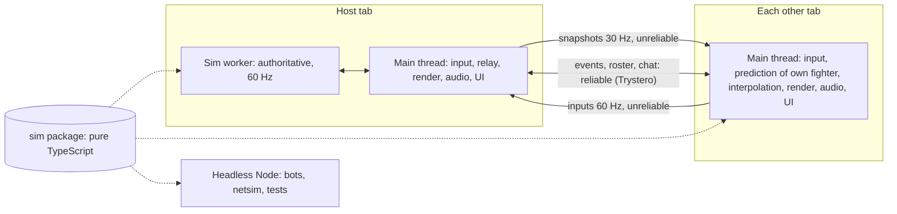

# 7. Technical direction

Medium level. This chapter says what exists, where it runs, what it talks to and how big it may be. It does not contain production code. The small scripts in `reference/poc/` are measurements, not a starting point.

## 7.1 Architecture




### Packages

| Package | Contains | May import | Must never import |
|---|---|---|---|
| `sim/` | World, tick, fighters, combat, gadgets, island, seeded PRNG, the data loaders. Emits events. | Rapier 2D, `data/*.json` | DOM, three.js, timers, `Date`, `Math.random`, anything in `net/` or `client/` |
| `net/` | Protocol: message schemas, quantisation, snapshot build and apply, input ring, clock estimate, interpolation buffer, prediction and reconciliation. A `Transport` interface. | `sim/`, msgpackr, snapshot-interpolation | DOM, three.js, Trystero |
| `net/transport/` | `trystero.ts` (real), `loopback.ts` (in-process, with dialled-in latency, jitter, loss, reordering). | Trystero, `net/` | `client/` |
| `host/` | The worker entry: owns a `sim` world, an input jitter buffer, the hurtbox history, snapshot scheduling. | `sim/`, `net/` | DOM |
| `client/` | Render (three.js), camera, VFX, audio, input devices, DOM UI, quality tiers. | everything above | — |
| `bots/` | Bot brains that read sim state and return a button mask. | `sim/` | `client/` |
| `tools/` | Headless runners: bot matches, netsim, balance reports, asset lint. Node only. | `sim/`, `net/`, `bots/` | `client/` |

The import rules are enforced by a lint rule and are the reason the whole game can be tested without a browser.

### The loop

- **Fixed timestep.** The sim advances in whole ticks of 1/60 s. It never sees wall-clock time.
- **Host.** A worker timer fires about every 4 ms; an accumulator runs as many ticks as real time demands, at most 5 per wake-up, then drops the rest (the host has stalled; say so on screen). Worker timers and message events keep running when the host's tab is hidden, which a main-thread loop does not (1.2).
- **Render.** `requestAnimationFrame` on the main thread. It draws the state between the two most recent sim states with a blend factor, so 144 Hz monitors are smooth and 60 Hz monitors are exact.
- **Events, not polling.** The sim emits a list of events each tick (hit, parry, launch, KO, chunk state, pickup and so on). VFX, audio, the HUD and the announcer are driven only by events. Nothing in `client/` reaches into the sim to ask what happened.
- **Fallback if the worker is trouble:** run the sim on the main thread, but keep a tiny worker that only posts a "tick" message every 16.6 ms. Message handlers are not throttled in hidden tabs, so the host still survives alt-tab. Same interface, one flag.

### The first ten seconds

| Time | What loads | What the player sees |
|---|---|---|
| 0 ms | `index.html` with inlined critical CSS and a 20 KB boot script. Open Graph tags are static in this file. | Paper, the backstamp, "Pouring..." |
| at once, in parallel | Main bundle (three and the game, about 330 KB gzip), Rapier (1.3 MB gzip), the lobby pack (saucer, four fighters, matcap, fonts, lobby sounds: about 550 KB). Trystero starts joining the room immediately; signalling runs while everything else downloads. | A progress seam fills with gold |
| about 2.2 MB in | Wasm compiled, lobby built. | You are a fighter on the saucer and can move. Peers appear as they connect. |
| background | The three arenas and the full audio sprite (about 1 MB). | Nothing. A round cannot start until every player has the next arena; the ready platter shows who is still loading. |

Budgets: first-playable payload 2.5 MB gzip at most; whole game 5 MB at most; playable in 5 s on a 10 Mbit connection and 10 s on 3 Mbit.

## 7.2 Dependencies

Short and boring. Versions are the registry's on 25 November 2026.

| Library | Version | Job | Why this one | Maturity | Size (gzip) | Fallback |
|---|---|---|---|---|---|---|
| **Vite** | 8.3 | Build and dev server | Default choice; production build of our test bundle took 0.4 s on the VM | Very high | dev only | esbuild directly |
| **TypeScript** | 7.0 | Types | The native compiler is fast enough to type-check on every test run on 2 cores | Very high | dev only | Pin 5.x if 7.0 has a blocking bug |
| **three** | 0.187 | Rendering, glTF loading, audio playback | Brief; ubiquitous; classic `WebGLRenderer` | Very high | 160 KB | None needed |
| **@dimforge/rapier2d-deterministic-compat** | 0.21 | 2D rigid bodies and the character controller | Brief (Rapier); 2D because gameplay is planar; deterministic build ends the cross-platform question for 10 percent | High | 1,300 KB | Standard build; or planck.js (pure JS, about 60 KB) if wasm load time fails the gate |
| **trystero** | 0.27 | Rooms, signalling over public Nostr relays, reliable messages, room state, host role | Brief; no keys; exposes the peer connection; has a TURN option | Medium-high: one main author, active this month | 53 KB | PeerJS 1.5.5 with its public broker |
| **msgpackr** | 2.1 | Wire encoding | Brief; 5 µs to encode our worst snapshot | High | 11.5 KB | `@msgpack/msgpack` |
| **@geckos.io/snapshot-interpolation** | 1.1.1 | Snapshot buffer, server-time estimate, interpolation of remote entities | Exists, transport-agnostic, tiny | Medium: stable, quiet since February 2025 | 2.2 KB | Vendor it; it is a few hundred lines |
| **Vitest** | 5.1 | Test runner | Shares Vite's config and transforms | Very high | dev only | `node --test` |
| **Playwright** (Chromium only) | 1.65 | One smoke test, screenshots, one clip | Standard; bundles its own Chromium and ffmpeg | Very high | dev only | `puppeteer-core` against a system Chrome (this is what produced the mock-ups in this package) |
| **@gltf-transform/cli** | 4.5 | Meshopt compression and quantisation of exported glTF | Blender's own meshopt flag did not compress in our test; this did (594 KB to 84 KB for Earl) | High | dev only | `gltfpack` |
| **Blender** | 5.3 (`pip install bpy`) | All models, previews, the matcap bake | Brief | Very high | dev only | Blender 4.5 LTS tarball |

Not used, on purpose: a UI framework (the UI is 6 screens of DOM), a state-machine library, a physics-debug library, an audio library (three's `Audio` on top of Web Audio is enough), an ECS, a tweening library.

## 7.3 Netcode

### 7.3.1 Shape

- **Star over a mesh.** Trystero connects every peer to every other peer. Game traffic only flows between the host and each client. The other links carry nothing but keep-alives, and exist so that any peer can become host without new signalling.
- **Two channels per host-client pair.**
  - *Reliable, ordered:* Trystero actions and room state. Joins, roster, scores, match events, quick phrases, host hand-over.
  - *Unreliable, unordered:* one extra data channel opened by us on the `RTCPeerConnection` that `room.getPeers()` exposes: `createDataChannel("bb", {negotiated: true, id: 7, ordered: false, maxRetransmits: 0})` on both sides. Inputs and snapshots. This is unknown U1 and is the first thing M1 proves.
- **Host authority is absolute.** A client decides its own inputs and how its own fighter looks for the next few frames. Nothing else.

### 7.3.2 Messages

| Name | Channel | Direction | Rate | Contents |
|---|---|---|---|---|
| `hello` | reliable | both | once | protocol version, build id, name, fighter, colour |
| `roster` | reliable (room state, host-only writes) | host to all | on change | per slot: user id, name, fighter, colour, wins, status; settings; host id; phase (lobby, countdown, round, results); arena id; round seed |
| `ev` | reliable | host to all | per tick with events, batched | `[tick, type, ...args]`: hit, block, parry, guard_break, grab, throw, launch, ko, respawn, shed, chunk_state, platform_state, hazard, gadget_spawn, gadget_take, gadget_use, gadget_gone, timeline, sudden_death, round_end |
| `say` | reliable | any to all | on press | one of 8 canned auction phrases. No free text: they are on a voice call, and there is nothing to moderate |
| `host` | reliable | any to all | rare | host offer, host take, host bench score |
| `perf` | reliable | client to host | every 5 s | frame-time p95, quality tier, snapshot loss |
| `in` | unreliable | client to host | 60 Hz | `[tick mod 65536, mask(t), mask(t−1), mask(t−2), mask(t−3), lastSnapshotTick]` |
| `sn` | unreliable | host to all | 30 Hz | snapshot (below) |

**Protocol version.** `hello` carries an integer protocol version and the build id. A mismatch closes that pair with a reliable `bye {reason: "version"}` and shows "This room is on a newer build. Refresh." with a button that reloads with a cache-busting query. Version 1 is this document.

### 7.3.3 Inputs

A 16-bit mask: 4 bits of direction (8 ways plus neutral), 1 bit tilt-or-full, and Jump, Attack, Heavy, Special, Guard, Grab, Use, Taunt, with three spare. Each packet carries the current mask and repeats the previous three, so four consecutive packets must be lost before an input is. Measured size: 16 bytes of payload.

The host keeps a 2-tick jitter buffer per client: an input stamped for tick T is applied at the first host tick after it arrives, never earlier than two ticks after the previous one was applied in order. Motion inputs (236 and so on) are detected on the host from the applied masks, and on the client from its own, by the same code.

### 7.3.4 Snapshots

One msgpackr-encoded array of small integers. Everything is quantised first: positions to 1/64 u, velocities to 1/8 u/s, angles to 1/256 of a turn, damage to 0.1 percent.

```
[ tick,
  [lastAppliedInputTick x 8],
  [ per fighter: x, y, vx, vy, state, stateFrame, flags, damage, guardHP, gilt, stocks<<4|gadget, extra ],
  [ per projectile: id, type, x, y, vx, vy ],
  ( every second snapshot: [chunks in motion], [rubble in motion], [gadgets] ) ]
```

- Only moving world objects are included. A body that comes to rest is sent once with a rest flag and then left out. A full keyframe of everything goes out every 2 seconds to heal loss.
- Chunk and platform *state changes* are events on the reliable channel; snapshots only carry transforms.
- Encoded once per tick and sent as the same bytes to every client.

Measured with real msgpackr on realistic values (`reference/poc/snapshot_size.mjs`):

| Snapshot | Bytes |
|---|---|
| Fighters only: 8 fighters, 4 projectiles | 239 |
| Typical with world: plus 2 chunks, 6 rubble, 3 gadgets | 379 |
| Worst case fighters only: 12 projectiles | 338 |
| Worst case with world: 6 chunks, 16 rubble, 8 gadgets, 12 projectiles | 716 |

All fit in one packet. Encoding the worst case takes 5 µs.

### 7.3.5 How hits, blocks, parries, grabs and launches are decided fairly

The problem: a client sees its own fighter now, and everyone else about 66 ms plus half its round trip in the past. Three rules handle it. Each side gets the benefit of the doubt in the thing it controls.

1. **Position favours the attacker.** The host keeps 12 ticks of every fighter's hurtboxes. When an attack's hitbox is active, the host tests it against each target as the attacker saw them: rewound by that attacker's round trip plus the interpolation delay, at most 8 ticks (133 ms). Above that, you lead your hits, and a "high latency" icon says so.
2. **Timing is shown honestly.** A remote fighter's *position* is interpolated in the past, but the *frame of the move they are in* is drawn at the client's estimate of the host's current tick. If the client learns late that a move started, the first frames of its startup are skipped. So the frame an attack looks active is the frame it is active. This is the same trade rollback games make.
3. **Defence favours the defender.** Guard, parry and dodge are judged on what the defender is doing on the host now, never rewound. And the host gives the defender grace: if a guard, parry or dodge input arrives within 3 ticks after a hit landed, and it was pressed before the hit on the defender's own clock, the hit is converted to a block, parry or miss. Hit-stop is at least 4 frames, so the conversion happens inside the freeze and nobody sees the fighter move. The attacker may see a hit spark turn into a block spark.

Consequences, stated so players can learn them (P4):

- "I hit him and he blocked" can happen. "I blocked and got hit" should not, below about 100 ms.
- **Grabs** use rule 1 for range and rule 3 for escapes: a jump or dodge within the grace window escapes.
- **Launches** are decided only by the host. The victim's client receives the hit event during hit-stop, starts the launch with the frames already elapsed removed, and is in sync by the time the freeze ends.
- **Throws, gadget pickups, ledge grabs, chunk damage:** host only. The client predicts the animation and is corrected if refused.
- **No added input delay.** The 2-tick host buffer is the only delay. Attack feedback arrives one round trip plus 33 ms after the press: about 4 frames at a 40 ms round trip. If playtests call hits mushy, the first experiment is local soft-confirm (spark and freeze predicted on the attacker's client, damage still from the host).

Design range: round trip up to 150 ms. Typical friends in one region are at 20 to 80.

### 7.3.6 Prediction, reconciliation, interpolation

- **Own fighter:** the client runs the same sim code for its fighter only, against terrain and moving platforms positioned from the latest snapshots. Movement, jumps, attack start-up, guard and gadget use appear immediately.
- **Reconciliation:** each snapshot carries the last input tick the host applied for each fighter. The client resets its fighter to the snapshot state and replays its stored inputs after that tick. An error under 0.5 u is blended out over 6 frames as a visual offset; a larger one snaps. Cost is one fighter for at most 15 ticks.
- **Everyone and everything else:** snapshot interpolation through `@geckos.io/snapshot-interpolation`, 66 ms behind (two snapshots), growing to at most 150 ms when arrival jitter is high. No extrapolation except for projectiles, which fly straight.
- **Clock:** the client estimates the host tick from snapshot arrival times, smoothed. Inputs carry the last snapshot tick seen, from which the host measures each client's round trip without extra messages.

### 7.3.7 Bandwidth budget

Thirty snapshots a second; world state rides on every second one. Per-packet overhead is taken as 85 bytes (IPv4 20, UDP 8, DTLS about 29, SCTP 12, data chunk 16); treat that figure as an estimate.

| | Arithmetic | Typical | Worst case |
|---|---|---|---|
| Client download, payload | 15 x 239 + 15 x 379 (typical); 15 x 338 + 15 x 716 (worst) | 9.3 kB/s | 15.8 kB/s |
| Client download, on the wire | plus 30 x 85 | **11.8 kB/s (95 kbit/s)** | 18.4 kB/s (147 kbit/s) |
| Client upload, on the wire | 60 x (16 + 85) | **6.1 kB/s (48 kbit/s)** | same |
| Host upload, 7 clients | 7 x download | **83 kB/s (0.66 Mbit/s)** | 129 kB/s (1.03 Mbit/s) |
| Host download, 7 clients | 7 x 6.1 | 42 kB/s (0.34 Mbit/s) | same |

Budget, enforced in the netsim: 20 kB/s down and 8 kB/s up per client; 1.2 Mbit/s up for the host. Most of the client's upload is packet overhead, not data; halving the input rate to 30 Hz with two inputs per packet would halve it, and is the first lever if anyone's upload is a problem.

Only gameplay debris is on the wire: at most 6 falling chunks and 16 rubble. Shards, chips, dust and trails are simulated on each machine from event ids and never sent.

### 7.3.8 Hosts

**Choosing one.** The room creator hosts at first. In the lobby every peer reports how many peers it reaches directly, a one-second sim benchmark score (ticks per second of a canned scene), and its median round trip. Between rounds the room proposes the best candidate: reaches everyone first, then benchmark, then round trip. The current host sees "Unsigned Vase would host better. Hand over?" with a default of yes after 5 seconds.

**A weak host.** If the host's tick takes longer than 12 ms for two seconds running: drop world state to 10 Hz, cap rubble at 8, then drop snapshots to 20 Hz, and show a small "host is struggling" tag. Hand over at the next round. The simulation rate never changes.

**A host who leaves.** The round is void. Everyone keeps the roster and scores, which were already in room state. The peer with the lowest slot number that reaches everyone remaining becomes host, announces it, and the room returns to the lobby within about 3 seconds: "The host dropped the tray. Unsigned Vase is hosting now." There is no mid-round migration. It is on the cut list as "never".

**A host who alt-tabs.** Nothing happens. That is what the worker is for. Their own view stops; everyone else carries on.

### 7.3.9 Failing to connect

Without a relay, roughly one connection in eight fails. Trystero reports it as `peer-connect-failed`.

- If a joiner cannot reach the host: the screen in `ui_connection_error.png`. It draws who reaches whom, and if some other player reaches everyone, offers "Ask them to host" as the primary button. That request goes over whatever link the joiner does have.
- If a joiner reaches nobody: the same screen without the map, with the three tips.
- If signalling itself fails (no relay socket within 6 seconds): "Can't reach the lobby service" with Retry, and a diagnostics line.
- **TURN slot:** `net/config.ts` exports `TURN_CONFIG: TurnServerConfig[] = []` under a comment reading `TURN SLOT`. It is passed to Trystero's `turnConfig`. Filling it in is the whole upgrade.

## 7.4 Physics

**Rapier 2D simulates the world. The fighters are scripted.**

| Thing | Body | Driven by |
|---|---|---|
| Intact and crazed chunks | Fixed, one convex polygon each | Data |
| Loose chunks, moving platforms, bowl halves, the seesaw | Kinematic, position-based | Script: sink, bob, drift, tilt |
| Falling chunks | Dynamic | Rapier |
| Rubble, dropped gadgets, empty shells, the toaster, bobbers | Dynamic | Rapier, plus impulses from hits and gusts |
| Projectiles (puff, cork, plunger, hook, sinker) | Not bodies | Script, with a shape-cast per tick against the world; continuous by construction |
| Fighters | Kinematic capsule | Script computes the desired movement; Rapier's character controller resolves it against the world (slopes, steps, moving platforms) |
| Hitboxes and hurtboxes | Not in Rapier | Capsules in a plain array, tested with a 40-line overlap function. Deterministic, trivially rewound for lag compensation |
| Fighter-versus-fighter | Not solid | A soft push: overlapping fighters separate at 3 u/s. They can pass through each other |
| Gusts, updraft, The Pour, suction | Not bodies | Scripted force volumes applied to fighters and dynamic bodies |

**Fracture** is a state change, not a computation. Chunks are authored polygons with HP. Going loose swaps a fixed body for a kinematic one; falling swaps it for a dynamic one and spawns 2 to 4 rubble bodies at authored points. There is no runtime cutting.

**Budgets** (the scene benchmarked in 1.2):

| Kind | Cap |
|---|---|
| Terrain chunks and platforms | 28 |
| Falling chunks at once | 6. A seventh waits in the loose state |
| Rubble | 16. The oldest resting piece crumbles when a 17th spawns |
| Gadgets in the world | 8 |
| Projectiles | 12 |
| Fighters | 8 |
| **Total bodies** | **about 74** |

Measured cost on a 2-vCPU machine in Node: mean 0.65 ms a tick, p99 2.4 ms. Budget on a player's laptop: 1.0 ms mean, 4 ms p99, in the worker.

**Determinism.** Same build, same seed, same inputs gives the same hash: verified. It is used for golden-replay tests and for bug reports (a replay is a seed and an input log), not for netcode.

## 7.5 Performance on the player's machine

Target: 60 fps locked on a mid-range laptop with integrated graphics, eight fighters, gadgets, effects and debris.

### Frame budget (16.6 ms)

| Slice | Budget |
|---|---|
| Client sim: prediction, reconciliation, interpolation | 1.5 ms |
| Scene update: poses, springs, VFX, camera | 2.0 ms |
| Render submission (three.js on the CPU) | 4.0 ms |
| Net, UI, audio scheduling | 1.0 ms |
| Headroom for garbage collection | 2.0 ms |
| GPU | 10 ms at the tier's resolution (runs alongside the CPU) |

The host's sim is in the worker and has its own core: 4 ms p99 per tick.

### Scene budget

| | High | Medium | Low |
|---|---|---|---|
| Draw calls | 90 | 80 | 60 |
| Triangles on screen | 110,000 | 110,000 | 70,000 |
| Cosmetic shards | 300 | 180 | 100 |
| Dust puffs | 250 | 150 | 80 |
| Textures | 1 (the matcap) | 1 | 1 |
| Lights and shadow maps | 0 | 0 | 0 |
| JavaScript heap | 200 MB | 200 MB | 150 MB |

Draw calls at eight players: 8 fighters, up to 8 guard plates, 24 chunks, 8 dressing, up to 8 gadgets, and one each for shards, puffs, projectiles, clouds, blob shadows, motes, sky and the finish pass: about 65.

### Quality tiers

| | High | Medium (default) | Low |
|---|---|---|---|
| Pixel ratio | up to 1.5 | 1.0 | 0.75 of CSS pixels |
| Anti-aliasing | 4x MSAA | 2x MSAA | none |
| Finish pass | vignette, grain, impact frame | vignette, impact frame | none; impact frame as a CSS overlay |
| Speckle | on | off | off |
| Fighter cracks | procedural | procedural | baked mask |
| Fighter meshes | full | full | LOD1 (under 3,000 triangles) |
| Dust motes, clouds | 40, 5 | 20, 4 | 0, 2 |

**Automatic fallback.** Start on Medium. Keep a rolling p95 of frame time. Above 18 ms for 2 seconds: first lower the render scale in steps (1.0, 0.85, 0.7), which can happen mid-round and is invisible; if still above, drop a tier at the next round start. Below 12 ms for 10 seconds: raise one step, never above the player's chosen maximum. The tier is shown in settings and can be pinned.

**Gameplay is identical on every tier.** Every tier draws chunk states, guard plate states, launch trails and the impact frame, because those are information. Tiers change how pretty they are, never whether they exist.

**What the VM cannot tell us.** Software rendering on two cores says nothing about an Intel integrated GPU. The game therefore records its own frame-time histogram, draw calls, tier and GPU string, and puts a "Copy perf report" button in settings. Human playtests return that text. It is the only evidence accepted for the 60 fps target.

## 7.6 Asset pipeline

```
assets-src/blender/<asset>.py     (start from reference/blender/)
        |  python + bpy, CPU, one asset at a time
        v
build/<asset>.glb  +  <asset>.json           export_gltf.py conventions
        |  gltf-transform optimize --compress meshopt --simplify false
        v
public/assets/<kind>/<asset>.glb             fighters about 85 KB each
        |  art lint (ART_BIBLE 4.9)          fails the build
        v
review/<asset>.png                           contact sheet, engine-look material, Cycles 20 samples
        |
        v
assets.manifest.json + LICENSES.json         hash, size, generator script, licence
```

- **One command:** `npm run assets`. It rebuilds only assets whose script, shared library or data file changed (content hash).
- **The shared library** is `ceramic.py`: lathe, sweep, blob, the engine-look material, camera and render helpers. Every asset script uses it; none creates a primitive.
- **Arenas are generated from `data/arenas.json`.** Changing a chunk polygon changes the collider and the mesh together.
- **Previews use the engine's own shading.** The preview material is an emission-only node tree that evaluates the same formula as the GLSL, so it needs no lights, converges in 20 samples and takes about 6 seconds a tile. Do not use EEVEE; it hung on the VM. Workbench works where Mesa is installed but adds nothing.
- **The matcap** is baked once by `bake_matcap.py` and checked in.
- **Sizes measured from the reference export:** a fighter is 79 to 96 KB after optimisation (49 to 58 KB gzip). Blender's own meshopt flag did not compress in our test; glTF-Transform did.
- **Not yet proven:** a Cycles ambient-occlusion bake to vertex colours in headless mode. The reference export writes a cheap hemisphere term instead. If the bake proves fiddly, keep the hemisphere term plus a darkening of the lowest 15 percent of each part; the blob shadows carry the rest.
